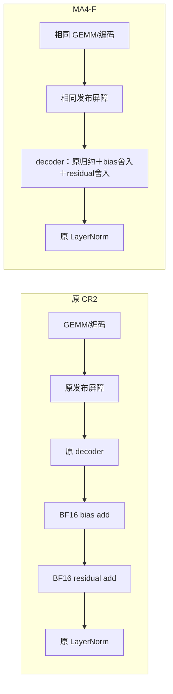

# MA4：从主机提交优化转向投影消费链融合

更新：2026-10-25。**旧 MA4-G 没有证实端到端增量；新的 MA4-F 直接把 decoder 后的 bias 和 residual 两次加法融合进 decoder。** 新候选记为 **F4**，同场对照为原 **CR2**，不叠加 CUDA Graph。MA4-F 已实现，尚无新的八卡性能结果。

重新检查时间线后，用户提出的 overlap 问题有明确证据：多数 rank 的提交工作已经提前排队数毫秒，减少其 CPU 区间并不等于缩短整步。也有少数供给较晚的 rank，且迟到者随方案变化，不能说所有主机优化始终被隐藏。下面把测到的事实、此次删除的依赖链工作及仍待验证的全局收益分开。

在目标八卡 H100 容器的仓库根目录启动新实验：

```bash
/workspace/conda-envs/flux-h100-ablation3-20261017/bin/python tools/h100/phase6/detach_ma4_f.py --execute
```

默认仍按上一轮要求，只测 **一轮 F4/CR2、8 个平衡配对块、16 个正式窗口**，每窗口 10 步预热＋50 步正式，共 **800 个正式 optimizer step**。完整命令与结果字段见第 5 节。

## 1. 旧结果必须保留：G 的局部收益没有兑现为整步收益

已完成的批次为 `ma4-g-pair-1x-50steps-20261025-095400-360259`。以下来自[完整训练报告](../../../../logs/h100/phase6/ma4-g-pair-1x-50steps-20261025-095400-360259/fullstep/report.json)，正数表示加速；步时为各窗口八 rank 最大墙钟 / 50，收益使用完整块配对对数比及 10000 次 bootstrap。

| 范围 | 配对块 | G 平均 ms/step | CR2 平均 ms/step | G/CR2 收益 %［95% CI］ |
| --- | ---: | ---: | ---: | --- |
| 前半程 | 4 | 508.674 | 510.281 | +0.314 [−0.130, +0.565] |
| 后半程 | 4 | 509.768 | 509.261 | −0.100 [−0.699, +0.603] |
| **完整一轮** | **8** | **509.221** | **509.771** | **+0.107 [−0.297, +0.486]** |

8 个块中 G 有 **4 个更快、4 个更慢**，算术均值差约 **0.550 ms/step**，完整区间跨零。独立 Attention/MLP 算子虽然分别快 **0.737% / 0.838%**，也不能替代整步判定。

该批 `completed/done`，800 正式步、128 份正式 rank 记录全部保留；算子逐位一致、对应 rank 的 loss/grad_norm 轨迹及最终参数指纹一致，图节点和原屏障路径验证通过。G 每槽构图一次、重放与两种参数更新各 120 次，包含预热；不是未启用或回退导致的无收益。证据见[批次状态](../../../../logs/h100/phase6/ma4-g-pair-1x-50steps-20261025-095400-360259/batch-state.json)、[算子报告](../../../../logs/h100/phase6/ma4-g-pair-1x-50steps-20261025-095400-360259/operator/report.json)、[训练 profile](../../../../logs/h100/phase6/ma4-g-pair-1x-50steps-20261025-095400-360259/fullstep/profile-summary.json)。

旧批次的原始报告及 [算子 profile](../../../../logs/h100/phase6/ma4-g-pair-1x-50steps-20261025-095400-360259/operator/profile-summary.json)继续保留；本次诊断记录了全部 16 份训练 trace 的 SHA256，不改写原始运行证据。原图实现和入口 [ma4_g_sources.py](../../../../tools/h100/phase6/ma4_g_sources.py)、[detach_ma4_g.py](../../../../tools/h100/phase6/detach_ma4_g.py)保留供复现。

本批没有同期 C/R，所以原“相对 C 和 R 总计达到 2%”的目标没有评估；不能把历史 CR2 的约 1% 与 G 的点估计拼接。

## 2. 重新定位：哪些减少的时间被隐藏了

此次重新解析全部 **16 份训练 trace、4096 次目标投影**，按 CPU/CUDA correlation、External ID、真实 GPU stream 顺序定位提交、decoder 和消费操作。诊断脚本与逐 rank 结果见 [analysis.py](../../../../outputs/h100/phase6/ma4-critical-path-20261025/analysis.py)、[analysis.json](../../../../outputs/h100/phase6/ma4-critical-path-20261025/analysis.json)、[运行日志](../../../../outputs/h100/phase6/ma4-critical-path-20261025/analysis.log)。

### 2.1. 多数 rank 有充足排队余量，但迟到 rank 仍需保留

下表先取每 rank 的角色中位数，再取八 rank 中位数；比例同样是八 rank 中位数。

| 指标 | CR2：Attention / MLP | G：Attention / MLP |
| --- | --- | --- |
| 投影 CPU 区间 | 98.532 / 99.248 μs | 87.861 / 89.202 μs |
| GEMM 在提交 API 结束后排队 | **7171 / 7464 μs** | **3778 / 4058 μs** |
| bias 在 decoder 完成前已提交的比例 | **99.61% / 100%** | **98.83% / 100%** |
| decoder 结束→后继 LayerNorm 结束 | 29.711 / 28.960 μs | 30.992 / 31.224 μs |

这说明投影 CPU 区间减少约 10 μs，并不能按 `10 μs × 256` 计算步时收益：大部分提交本来就早于 GPU 的需求时刻，G 也没有缩短上述消费链。

不能只看八 rank 中位数。CR2 的 rank2 GEMM 排队仅约 **1.0/1.1 μs**，Attention 的 bias API 结束晚于 decoder 完成约 **36.8 μs**；G 的迟到者变为 rank6，对应约 **3 μs / 13.6 μs**。API 结束晚于 decoder 是迟交诊断，不等于这段时间全部暴露：GPU 也可能在 API 返回前开始执行。不能按固定 rank 写特例，更不能把 barrier 等待、迟交和空档直接相加预测收益。

这些 profile 的 GPU span 约 **842–843 ms**，正式步时约 **509 ms**，观测开销明显。这里重建的是各 rank 的 stream 顺序和数据消费关系，**不是完整八卡依赖图的最长路径证明**。是否缩短全局关键路径，仍以同期完整 optimizer step 的结果判定。

### 2.2. 可以直接删除的工作：decoder 后两次消费

4096 次投影都匹配到以下顺序：

```text
GEMM/编码 → 原发布屏障 → decoder → bias add → residual add → LayerNorm
```

冻结 BDA 源码执行 `x + bias → dropout(p=0) → residual + out`。两次 add 的结果是后继 LayerNorm 的输入；当前配置为 BF16、`skip_bias_add=True`、dropout=0、bias-dropout fusion 关闭、sequence parallel 开启。这里有源码与关联 trace 的共同证据，不仅是按 kernel 名猜测。

CR2 两个 add 的 GPU 工作合计约 **7.04–7.07 μs/次**；全步求和后八 rank 中位约 **1.809 ms**，量级约为正式步时的 0.36%。这只是删除独立 add kernel 的工作量预算：融合会增加 decoder 的运算与访存，也可能减少提交空档，**既不是净节省保证，也不是严格端到端上界**。它本身不足以承诺补齐原 2% 目标。

## 3. 新机制 MA4-F：融合有序归约后的 bias 与 residual

F4 直接基于 CR2，保留同一个 GEMM、编码、selective mask、双工作区、原发布屏障、来源累加顺序和解码舍入。改变的是归约已经完成之后的写出边界。



每个输出元素仍按以下顺序计算：

```text
projection = 原 CR2 的完整 BF16 有序归约结果
with_bias  = BF16(projection + bias)
output     = BF16(residual + with_bias)
```

两次 BF16 舍入不能合并成一次 FP32 三项求和。例如 `projection=1, bias=1/256, residual=-1`，上述顺序得到 0，先用 FP32 合并再舍入会得到 1/256。新 kernel 对纯 BF16 和含量化来源两条出口均在原归约完成后执行两次 packed BF16 add；不把 bias 加入逐来源归约。

每次调用仍分配独立输出，bias 和 residual 作为显式 Tensor 传入；native 校验设备、形状、dtype、连续布局、对齐和执行 stream，并登记 allocator 的 stream 使用。输出仅作等元素数的 metadata 改形，不引入 output clone、共享输出或输入拷贝。候选每步删除 **256×2=512 个独立 add kernel** 及其中间输出读写；LayerNorm 本身保持原实现。

代码落点：

- [ma4_f_sources.py](../../../../tools/h100/phase6/ma4_f_sources.py)：从 CR2 生成 F4 decoder、原生入口与融合调用计数。
- [ma4_f_adapter.py](../../../../tools/h100/phase6/ma4_f_adapter.py)：每层 residual 绑定、显式 autograd 输入和对应 BDA 消费。
- [ma4_f_build.py](../../../../tools/h100/phase6/ma4_f_build.py)：只构建 F4/CR2，逐文件验证原 CR2 控制组和注册变换。
- [ma4_f_bench.py](../../../../tools/h100/phase6/ma4_f_bench.py)、[ma4_f_fullstep.py](../../../../tools/h100/phase6/ma4_f_fullstep.py)：完整消费链微测、训练、逐参数检查与路径验证。共同控制器及新增模块随批次冻结并校验哈希。

### 3.1. Residual 与 autograd 必须一起正确接入

adapter 按 TransformerLayer 实例分别绑定 Attention 和 MLP 的 residual，不使用进程级共享状态。投影返回融合输出和 `bias=None`；对应 BDA 只返回该次输出，核对 residual 对象、版本、输出身份以及 dropout=0，避免重复加法。阶段结束清除上下文，异常后封锁实例。

bias 和 residual 是自定义 autograd 的显式输入。`grad_bias=grad_output.sum_to_size(bias.shape)` 使用原广播归约语义，`grad_residual=grad_output`；linear backward 保留原 sequence all-gather、dgrad 和 wgrad 计算。原参数对象及 sequence-parallel 标记不变，梯度仍走原后续归约。bias 梯度的归约提交位于 gather/dgrad/wgrad 之前，以贴近原 add backward 顺序。

该接口仍可能改变 autograd 的调度边界，故必须验证完整训练，不能把全部可能收益预先归因于删除两个前向 kernel。支持范围固定为当前 BF16/TP8、Attention/MLP 形状、原 bias、零 dropout 和无重计算配置；训练 adapter 对 eval、no_grad/inference、CUDA Graph、重入及布局漂移明确拒绝，失败不静默回退。

## 4. 验证标准：不仅看 loss 或短算子

### 4.1. 数值、生命周期与反向

算子前置检查使用两个 K、多个 seed、零值/小值/离群值/随机值，以及非零且变化的 bias/residual。额外覆盖半 ULP 两次舍入、subnormal、六份存活独立输出、动态 storage、慢 rank 和多步原地参数更新。参考使用独立 CR2 实例完成原 `residual + (projection + bias)`，要求输出逐位一致。

独立 autograd 检查逐项比较 input、weight、bias、residual 的完整梯度及三步更新。完整训练 smoke 在 **optimizer 更新前**记录全部可训练参数的梯度形状、dtype、SHA256，在更新后记录全部参数指纹；检查三个 smoke step，明确要求 64 个目标模块的 weight/bias 全部存在，并在 F4/CR2 对应 rank 间逐项比对。这些检查在正式计时窗口之外。

正式训练继续核对 loss/grad_norm 轨迹、最终参数指纹、完整模块覆盖、零 skip/fallback。F4 每槽 `bias_residual_calls` 必须等于 `successful_calls`；默认正式窗口每槽为 **120 次**、两槽合计每模块 **240 次**，包含 10 步预热与 50 步正式测试。保留裸 projection 入口只用于独立参考实例，不能混入候选的测量路径。

### 4.2. 路径与可比较的消费链区间

独立 profile 要求：

- 两组投影本体均为原 GEMM→发布屏障→对应 decoder，无额外 kernel、clone 或 copy。
- CR2 的 decoder 后仍有两个 add 再进入原 LayerNorm；F4 的融合 decoder 直接进入同一 LayerNorm，后继 LayerNorm 由 CPU External ID 与 GPU kernel 共同确认。
- 两组都记录 **decoder 开始→LayerNorm 结束**、**GEMM 结束→LayerNorm 结束**。不能只比较“decoder 结束→LayerNorm 结束”，否则会漏算 F4 移入 decoder 的新增工作。

路径检查证明改动执行以及消费链形态；profile 的时长不充当正式性能结果。编译诊断也显示融合会增加资源占用：当前 F4 decoder 为 **51 registers**，CR2 为 **44 registers**，均无 spill。它可能抵消部分 add 删除收益，必须让完整测量回答。

## 5. 启动、工作量与结果判定

默认一轮：

```bash
/workspace/conda-envs/flux-h100-ablation3-20261017/bin/python tools/h100/phase6/detach_ma4_f.py --execute
```

也可通过环境恢复脚本选择 Python/CUDA 路径：

```bash
bash tools/h100/phase6/run_ma4_f.sh --execute
```

`run_ma4_f.sh` 优先读取 `outputs/h100/container-recovery/env.sh`；`MA4_F_PYTHON` 可覆盖 Python。去掉 `--execute` 只预览，不创建批次目录、不编译或查询 GPU。两轮复测用 `--trials 2`；`--foreground` 可前台运行。

默认工作量为 **F4/CR2、一轮 8 个平衡配对块、16 个正式窗口、128 份正式 rank 记录、800 个正式 optimizer step**。每窗口独立进程，10 步预热＋50 步正式；另有算子测试、训练 smoke 与独立 profile。两轮则为 32 窗口、1600 正式步。短算子负收益或完整训练区间跨零仍保留全部结果，正确性/路径失败才终止候选。

默认目录：`logs/h100/phase6/ma4-f-1x-50steps-<北京时间戳>/`。查看 `batch-state.json`、`handoff/container-supervisor.log`、`fullstep/report.json`、`fullstep/report.md` 和 `fullstep/profile-summary.json`。可用 `--ma4-f-build <目录>` 复用经当前源码身份验证的 F4/CR2 构建；它与旧 G/CR2 或 MA5 构建不混用。

完整 step 包含前向、反向、通信、optimizer 更新及清梯度。报告保留每轮均值、前后半程、全部样本与完整块配对 bootstrap 95% CI。`increment_over_CR2_validated` 要求每个请求的 trial 中 F4/CR2 点估计及区间下界均 >0，并通过数值与执行路径检查。

本轮只判断 CR2 上的新增量，不测 C/R，所以 `target_evaluated=false`、`target_validated=false`；这两个字段不代表批次运行失败。原相对 C/R 的 2% 目标必须另做同期比较，不能把多个批次的百分比相加。

## 6. 当前完成范围

已完成旧 trace 的队列/消费链重分析、F4 原生 decoder 与显式 autograd 接入、独立 F4/CR2 构建和测试启动器。没有启动新八卡实验，也没有 F4 端到端收益结论。

本地 **32 项 CPU 检查全部通过、零跳过**，包含真实 PyTorch CPU 的完整梯度及三步更新对照、输出独立性、实例上下文错误拒绝、冻结脚本独立导入与单/双轮报告验证。F4/CR2 的两种 K 主机映射、SM90 runtime/PTX、GPU mapping 程序，以及 F4 的真实 C++ wrapper 与 pybind 对象编译通过；GPU mapping 程序只编译未运行，尚未进行完整动态库链接或 F4 八卡测试。见[验证汇总](../../../../outputs/h100/phase6/ma4-f-validation-20261025/validation.json)、[CPU 日志](../../../../outputs/h100/phase6/ma4-f-validation-20261025/cpu-tests.log)、[编译记录](../../../../outputs/h100/phase6/ma4-f-validation-20261025/final/compile-check/validation.json)和[命令预览](../../../../outputs/h100/phase6/ma4-f-validation-20261025/launch-preview.txt)。

原始 G 结果和诊断 trace 保留。最终应同时看到消费链变短与无 profiler 整步的可靠增量，才能认定新实现改善了本配置的全局关键路径。若只有局部链变短、整步区间仍跨零，继续保留 CR2 为已验证基线，并如实记录负结果。
