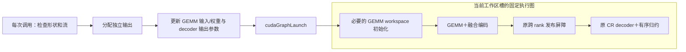

# MA4：在 CR2 上进一步减少提交与消费边界开销

日期：2026-10-23。**本次选择新增机制路线，首选 CR2 双工作区上的原生 CUDA Graph 动态参数重放，备选 decoder 后融合投影 bias。** 继续缓存 CUTLASS 初始化可作为辅助对照，但目前没有足够证据认为只改这一段就能把相对 C/R 的整步收益提高到 2%。

**当前状态：MA4-G 原生图机制和独立四组测试入口已实现；尚无 MA4 的八卡性能结果，不能声称已达到 2%。** 实现、验证范围与启动命令见第 7 节。已验证的 CR2 实现及其启动入口保持原样，见 [ma-2-ablation.md](ma-2-ablation.md#10-cr2固定形状的原生提交缓存2026-10-23)。本页的 2% 指**相对同期 C/R 的总收益**，不是相对 CR2 再快 2%。

## 1. 现状与还需要节省多少时间

CR2 批次为 `ma2-cr2-2x-50steps-20261023-153237-090898`。两轮 CR2/C 为 **+1.027% / +1.097%**，CR2/R 为 **+0.630% / +1.083%**，对应区间均完全为正；第一轮相对 R 尚不足 1%。因此达到相对两个方案的总计 2%，还需要新的实测增量。

以下用[完整训练报告](../../../../logs/h100/phase6/ma2-cr2-2x-50steps-20261023-153237-090898/fullstep/report.json)的算术均值估算时间量级，目标耗时为 `对照平均ms × 0.98`：

| 比较 | 当前 CR2（ms/step） | 达到 C 的 2% 所需耗时 | 相对 CR2 还需节省 | 达到 R 的 2% 所需耗时 | 相对 CR2 还需节省 |
| --- | ---: | ---: | ---: | ---: | ---: |
| compare1 | 511.715 | 506.684 | **5.031 ms** | 504.661 | **7.054 ms** |
| compare2 | 510.879 | 506.213 | **4.666 ms** | 506.143 | **4.736 ms** |

每步共有 256 次目标投影，约需再消除 **18–28 μs/次** 的暴露开销。第一轮相对 R 的要求最高，相当于 CR2 自身还需缩短约 1.378%。这些是定位优化规模的描述性预算；正式判定仍使用完整块配对对数比及 bootstrap，不能用均值相除或汇总表的中位数比替代。

## 2. 为什么不把继续优化 decoder 或初始化作为主线

这次重新解析了最新 CR2/CR/C/R 的全部 **32 份训练 trace**，每份包含一个 optimizer step、Attention/MLP 各 128 次投影。证据见[诊断摘要](../../../../outputs/h100/phase6/cr2-next-diagnosis-20261023/profile-summary.md)、[逐 rank 阶段统计](../../../../outputs/h100/phase6/cr2-next-diagnosis-20261023/profile-analysis.json)、[CUDA API 与后继操作统计](../../../../outputs/h100/phase6/cr2-next-diagnosis-20261023/profile-runtime.json)。

| CR2 观察项 | 本批 profile 结果 | 对下一步的含义 |
| --- | --- | --- |
| 投影 CPU 区间中位数 | Attention 99.656 μs，MLP 99.408 μs | CR2 已消除原 CR 的一部分提交工作，但仍有主机路径 |
| 投影内 CUDA API 耗时中位数 | Attention 27.230 μs，MLP 26.522 μs | 提交与参数准备值得进一步拆分，不能把整个 CPU 区间都视为可省时间 |
| 全步 decoder 时间求和后取八 rank 中位数 | **2.786 ms/rank** | 继续只缩短 decoder 的可见量级小于目标所需的额外 4.7–7.1 ms |
| 每步投影内常规 API 次数 | **768 次 kernel launch、256 次 memset、256 次 capture query** | 可以考虑一次提交固定依赖链；偶发 allocator event query 另计 |
| 上述三类 API 的主机耗时 | 各 rank 总和再取中位：4.658 / 1.924 / 0.308 ms | 总计约 6.89 ms 是诊断预算，不是 graph 可全部回收的时间 |
| 本次 CR2 profile 的 rank5 | Attention 解码后空档中位 40.160 μs，后继 launch 晚 38.675 μs | 少数 rank 仍可能因主机提交较晚影响后续执行 |

同一 CR2 trace 中，rank5 的 GEMM 排队中位仅约 0.960/1.070 μs，整步 decoder 后正提交延迟累计约 5.088 ms；其他多数 rank 已经提前排队数毫秒。不能仅凭八 rank 中位数判断所有 GPU 都有足够排队工作，也不应针对固定 rank5 写特殊逻辑：其他组的落后 rank 和队列状态不同。

**这些 profile 的 GPU 时间跨度约 842–901 ms，正式 CR2 步时约 511 ms，观测开销明显。** CPU、GPU 与通信会重叠；decoder 总量、API 总量、屏障等待和后继空档不能相加预测加速。上表用于选择可检验的优化方向，不是严格上界或 2% 收益保证。

### 2.1. 仍可做的代码优化：缓存 CUTLASS 固定准备工作

[CR2 源码变换](../../../../tools/h100/phase6/ma2_cr2_sources.py)已经缓存 operator 与固定参数，但 `cr2_op->run(args, workspace, stream)` 仍逐次经过 `to_gemm_args → can_implement → initialize → run`。NVLink 路径的 CUTLASS `Params::update` 可以更新输入/权重指针及 epilogue 参数，因此有进一步缓存固定 block mapping 和 iterator 参数的空间。

但不能直接把它改成 `update() + run()`：原 `initialize` 还执行 StreamK workspace 初始化，必要的 barrier 清零必须保留。更新还必须覆盖当前槽的 TACO 配置，不能只改两个裸指针。设备、M/N/K、stride、dtype、grid、共享内存和工作区身份须固定；每槽独立缓存。

当前 trace 没有单独标记 `can_implement`/`initialize`，不能将其节省量当作已经测出的 20 μs/次。设备属性查询本身也已有缓存，不能把它描述成每次都有完整 occupancy 查询。**这项低风险改动适合单独作为准备工作缓存对照 U，用来区分收益来自少做主机准备，还是来自合并 GPU 提交。** 它暂不替代已验证的 CR2，也不先宣称能满足 2%。

## 3. 首选机制 MA4-G：双工作区上的原生短图重放

目标是将同一投影的固定 GPU 依赖链预先建立为可重放执行图，每次只更新真实变化的参数并提交一次。计算仍使用 CR2 的相同 GEMM、编码、原发布屏障和 decoder。



### 3.1. 图与动态地址如何管理

- 每个投影模块的两个工作区槽分别持有 graphExec、节点句柄和固定资源；每 rank 为 **64 模块 × 2 槽＝128 份图**。下一次调用继续按原双槽顺序切换。
- input 和 weight 的**地址与内容**都可能变化。GEMM 节点参数必须通过真正的 CUTLASS 类型构造和更新，同时保留 epilogue/TACO 参数；不能扫描参数字节后按偏移猜测地址。
- 每次在图外分配新的 `[256,4096]` BF16 输出，更新 decoder 的输出地址。输出继续由返回的 Tensor 独立持有，不引入固定共享输出、额外 output clone 或输入拷贝。
- 图内保留每次 GEMM 必需的 workspace 初始化。只把固定参数准备移出热路径；不能把构造时的 IPC 同步缓冲区清零或全局协议 reset 录进每次重放，以免擦除其他 rank 的握手状态。
- 初始化按所有 rank 相同的模块/槽顺序完成，确认图和 IPC 资源就绪后再预热。优先显式构造节点；若用 stream capture 做原型，应采用独立的只记录入口，避免旧 `forward` 推进槽位或成功计数。

CUDA Runtime 12.4.1 提供 `cudaGraphExecKernelNodeSetParams`，可更新已实例化图的 kernel 参数；更新影响后续 launch，不改变已经排队的 launch。图对象需要调用方保证线程安全，更新和启动应受实例锁保护。这里按本实验的 **CUDA runtime 12.4** 设计，不套用更新版本的性能数字。[CUDA 12.4.1 Graph API](https://docs.nvidia.com/cuda/archive/12.4.1/cuda-runtime-api/group__CUDART__GRAPH.html)

参数快照中的地址不代替设备内存的生命周期管理。实例必须持有其 IPC/workspace/mask；输入、权重和独立输出须存活到对应 GPU 使用结束，并遵守 PyTorch stream/allocator 约定。避免使用会被下一次主机调用覆盖的共享设备端参数表。销毁图及通信资源前也要确认其异步使用已经结束，而不是每次调用新增全设备同步。

### 3.2. 同步协议与数值语义

原双缓冲仍是安全基础：调用 k+1 使用另一槽，其发布屏障在各 rank 的调用 k 解码之后执行，保障调用 k+2 复用旧槽。MA4-G 保留同一 stream 的执行顺序和每次原发布屏障，不将其视为“空开销”删除。图的节点顺序必须与原路径一致，尤其是 workspace reset、GEMM 写入、发布、读取的依赖关系。

量化 mask、生产顺序、每来源的 Hadamard 反变换、解码后的 BF16 舍入、逐源累加顺序和最终输出 dtype 都保持。图优化改变提交方式，不把七个来源合并反变换，不新增 fragment-ready 标记或辅助消费 stream。

### 3.3. 与现有 graph 开关及历史尝试的关系

仓库旧 `GemmRSTaco._graph_forward` 只面向 TP4，采用固定输入缓冲区 copy 和静态图输出 clone，并要求权重 storage 不变；CR2 还明确拒绝 capture。**MA4-G 需要独立的 TP8 原生图路径，不能通过直接设置 `graph=True` 作为实现。** 普通 PyTorch CUDA Graph 的重放依赖固定内存地址，这也是这里要求显式更新动态参数的原因。[PyTorch 2.6 CUDA Graphs](https://docs.pytorch.org/docs/2.6/notes/cuda.html#cuda-graphs)

它与 MA1/MA2 的来源预取、MA3 的来源并行归约不同：MA4-G 保留已经验证的 CR2 GPU 计算，减少主机重复准备和提交边界。历史 op3 的提前消费增加了发布/调度成本，MA3 未形成整步收益，op4 的合并反变换触发数值门禁；这些结果说明本轮应继续保留原协议和算术顺序，而不能假定更多并行自然更快。历史结果见 [MA3 总结](ma-3.md#8-八卡实测结果与离线复核2026-10-23)。

### 3.4. 可能无收益的情况

当前路径只有三个 kernel 加一次必要的 memset，图很短；更新 GEMM 和 decoder 两个节点、输出分配和图启动的成本可能抵消收益。真正的跨 rank 等待也不会因使用图而消失。128 份图/rank 的构建时间、首轮开销、主机/显存占用应单独记录，不能只展示热态数字。

因此 MA4-G 的假设是：**减少主机提交工作及其抖动，可以在部分投影供给不足时减少整组等待**。是否能提供额外约 4.7–7.1 ms，必须通过同场完整训练判定。

## 4. 次选机制 MA4-B：decoder 完成后融合投影 bias

最新 rank5 trace 中，256 个紧随 decoder 的 GPU 操作都是 BF16 `aten::add`。进一步核对本批冻结代码：Attention 的输出投影和 MLP `linear_fc2` 都使用 `skip_bias_add=True`，adapter 返回 `(output, module.bias)`；BDA 随后按 **`x + bias → dropout → residual + out`** 执行。本批配置为 bias 开启、hidden/attention dropout 为 0、bias-dropout fusion 关闭。因此第一个加法有明确的投影 bias 消费路径，而不是凭 kernel 名称直接推测。

证据：[冻结 adapter](../../../../logs/h100/phase6/ma2-cr2-2x-50steps-20261023-153237-090898/fullstep/scripts/adapter.py)、[Attention 构造](../../../../logs/h100/phase6/ma2-cr2-2x-50steps-20261023-153237-090898/fullstep/megatron/megatron/core/transformer/attention.py)、[MLP 构造](../../../../logs/h100/phase6/ma2-cr2-2x-50steps-20261023-153237-090898/fullstep/megatron/megatron/core/transformer/mlp.py)、[BDA 实现](../../../../logs/h100/phase6/ma2-cr2-2x-50steps-20261023-153237-090898/fullstep/megatron/megatron/core/fusions/fused_bias_dropout.py)、[运行配置](../../../../logs/h100/phase6/ma2-cr2-2x-50steps-20261023-153237-090898/fullstep/results/compare1/block00-CR2/process.log)。

候选做法是在 decoder **完成原 BF16 有序归约及舍入后**，按原 dtype/广播规则加 bias 并保留原舍入，再写入独立输出，减少一次 kernel 提交和中间输出的读写。第一版仅融合 bias，保留原 dropout/residual 路径。

这需要同时改变 autograd 接口，而不只是 kernel 加一行：bias 必须作为显式输入，按原广播归约规则产生其梯度，保留原参数对象及 sequence-parallel 梯度归约；上层返回的 bias 应为 `None`，避免重复加 bias。不能把 bias 加进逐来源归约，也不能把 bias/residual 合成一次 FP32 求和后只做一次 BF16 舍入。

需用非零 bias、不同 bias 内容、保留输出、完整参数梯度及多步参数更新验证，不只比较 loss 或总 grad norm。若实际 dtype/布局或 dropout 条件不符合冻结范围，应明确拒绝并另设实验，而不是悄悄扩大范围。

MA4-B 有直接的代码落点，但风险高于仅改变提交的 MA4-G。去掉 bias kernel 后，后续 residual 加法仍可能等待主机；不能把 profile 中约 38.7 μs 的迟交全部当作可省收益。**先单独验证 MA4-B/CR2，再考虑与 MA4-G 组合**，避免把两项改动混在一起后无法归因。

## 5. 实验顺序与 2% 判定

### 5.1. 先验证机制，再开展正式比较

准备工作缓存对照 U 与 MA4-G 都应保持相同 GPU 数值计算。先检查两种 K、改变输入/权重地址和内容、optimizer 原地更新、不同实例交错、双槽复用、至少六份存活输出，以及 rank0/rank7 延迟场景。图参数更新或构建失败时终止该候选，不能静默回退到 eager 后仍标记为图路径。

采集三类证据：

1. **数值与生命周期：** MA4-G/CR2/C 的输出逐位一致和模型轨迹一致；R 使用自己的全远端 codec 参考。若测试 MA4-B，额外验证 bias 及其他参数的逐项梯度和更新后参数。
2. **实际路径：** 图实例、参数更新与重放计数；每模块、每槽和节点身份；原 kernel、workspace reset、发布屏障、输出独立性和零意外 copy/clone。Profile 解析器必须支持 graph 节点关联，不能要求每个 GPU kernel 都有单独的 CPU launch 事件。
3. **完整计时：** 检查、动态参数更新、输出分配、图 launch 均计入正式窗口。构图/首次初始化成本单列并固定预热规则；正确性与路径通过后，短算子负收益也要继续完成已安排的整步比较并保留结果。

若 U 在无 profiler 的完整调用中已经获得与 G 相近的收益，后续应优先考虑更简单的实现；只有 G/U 的直接比较才能把新增收益归给图提交。这一探索对照不与正式四组历史窗口混合。

### 5.2. 正式四组方案

建议首轮正式实验为 **G / CR2 / C / R**，其中 G 仅新增 MA4-G。保持原模型、两种投影范围、种子、输入、mask、到达表、通信配置及反向路径；两轮各 8 个顺序平衡的完整四组块，每窗口 10 步预热＋50 步正式，共 **64 窗口、512 份正式 rank 记录、3200 正式 optimizer step**。Profile 独立采集，所有完整块保留。

按“相对 C 和 R 都提升到 2%”设置主目标，并保留单独达到某个对照的结果：

- **主目标：** 两轮各自的 G/C、G/R 点估计都 ≥2%，且各自 95% CI 下界 >0；正确性、完整性、执行路径均通过。
- **机制增量：** 两轮 G/CR2 的点估计和区间下界均 >0，确认在 CR2 之上有效。
- **单独目标：** 两轮对同一个 C 或同一个 R 达到 2% 分别登记；只通过其中一个时不能写成同时优于两个对照 2%。
- **更强诊断：** G/C、G/R 的 CI 下界是否也达到 2% 单列。点估计 ≥2% 且确认正收益，不等于区间已确认至少 2%。

完整报告 G/C、G/R、G/CR2、CR2/C、CR2/R、R/C 六项比较、每轮均值与配对区间、前后半程、全部样本及数值轨迹。主判定继续按完整块配对 bootstrap，不使用汇总表中的中位数比，也不把旧 CR2 的约 1% 加到新候选收益上。

如果后续评估 MA4-B，应新建 **B4 / CR2 / C / R** 同样规模的独立批次，避免与 baseline B 混名。两项机制各自验证后再测组合，不能先假定收益可叠加。

## 6. 分析阶段完成范围

分析阶段完成了现有 32 份训练 trace 的进一步分析、当前 CR2/CUTLASS 提交路径与 bias 消费路径核对，以及上述机制与验证方案；当时未实现 MA4。后续实现记录见下一节，CR2 原运行代码仍保持原样。

诊断脚本仅解析已回传的 profile，可在仓库根目录复现：

```bash
python3 outputs/h100/phase6/cr2-next-diagnosis-20261023/profile-analyze.py
python3 outputs/h100/phase6/cr2-next-diagnosis-20261023/profile-runtime.py
```

优先推进 **MA4-G**；将固定准备工作缓存 U 作为归因对照，**MA4-B** 作为独立备选。当前证据足以支持验证这些方向，但不足以承诺 2% 已经实现。

## 7. MA4-G 实现与启动（2026-10-23）

本轮实现第 3 节的 G 路线，新增 [ma4_g_sources.py](../../../../tools/h100/phase6/ma4_g_sources.py)、[ma4_g_build.py](../../../../tools/h100/phase6/ma4_g_build.py)、[算子测试](../../../../tools/h100/phase6/ma4_g_bench.py)、[完整训练测试](../../../../tools/h100/phase6/ma4_g_fullstep.py)和[后台启动器](../../../../tools/h100/phase6/detach_ma4_g.py)。本轮不包含 U、bias 融合或 G+B 组合，因此即使获得增量，也只能归因于 G 的整体改动，不能单独量化“缓存准备”与“图提交”的各自贡献。

### 7.1. 实际代码路径

- G 从冻结 CR2 源码复制后应用独立增量；同期 **CR2/C/R** 源码逐文件校验，不覆盖旧实现或使用旧批次耗时。
- 每个原生工作区持有一份图，64 个模块共 **128 图/rank**。训练在预热前按所有 rank 一致的模块/槽顺序准备，然后集合屏障；准备阶段不执行投影、不推进双槽或成功调用数。
- 使用独立非阻塞 stream 记录固定链，随后核验图恰有 **1 个 workspace memset＋3 个 kernel**，且依赖为 `reset → GEMM → 原发布屏障 → 原 decoder`。三种 kernel 以真实函数地址识别，清零地址必须落在本槽 GEMM workspace 内。
- 热路径调用 CUTLASS 真类型 `Params::update`，更新输入、权重和 epilogue/TACO 参数，复用捕获的 grid/block/shared-memory；另更新 decoder 的独立输出地址，然后一次 `cudaGraphLaunch`。不复制输入，不使用静态共享输出或 output clone。
- 保留 CR2 的形状、dtype、布局、设备、stream 和选项检查；新指针要求符合 kernel 的 16 字节对齐。原 mask、量化、解码、BF16 舍入与逐源归约顺序均保留。
- 原生实例强持有 peer packet、mask 和 compact tile-index Tensor；输入/权重/输出按执行 stream 登记 allocator 使用，析构在释放图和 IPC 资源前等待已提交工作。图准备或参数更新失败会封锁实例，不回退 eager。

`ma4_graph_state()` 导出每槽构图、GEMM/decoder 参数更新、重放计数，图/节点、workspace、packet、设备和 stream 身份，以及构图主机时间。正式训练要求每槽构图一次、重放 **120 次**，两次参数更新分别与重放数相等；每模块两槽共 `(10+50)×4=240` 次。

### 7.2. 测试与验收

算子前置验证覆盖两种 K、不同输入/权重 storage 和内容、同 storage 原地更新、六份同时存活的独立输出、不同实例交错、双槽复用及 rank0/rank7 延迟。G/CR2/C 要求输出逐位一致；R 保留其全远端参考。完整训练另外核对初始身份、loss/gradient 轨迹和计时外最终逐参数 SHA256。

构图耗时、显存变化、主机峰值内存变化及首个预热步骤单列。正式窗口包含检查、参数更新、输出分配和图启动。Profile 单独运行，使用 `cudaGraphLaunch` correlation 或 autograd External ID 关联完整图节点，不要求每个 kernel 单独有 CPU launch；PyTorch 2.6 不依赖后续版本才加入的 graph/node ID 元数据。关联缺失或歧义会失败，不按 GPU 时间近邻猜测归属。

默认完整实验仍为 **G/CR2/C/R、两轮各 8 块、每窗口 10 预热＋50 正式步**，即 64 窗口、512 份正式 rank 记录、3200 正式 optimizer step。短算子负收益不会取消后面的完整训练；正确性或路径错误会终止批次并保留证据。

批次 `batch-state.json` 的 `target_validated` 只有在两轮各自 **G/C、G/R 点估计均 ≥2%，且各自 95% CI 下界 >0**，并通过正确性与执行路径检查后才成立。`fullstep/report.json` 先记录数值与计时判定，最终路径门禁由批次状态确认。`increment_over_CR2_validated` 单独要求两轮 G/CR2 点估计和区间下界均 >0。单个对照达标、严格 CI 下界 ≥2% 另列，完整报告保留六项同期比较及全部样本。

### 7.3. 启动命令

在八卡 H100 容器的 `TempName` 仓库根目录执行：

```bash
/workspace/conda-envs/flux-h100-ablation3-20261017/bin/python tools/h100/phase6/detach_ma4_g.py --execute
```

默认新建 `logs/h100/phase6/ma4-g-2x-50steps-<北京时间戳>/`，依次完成独立构建、算子正确性/计时/profile、两轮完整训练和独立训练 profile。查看 `batch-state.json` 与 `handoff/container-supervisor.log`；最终结果在 `fullstep/report.json` 和 `fullstep/profile-summary.json`。去掉 `--execute` 仅预览，不创建目录或查询 GPU。

默认使用 CUDA 12.8 构建、CUDA 12.4 运行，与旧入口一致；可用 `--build-cuda-home`、`--cuda-home` 指定。复用构建使用 `--ma4-g-build <目录>`，仅接受本协议完整验证的 G/CR2/C/R 构建，不能直接传旧 CR2 build。

本地 **70 项 CPU 检查通过**（36 项 MA4、34 项旧 CR2 回归）。四组两种 K 的主机映射检查、SM90 runtime 对象/PTX，以及 G 的真实 CUTLASS 模板、发布屏障、PyTorch C++ wrapper 与 pybind 对象编译通过；未完成整套动态库链接，也未运行 GPU。证据见[验证汇总](../../../../outputs/h100/phase6/ma4-g-validation-20261023/validation.json)、[CPU 日志](../../../../outputs/h100/phase6/ma4-g-validation-20261023/cpu-tests.log)、[编译记录](../../../../outputs/h100/phase6/ma4-g-validation-20261023/final/compile-check/validation.json)和[命令预览](../../../../outputs/h100/phase6/ma4-g-validation-20261023/launch-preview.txt)。本地检查不替代八卡正确性、真实 graph trace 或整步性能；**2% 是本轮待验证目标**。

### 7.4. 单轮 G/CR2 对照（2026-10-25）

只测试一轮、只比较 G 与 CR2 时，在原命令中加入 `--pair`：

```bash
/workspace/conda-envs/flux-h100-ablation3-20261017/bin/python tools/h100/phase6/detach_ma4_g.py --pair --execute
```

该模式只编译、运行和采集 **G/CR2**；一轮 **8 个顺序平衡的配对块、16 个正式窗口**，每窗口仍为 **10 步预热＋50 步正式测试**，共 **800 个正式 optimizer step、128 份正式 rank 记录**。算子正确性、算子计时/profile、训练预检和训练 profile 仍保留，两种投影均覆盖。构建时保留重建 CR2 所需的参考源码，不编译或执行 C/R。

批次目录为 `logs/h100/phase6/ma4-g-pair-1x-50steps-<北京时间戳>/`。计划和报告使用独立单轮协议，唯一性能比较为 `G/CR2`，保留全部 8 个配对块及前后半程诊断；`increment_over_CR2_validated` 要求本轮点估计与 95% CI 下界均 >0。未测 C/R，因此 `target_percent=null`、`target_evaluated=false`、`target_validated=false`，不据此推算原四组的 2% 目标。负收益仍完整记录，不取消已安排的完整训练。

去掉 `--execute` 仅预览。新建构建只含 G/CR2 两个编译目标；`--ma4-g-build` 可复用通过当前源码身份校验、包含所选两组的构建。省略 `--pair` 保持原两轮四组流程。
