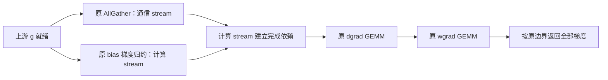

# MA6：在 F4 上缩短真实依赖链的下一步设计

更新：2026-10-25。已实现 **F4 / F4-tile / F4-gather** 三组对比；首次上机在 worker 在线校验中因 Python 同名模块冲突失败，现已修复，原因与复用构建重跑命令见第 10 节。第 1–8 节保留设计分析，原 B6 对应本轮 F4-gather；S6、N6 仍是未实现的设计候选。当前尚无三组完整训练性能结果。

**建议第一步验证反向中的一个不必要串行关系：先异步启动 `AllGather(grad_output)`，让原 bias 梯度归约与它重叠，再执行原 dgrad/wgrad。** 它直接基于 F4，前向完全沿用已验证的消费融合，数学计算和梯度返回边界保持原样。第二方向是 decoder＋后继 LayerNorm 的进一步融合，先限制为 Attention；跨层延迟 wgrad、逐片提前消费暂不作为第一实现。

这一排序依据是：F4 的前向两个独立 add 已经删除；新的八卡 trace 中，反向 bias 归约与 AllGather 仍实际串行，但二者没有数学上的先后依赖。应先验证这条较小、可隔离的调度改动，而不是看到某个几百微秒的 barrier/NCCL kernel 就认为这些时间可以全部收回。

## 1. 起点是同期 F4，不再从历史 CR2 估算增量

F4 批次为 `ma4-f-1x-50steps-20261025-115124-977713`。完整训练 F4 / CR2 平均为 **501.433 / 509.852 ms/step**，配对收益 **+1.652%［95% CI：+1.297%, +2.034%］**，8 个块全部更快。逐位前向、梯度/参数更新指纹和实际融合路径通过；但仍只有一次独立 trial。见 [MA4 实测](ma-4.md#6-本轮-ma4-f-结果相对-cr2-有端到端增量)及[原始报告](../../../../logs/h100/phase6/ma4-f-1x-50steps-20261025-115124-977713/fullstep/report.json)。

下一次应冻结原 F4，使用**新候选/F4 同场比较**。历史 501.433 ms 只说明量级：再减少 1% 约需净省 **5.014 ms/step**；它不是新批次的固定基准。`baseline.md` 的跨批次中位数比也不用于验收新机制，更不能把多个批次的收益相加。

固定当前模型和数值边界：TP8、32 层、hidden=4096、sequence=2048、global batch=4、四个 microbatch、BF16、零 dropout、原 selective mask、原逐来源累加与舍入。每步每 rank 有 Attention/MLP 投影各 128 次，合计 256 次。

## 2. 重新读 F4 时间线：机会与不能相加的时间

此次只读分析覆盖 F4 **全部 8 份训练 trace、2048 次前向投影及其 2048 次反向**。它们来自独立 profile，每 rank 记录一个完整 optimizer step；不是从正式窗口中抽出的无 profiler 步时。

### 2.1. 反向存在可拆开的依赖

当前 [ConsumerGemmRSFunction.backward](../../../../tools/h100/phase6/ma4_f_adapter.py) 的顺序为：

```text
grad_bias = sum_to_size(grad_output)
    → AllGather(grad_output)
    → grad_input GEMM
    → grad_weight GEMM
    → 返回 input/weight/bias/residual 的梯度
```

冻结 [mappings.py](../../../../logs/h100/phase6/ma4-f-1x-50steps-20261025-115124-977713/fullstep/megatron/megatron/core/tensor_parallel/mappings.py) 中 `_gather_along_first_dim` 调用默认同步 collective API。这里“同步”主要描述 CUDA 输出消费依赖，不能简单解释为 CPU 等待整个通信结束。

以下先取每 rank 的角色中位数，再取八 rank 中位数，单位 μs；不同指标的中位数不能直接相加还原一次调用。

| 反向指标 | Attention | MLP |
| --- | ---: | ---: |
| bias 梯度归约 kernel | 8.872 | 8.872 |
| AllGather kernel，包含等待等影响 | 494.831 | 565.976 |
| dgrad GEMM | 17.128 | 46.528 |
| wgrad GEMM | 16.768 | 50.160 |
| bias 结束→AllGather 开始 | 4.112 | 4.072 |
| AllGather 结束→dgrad 开始 | 2.704 | 2.736 |

全部 2048 次调用中，AllGather 都在 bias kernel 结束后开始，最小间隔 **1.120 μs**；dgrad 都在 AllGather 结束后开始，wgrad 都在 dgrad 结束后。源码顺序与实际 GPU 链一致。

关键区别是：**dgrad/wgrad 需要完整 gathered gradient，而 bias 梯度只需要本 rank 的 `grad_output`。** bias 归约和 AllGather 都是对该输入的只读消费者，输出地址独立。当前将二者串行，属于值得移除的调度依赖；这还不是全局最长路径已被证明的结论。

### 2.2. 长 AllGather 不等于纯传输瓶颈

不同 rank 的同类通信时长差异很大，不能只展示八 rank 中位数：

| rank | profile GPU span，ms | 本步 bias 归约工作和，ms | backward AG 中位 μs：Attention / MLP |
| --- | ---: | ---: | ---: |
| 0 | 836.798 | 2.275 | 494.399 / 566.543 |
| 1 | 825.218 | 2.278 | 73.792 / 73.888 |
| 2 | 821.110 | 2.279 | 494.017 / 565.408 |
| 3 | 822.391 | 2.276 | 498.015 / 570.416 |
| 4 | 821.104 | 2.282 | 496.048 / 569.377 |
| 5 | 819.210 | 2.279 | 495.744 / 564.561 |
| 6 | 818.808 | 2.310 | 492.368 / 564.864 |
| 7 | 824.284 | 2.295 | 495.263 / 567.119 |

rank1 的 backward AllGather 在提交 API 结束后约 **1.44 / 1.43 μs** 开始；其他 rank 常已提前排队数毫秒甚至二十多毫秒。这支持存在到达不均衡和调度等待，**不支持把 494/566 μs 都当作网络传输或可节省预算**。也不能凭这一次 profile 固定优化 rank1，或未经时钟对齐就跨 rank 相减绝对时间戳。

这些 profile 的 GPU span 为 **818.808–836.798 ms**，中位 **821.750 ms**，明显高于正式 F4 的 501.433 ms。profile 足以观察调用和依赖形态，不能直接给无 profiler 整步做时间分账。

### 2.3. 前向还剩的相邻工作

全部 2048 次 F4 decoder 后面均直接接原 LayerNorm。每 rank 共 260 个前向 LN，其中 256 个是投影后继，另外 4 个是各 microbatch 首层输入 LN。

| 前向指标，μs | Attention | MLP |
| --- | ---: | ---: |
| F4 decoder | 11.296 | 11.776 |
| 原后继 LayerNorm | 18.000 | 17.856 |
| decoder 结束→LayerNorm 开始 | 1.296 | 1.296 |
| decoder 开始→LayerNorm 结束 | 30.568 | 30.896 |

256 个后继 LN 的 kernel 工作之和，每 rank 为 **4.549–4.583 ms**，跨 rank 中位 **4.571 ms**。归一化计算必须保留，因此这不是可删除的 4.571 ms。LN 后到同 stream 下一 GEMM 前还存在 AllGather，后续方案必须追踪到通信/GEMM的开始，不能只停在 LN 结束。

## 3. 第一候选 B6：让 bias 梯度归约与原 AllGather 重叠

### 3.1. 改变依赖，不改变公式

记本 rank 的输出梯度为 `g`，仍使用原参数、原 TP group、原 rank 拼接顺序和原 BF16/FP32 规则：

```text
db = sum_to_size(g, bias.shape)
G  = AllGather(g)
dx = G @ weight
dW = G.reshape(...).T @ saved_input.reshape(...)
dresidual = g
```

`db` 不读取 `G`，`G` 也不读取 `db`。拟议的执行关系为：



第一版本只调整同一次 backward 内的提交与等待：

1. 准备与原实现相同的 contiguous 通信输入和独立 gather 输出。继续对原 `g` 执行原 `sum_to_size`，不改变它的归约布局、dtype 或算术顺序。
2. 从正确的计算 stream 异步启动原 AllGather，使通信的输入就绪事件位于 bias 归约之前。
3. 在原计算 stream 上执行 bias 归约；不在这里做全设备同步。
4. **在 bias 归约提交之后、首次读取 `G` 之前**调用对应 `Work.wait()`，建立当前计算 stream 的安全消费依赖。
5. 原样执行 dgrad、wgrad，按原接口返回全部梯度。第一版不提前返回 residual/dgrad，不延迟跨层 wgrad，不改变四个 microbatch 的梯度累积顺序。

仅将 `async_op=True` 写上去不够：若先 `wait()` 再做 bias，就恢复串行；若 bias 之后才建立通信输入事件，AllGather 仍可能等它。PyTorch 2.6 的 NCCL 实现分别在 collective 提交与 `Work.wait()` 中建立输入就绪、输出可消费的 stream 依赖，应以实际使用版本核对，不能靠 CPU API 返回时间代替 GPU 完成判断。见 [PyTorch 2.6 collective 语义](https://docs.pytorch.org/docs/2.6/distributed.html#synchronous-and-asynchronous-collective-operations)、[v2.6.0 ProcessGroupNCCL 的 syncStream / synchronizeStream](https://github.com/pytorch/pytorch/blob/v2.6.0/torch/csrc/distributed/c10d/ProcessGroupNCCL.cpp)。

### 3.2. 为什么它比再次缩短 CPU 提交更有针对性

旧 G 主要减少主机提交，但多数调用早已排队。B6 的目标是更改**GPU 必须满足的先后关系**，使通信无需等待一个无数据依赖的 reduction。理想局部模型可由 `B + A` 变为 `max(B,A)`，但只在到达时序、资源使用等其他条件不变时成立。

当前 bias 归约全步工作之和的 rank 中位为 **2.279 ms**，约为正式步时的 **0.455%**。这是直接可探索重叠的工作量级，**既不是保证收益，也不是包含调度变化后的严格全局上界**。它不足以预先承诺额外 1%；若实际改变了最晚 rank 的通信到达，效果可能与局部工作和不同，需要完整训练回答。

这也回应“优化的是否还是已经 overlap 的部分”：现有 trace 中 bias 与该次 AllGather 没有 overlap，拟议改动有明确可观测对象；但它们是否决定最终整步，仍须新旧同场结果检验。若只是早到 rank 更早等待其他 rank，整步可能不变。

### 3.3. 不能省掉的实现约束

- **输入真实就绪。** NCCL 只能读已完成生产的 `g`；若调用方使用其他 stream，需沿用正确 producer→current stream 的依赖，不能为了提前通信跳过它。
- **生命周期。** input、gather output 与 Work 必须活到相关 GPU 使用结束；复用缓冲区时必须有完成边界。首版保留独立输出及原 allocator 管理，不同时引入全局 buffer 池。
- **集体通信顺序。** 所有 rank 使用相同 TP group、相同 shape、同样的逐层/逐 microbatch collective 顺序；只移动该次 bias kernel，不跨其他 collective 重排。同一次 backward 只保留这一项未完成 Work；异常后不能回退并重复发起 AG。
- **保持输入副本事实。** 本次 2048 次 backward 中未观察到 contiguous/clone/copy 或 GPU memcpy，现有 `.contiguous()` 没有实际复制。新路径不能靠新增输入 clone 才工作，也不能把 MLP wgrad 前的 memset 误判为 gather 拷贝。
- **保持完整数值检查。** 归约算子、dgrad/wgrad 的形状、布局和调用保持一致；同读输入并不自动保证调度改动后逐位一致，仍须跑原全参数梯度/更新检查。
- **保持环境作为控制变量。** 首版继续 `CUDA_DEVICE_MAX_CONNECTIONS=1` 和原 NCCL 配置。不同 stream 只提供并发机会，不保证并发；资源争用、隐式同步或调度都可能使 B6 无收益。若要改连接数，另设双方共同改变环境的实验。见 [CUDA 12.4 并发执行与 stream 同步说明](https://docs.nvidia.com/cuda/archive/12.4.1/cuda-c-programming-guide/index.html#asynchronous-concurrent-execution)。

## 4. 第二候选 N6：先做 Attention 的 decoder＋LayerNorm 融合

这条方向比 B6 更接近 F4 的前向融合，但复杂度也更高。建议先做 **Attention-only**：Attention BDA 后在同一个 `_forward_attention` 中进入 `pre_mlp_layernorm`，接口边界较清楚。MLP 输出则跨到下一层 `input_layernorm`，最后一层进入 `final_layernorm`，应作为后续独立扩展。

### 4.1. 必须保留两个输出

```text
z = BF16(residual + BF16(projection + bias))
y = 原 LayerNorm(z; gamma, beta, epsilon)
```

`z` 仍是下一子层的未归一化 residual，`y` 才是归一化后的计算输入。因此候选必须同时保留 `z` 和 `y`；不能只返回 `y`，也不能声称删除 `z` 的全部写出。LN 统计必须基于已经完成两次 BF16 舍入的 `z`，不能改成对未舍入的 FP32 三项和求均值/方差。

每次 `[256,4096]` BF16 的 `z` 为 **2 MiB**。可能省掉的是 LN 对 `z` 的独立读取及一个 launch/依赖边界；Attention-only 对应每步 128 次、约 **256 MiB 逻辑读取**，覆盖全部后继则约 512 MiB。它们可能命中缓存，不能直接按 HBM 带宽换算节省；原归一化、`z/y` 写出及 backward 保存仍有成本。

### 4.2. 现有 H128 decoder 不能直接附加整行归约

当前每 warp 处理一个 H128 组，每 CTA 四个组；一行 4096 元素有 32 个 H128 组，跨 **8 个 CTA**。`__syncthreads()` 不能跨这些 CTA 完成一行统计。

候选需让一个 CTA 拥有整行，例如 128/256 线程，每 warp 分别循环处理 8/4 个 H128 组，再进行行内归约。这只是待评估布局，不是确定参数。必须保留原 H128 shuffle、逐来源顺序和量化路径，核对寄存器、共享内存、spill 与实际 occupancy。F4 decoder 已为 51 registers，原 LN 为 48 registers；融合后的资源不能按简单相加或取较小值估算。

本批 LN 实际为非 persistent `cuApplyLayerNorm<BFloat16,float,BFloat16>`，epsilon 为 `1e-5`，`apply_layernorm_1p=false`。冻结快照有 Megatron 包装，但尚缺本次服务器 **Apex CUDA LN 源码及版本身份**；实现前需补齐其统计归约树、affine 与舍入规则，不能用本地另一版 Apex 或任意 Welford 算法替代后再放宽验证。

### 4.3. 反向与判定

双输出 `(z,y)` 会带来 residual 分支和 LN 分支两路梯度。需要按原 dtype、相加与舍入语义合并它们，再走 F4 的 bias、AllGather、dgrad、wgrad；同时保持 gamma/beta 的参数身份、梯度、sequence-parallel 属性和 mean/invvar 等保存量。优先研究复用原 LN backward，而不是同时重写前后向算法。

Attention-only 最多消除 128 个独立前向 LN 调用，不能声称消除全部 260 个。应同时测 **decoder 开始→LN 结束→后继 FC1 开始**与整步；如果只让 LN 更早结束，但后继 AllGather/FC1 和完整 step 未提前，就不能认定关键路径已缩短。

停止条件包括：融合后 decoder 的新增成本抵消原边界/读取收益；行级布局明显损伤 decoder 吞吐；原数值门槛无法保持；或完整训练区间跨零。它是值得做受控原型的第二候选，不是已经确认的下一项收益。

## 5. 有更大工作量的 wgrad 延迟，为何暂不放第一位

本次 trace 中，目标 wgrad 的每 rank 全步工作和中位为 **8.569 ms**；dgrad 结束到 wgrad 结束的区间和中位为 **9.622 ms**。从数学依赖看，前一层通常只需要 dgrad，wgrad 只需在参数更新前完成，存在延迟执行的研究动机。

但当前 Function 一次返回全部梯度；仅把 wgrad 放到另一 stream，随后在相同返回点等待，并不会缩短传播路径。真正重叠需要重新安排 autograd 节点、梯度累积 hook、`main_grad` 生命周期和输入保留，可能改变多个 microbatch 的归约顺序。若借用通信等待执行 wgrad，还会争用 SM/带宽。

不能直接用 FP32 GEMM 累加替代原 BF16 wgrad→原累积并宣称逐位等价。也不能让 grad norm、optimizer 或清梯度越过尚未完成的 wgrad。trace 在当前 wgrad 后出现的两个 `aten::add_` 尚未逐项确定数学来源，不据此认定某个一定是 residual 梯度合并。

这一方向可能比单个 bias reduction 有更大机会，但首先要证明**下一层 dgrad 能提前、最终 optimizer 前的尾部没有等量增长、显存峰值可接受**。本轮只列为后续研究，不与 B6/N6 同时实现。

## 6. 暂不重复的路线及理由

| 路线 | 现有证据 | MA6 判断 |
| --- | --- | --- |
| 再缩短 CPU 提交 / 直接叠加 G | 旧 G/CR2 整步 +0.107%，CI 跨零；多数调用有充足排队 | 暂不作为主线，除非新的无 profiler 证据显示关键 rank 持续供给不足 |
| 直接套 MA5 tile/block | CR2 上默认候选整步 +0.069%，CI 跨零；F4 decoder 资源已变化 | 可作以后 F4 专属消融，不能直接移植收益或替换成丢失 bias/residual 的旧 decoder |
| 只融合发布 barrier 与 decoder | F4 barrier 结束→decoder 开始的八 rank 中位约 1.360 μs；每 rank 全步间隙和中位约 0.415 ms | 仅边界机会很小，不能把 barrier 的几百 μs 都记作可删开销 |
| tile-ready＋辅助 stream 提前消费 | 旧 op3-v2 有有效提前消费，O/A 两轮仍慢 0.928% / 0.844%；O/S 也退化 | 暂缓直接复制，必须先找到 F4 上不同于旧实验的可利用尾部 |

op3 的负结果来自另一基线，不证明 F4 上永远无机会；但它已经实现 fragment/epoch 发布、辅助消费并取消原发布屏障，不能把同一思路重新当成未经尝试的方案。见 [op3-v2 实测](../到达优先/base-op3.md)、[MA5 实测](ma-5-tile&block.md#6-默认候选八卡实测结果与离线复核2026-10-25)。

如果以后重启发布路线，关键应是**最晚必需分片到达后的剩余消费尾部**，而不是“多少非关键分片提前完成”。若各 destination 的消费耗时近似相同、后继仍等待全量 TP AllGather，一个简化边界为 `max_destination(max_source ready[source,destination] + consumer_time[destination])`；提前完成早到 destination 可能只增加下一道集合通信的等待。

协议方面还需覆盖量化 payload/scale、未量化远端 BF16 与本地 BF16。Stream-K 的一个 epilogue callback 可能只完成 tile 的 fragment，不能直接宣布整 tile ready；每 destination 有 64 个物理 tile、每 tile 八个 fragment。system release/acquire 必须覆盖实际写入完成，双槽 epoch 和旧消费者结束后才能复用的保证也必须保留。不要让所有驻留消费者 CTA 忙等本地尚未获得调度的 producer，或假设不同 stream 一定同时运行。

## 7. 拟议验证：先区分重排收益与真正重叠

### 7.1. B6 用三组隔离变量

以下为设计阶段的机制归因方案。本次按用户指定，实际运行组调整为 **F4 / F4-tile / F4-gather**，不包含 S6，见第 9 节；因此本批能判断两项优化相对 F4 的净效果，不能独立分离 gather 的重排贡献与异步重叠贡献。

| 拟议组 | 同一次 backward 的顺序 | 作用 |
| --- | --- | --- |
| F4 | bias → 原同步 API 的 AG → dgrad → wgrad | 冻结基线 |
| S6 | 与 B6 相同的异步 AG helper → 立即 wait → bias → dgrad → wgrad | 先提交通信但保留串行，作为 B6 的等待位置对照 |
| B6 | 异步 AG 与 bias 并行 → wait → dgrad → wgrad | 在重排基础上允许重叠 |

三组均保留 F4 前向和相同数学算子，不同时改 GEMM、NCCL 算法、量化 mask、工作区或连接数。

**B6/F4** 预先指定为主要比较，回答用户关心的净增量；**B6/S6** 为机制归因比较，使用相同异步 API/helper，只改变 wait 相对 bias 的位置，判断允许重叠是否有额外贡献。**S6/F4** 包含通信提前提交以及原 helper→显式异步 helper 的差异，不能称为完全隔离的纯重排收益。若需进一步分解，可另加 `bias → 异步 AG → 立即 wait` 的串行桥接控制；不要为统一 helper 而悄悄改掉 F4 基线。

若 B6/F4 为正而 B6/S6 不明确，只能报告组合调度改善，不能单独宣称重叠贡献已被证实。即使 B6/S6 为正，也要结合实际 GPU overlap 证据，区分重叠与提交顺序引起的其他变化。

### 7.2. 三层检查

1. **数值与生命周期：** 独立检查 input/weight/bias/residual 完整梯度和多步更新；沿用 F4 smoke 的每 rank 389 个可训练参数张量、三步梯度/参数指纹比较；正式窗口 loss/grad_norm 轨迹、最终参数指纹一致。测试输入 storage 变化、多个存活输出、慢 rank 与不同模块/双槽复用，记录零 skip/fallback。
2. **依赖与路径：** 每 rank 每步仍是 256 次目标 backward、256 个原 bias reduction 和 256 次相同 AllGather，原 dgrad/wgrad 数量不变。按同一次调用关联 bias、AG、GEMM，检查通信输入事件在 bias 之前、wait 在首次读 `G` 之前；单列 bias/AG 的真实 GPU 区间交集、AG 结束和 dgrad 开始。优先比较**同一上游 `g` 的真实 GPU 生产结束→dgrad/wgrad 结束及后继 backward 开始**；若暂时无法关联这个上游节点，至少使用同次调用 `min(bias_start, AG_start)→wgrad_end` 作为完整局部执行 span。不能继续只从 bias 开始计时，否则 B6/S6 提前执行的 AG 部分被漏掉；也不能用不相关调用的重叠冒充本次收益。
3. **完整训练：** 正式计时关闭 profiler，以每窗口八 rank 最大墙钟/50 计算步时；每窗口独立初始化，10 步预热＋50 步正式。建议探索阶段 12 个完整三组块，每半程包含全部六种块内顺序一次，运行前固定随机种子并冻结完整顺序，共 36 窗口、288 份 rank 记录、1800 正式 optimizer step；全部窗口保留，不按微测速度筛掉负结果。以完整块做配对 bootstrap，不能将八 rank 或 50 步当成独立重复。

B6/F4 的 95% CI 下界大于零、数值与路径通过，才报告该批正增量；之后用新批次独立复测，再谈稳定收益。N6 另开候选/F4 实验，不在第一次 B6 验证中叠加。任何新配置都以其同期 F4 为控制，不能用历史均值凑出百分比。

### 7.3. 收益没有兑现时应如何判断

- **没有发生 AG/bias 重叠：** 先检查事件、wait 位置与环境限制；不能把 `async_op=True` 当作已实现机制。
- **发生重叠但 AG 延长、dgrad 未提前：** 通信与 reduction 的资源竞争或其他 rank 到达可能吞掉了机会。
- **局部 backward 变短但整步 CI 跨零：** 说明这条改动尚未形成可确认的全局增量，保留 F4，不继续用局部百分比作结论。
- **数值或生命周期失败：** 停止候选，不通过减少参数检查、允许隐式回退或放宽到“loss 接近”来过关。

## 8. 证据来源与仍待补齐的部分

分析使用[冻结计划](../../../../logs/h100/phase6/ma4-f-1x-50steps-20261025-115124-977713/fullstep/plan.json)、[已有训练 profile 汇总](../../../../logs/h100/phase6/ma4-f-1x-50steps-20261025-115124-977713/fullstep/profile-summary.json)以及以下完整 F4 trace：[rank0](../../../../logs/h100/phase6/ma4-f-1x-50steps-20261025-115124-977713/fullstep/results/profile-F4/rank0-profile.json.gz)、[rank1](../../../../logs/h100/phase6/ma4-f-1x-50steps-20261025-115124-977713/fullstep/results/profile-F4/rank1-profile.json.gz)、[rank2](../../../../logs/h100/phase6/ma4-f-1x-50steps-20261025-115124-977713/fullstep/results/profile-F4/rank2-profile.json.gz)、[rank3](../../../../logs/h100/phase6/ma4-f-1x-50steps-20261025-115124-977713/fullstep/results/profile-F4/rank3-profile.json.gz)、[rank4](../../../../logs/h100/phase6/ma4-f-1x-50steps-20261025-115124-977713/fullstep/results/profile-F4/rank4-profile.json.gz)、[rank5](../../../../logs/h100/phase6/ma4-f-1x-50steps-20261025-115124-977713/fullstep/results/profile-F4/rank5-profile.json.gz)、[rank6](../../../../logs/h100/phase6/ma4-f-1x-50steps-20261025-115124-977713/fullstep/results/profile-F4/rank6-profile.json.gz)、[rank7](../../../../logs/h100/phase6/ma4-f-1x-50steps-20261025-115124-977713/fullstep/results/profile-F4/rank7-profile.json.gz)。

复核方法：先用 `scope.attn.candidate` / `scope.mlp.candidate` 定位前向，再用 CPU `Sequence number` 关联对应 `ConsumerGemmRSFunctionBackward`；在该 CPU 区间内取 CUDA runtime correlation，并与 External ID 共同关联 GPU kernel。逐调用检查 bias/AG/dgrad/wgrad 的数量与时序，各角色每 rank 均为 128 次，再汇总。前向按真实 stream 的相邻 kernel 找 decoder、LN 和下一 GEMM，同时保留其他 stream 的通信。

每次 backward 虽然记录了四个 `cudaStreamWaitEvent`，本批 Kineto 参数缺少足够的 event handle、源/目标 stream 信息，不能只用这些记录重建完整事件因果图。**本文证明的是源码依赖和实际执行顺序相符，尚未证明八卡全局最长路径，也没有新机制的性能数据。** 若后续要做完整因果归因，应补充能关联具体事件/collective 的诊断，并在 profiler 之外复核收益。

代码边界见 [F4 decoder 生成](../../../../tools/h100/phase6/ma4_f_sources.py)、[F4 adapter/autograd](../../../../tools/h100/phase6/ma4_f_adapter.py)、[原 H128 decoder](../../../../tools/h100/phase6/ma2_c_decode.cuh)、[CR2 提交与屏障](../../../../tools/h100/phase6/ma2_cr2_sources.py)、[冻结 TransformerLayer](../../../../logs/h100/phase6/ma4-f-1x-50steps-20261025-115124-977713/fullstep/megatron/megatron/core/transformer/transformer_layer.py)、[冻结 LN 包装](../../../../logs/h100/phase6/ma4-f-1x-50steps-20261025-115124-977713/fullstep/megatron/megatron/core/fusions/fused_layer_norm.py)。

NVIDIA 目录中的 [Megatron-Bridge 通信重叠资料](https://github.com/NVIDIA/skills/blob/main/skills/nemo-mbridge-perf-tp-dp-comm-overlap/SKILL.md)面向 Bridge/TE 等集成配置；当前目标是仓库自己的 F4 autograd 路径，不能据此认为开启一个配置就会自动重叠。本次没有安装新技能或修改训练环境。

## 9. 本轮实现：F4 / F4-tile / F4-gather 同场比较

### 9.1. 三组各自改变什么

| 组别 | 前向 decoder | 反向调度 |
| --- | --- | --- |
| **F4** | 原融合 bias/residual decoder，两角色均 `<<<2048,128>>>` | 原 bias reduction → AllGather → dgrad → wgrad |
| **F4-tile** | 默认 Attention `<<<528,256>>>`，MLP 原 `<<<2048,128>>>`；保留全部 F4 消费融合 | 与 F4 相同 |
| **F4-gather** | 与 F4 相同，原生源码逐文件一致 | 先异步 AllGather，再原 bias reduction，wait 后执行原 dgrad/wgrad |

本轮没有 tile＋gather 合并组，便于分别归因。**调节的是 decoder 的 CTA 输出 tile 和 grid，不改变 GEMM 的 `128×128×32` tile 或 SM 设置。** 每 warp 仍负责一个 H128 组，128/256 threads 对应每 CTA 每次处理 512/1024 个元素；grid-stride 循环覆盖全部 8192 组，纯 BF16 路径的提前返回仅结束当前组。

默认采用 MA5 的角色拆分作为一个待测候选，不把它当作已验证最优配置。MA5-R 新回传结果出现同期两组从约 510 ms 跳到约 5.6 秒的窗口，用户已确认当时有其他进程占用 GPU；该批区间跨零，不能作为 F4-tile 已有收益的依据。本次按要求不增加每窗口 GPU 状态记录。Attention、MLP 的 threads/blocks 都可独立指定，所有负收益和慢窗口保留。

F4-tile 按实例固定 K 选择解码入口，K=512 对应 Attention、K=2048 对应 MLP；不在每次 forward 修改 TLS 配置。某角色使用 `128 threads / 2048 blocks` 时，直接保留原 F4 kernel，但实例固定函数选择接口的新增开销仍计入比较。构建记录 tile 参数，原生 ABI 和真实 profile 分别核对选择与实际 launch。

F4-gather 使用第 3 节的调度，bias 仍对原本地 `grad_output` 执行 `sum_to_size`，不对 gathered tensor 归约；输入梯度、权重梯度、残差梯度和更新顺序保持原规则。三组共用相同的实验计数接入；F4 保留原 native、数学与反向顺序，但不把新增公共计数包装声称为完整 Python 文件逐字不变。

代码入口：

- [ma6_sources.py](../../../../tools/h100/phase6/ma6_sources.py)、[ma6_build.py](../../../../tools/h100/phase6/ma6_build.py)：生成独立三组构建、冻结原 F4 和角色参数。
- [ma6_adapter.py](../../../../tools/h100/phase6/ma6_adapter.py)：每模块反向身份与计数、F4-gather 的异步 gather 调度。
- [ma6_bench.py](../../../../tools/h100/phase6/ma6_bench.py)、[ma6_fullstep.py](../../../../tools/h100/phase6/ma6_fullstep.py)：三组正确性、完整训练与实际路径检查。
- [detach_ma6.py](../../../../tools/h100/phase6/detach_ma6.py)、[run_ma6.sh](../../../../tools/h100/phase6/run_ma6.sh)：顺序构建与后台测试。

### 9.2. 启动三组对比

在目标八卡 H100 容器的仓库根目录运行：

```bash
/workspace/conda-envs/flux-h100-ablation3-20261017/bin/python tools/h100/phase6/detach_ma6.py --execute
```

环境恢复入口：

```bash
bash tools/h100/phase6/run_ma6.sh --execute
```

默认 **一轮、12 个完整三组块、36 个正式窗口、288 份 rank 记录、1800 个正式 optimizer step**，每窗口 10 步预热＋50 步正式。每半程六种块内顺序各出现一次，顺序在计时前冻结。另有算子正确性、三步完整梯度/更新、训练 smoke 和独立 profile。`--trials 2` 为两轮、72 窗口、3600 正式步；它会运行完整新比较，不从历史结果中拼对照。

去掉 `--execute` 只预览，不创建批次、不查询 GPU或编译；`--foreground` 前台运行。默认结果目录：

```text
logs/h100/phase6/ma6-f4-tile-gather-1x-50steps-<北京时间戳>/
  batch-state.json
  handoff/container-supervisor.log
  operator/report.json
  fullstep/report.json
  fullstep/report.md
  fullstep/profile-summary.json
```

例如要让 F4-tile 两个角色都使用原 MA5 的统一候选，可显式指定：

```bash
bash tools/h100/phase6/run_ma6.sh --execute \
  --attn-threads 256 --attn-blocks 528 \
  --mlp-threads 256 --mlp-blocks 528
```

threads 支持 64/128/256/512；blocks 必须为正且不超过 `8192 / (threads/32)`。每次只测一份明确配置，不自动扫描挑选最佳。`--ma6-build <目录>` 仅复用经过验证、参数与命令一致的 MA6 三组构建；不能混用旧 F4/CR2 或 MA5 构建。`MA6_PYTHON` 可覆盖 shell 入口的 Python 路径。

### 9.3. 看哪些结果

主要比较为 **F4-tile/F4、F4-gather/F4**，并报告 F4-tile/F4-gather。各候选单独记录 `increment_over_F4_validated`，要求每个请求 trial 中相对 F4 的配对点估计及 95% CI 下界都为正；一组失败不意味着另一组失败。数值/路径失败会停止并保留现场，性能负收益则完成并保留全部窗口。

算子前向微测三组都是完整 `projection+bias+residual`，**它无法评估 F4-gather 的反向优化**。gather 的结论必须来自完整训练、实际 backward 调度计数和独立 GPU trace；`async_op=True` 不等于已经发生 GPU overlap，无 overlap 也应如实记录。

反向 profile 需按同次调用识别 bias、AG、dgrad、wgrad，记录 AG/bias 实际重叠，以及 `min(bias_start, AG_start)→wgrad_end` 的完整局部 span。该区间仍不能替代整步验收。正性能结论以关闭 profiler 的全 optimizer step 为准，不能只报告快的 Attention 或剔除后半慢窗口。

本轮不测 C/R，也不验证原相对 C/R 的 2% 目标。与第 7 节设计不同，本次没有 S6，所以即使 F4-gather 有增量，也先表述为“提前发起 gather 并延后等待的整体调度收益”；实际 overlap 及其独立贡献需要分别说明。

### 9.4. 本地验证与待运行范围

本节保留首次实现时的验证记录；它没有覆盖本次发现的冻结 worker 在线 builder 导入路径，新增回归见第 10 节。

当前工作区没有 `/dev/nvidia0`，也没有目标服务器的 `/workspace/conda-envs/flux-h100-ablation3-20261017/bin/python`。本地只做 CPU/源码/编译检查；八卡完整训练应通过上面的入口在目标环境运行，尚无 F4-tile 或 F4-gather 的性能结论。

已完成 **74 项 MA6 与原 MA4-F 统一 CPU 检查，全部通过、零跳过**。最后对冻结只读重放的修正又定向复测 **21 项**，对启动器模板哈希冻结复测 **6 项**，均通过。这些复测与统一套件有重叠，不作为新的独立性能样本。覆盖真实 PyTorch CPU 的四类完整梯度和三步更新、异步 API 模拟下的提交/等待与异常处理、三组均衡顺序、独立结果判定、完整参数门槛及冻结脚本隔离导入。

三臂 host mapping、SM90 runtime、GPU mapping 程序及 PTX/SASS 编译通过，F4-tile 的真实 C++ wrapper 和 pybind 对象也编译通过。默认 F4-tile 的 MLP 与 F4-gather 保留的原 F4 decoder **PTX 完全一致**。默认 Attention 新 kernel 为 **44 registers**，原 F4 为 **51 registers**，均为 **0 spill、8-byte stack frame**；资源变化不等于性能收益。

GPU mapping 程序仅编译未运行，本地未完成整套 Flux 动态库链接；GPU 数值等价、真实通信重叠和整步性能仍须上机验证。证据见[验证汇总](../../../../outputs/h100/phase6/ma6-validation-20261025/validation.json)、[统一 CPU 日志](../../../../outputs/h100/phase6/ma6-validation-20261025/cpu-tests.log)、[最终 harness 复测](../../../../outputs/h100/phase6/ma6-validation-20261025/final-harness-tests.log)、[最终 launcher 复测](../../../../outputs/h100/phase6/ma6-validation-20261025/final-launcher-tests.log)、[编译验证](../../../../outputs/h100/phase6/ma6-validation-20261025/native-compile/validation.json)和[启动预览](../../../../outputs/h100/phase6/ma6-validation-20261025/launch-preview.txt)。

## 10. 首次上机失败与修复：冻结 worker 的模块名冲突

失败批次为 `ma6-f4-tile-gather-1x-50steps-20261025-153202-551639`。[批次状态](../../../../logs/h100/phase6/ma6-f4-tile-gather-1x-50steps-20261025-153202-551639/batch-state.json)记录 `failed / operator-timing`，实际停在该阶段的第一个 `preflight-F4`，还未进入正式算子计时或完整训练。三组编译及六个角色 mapping 命令已完成；不能把本次中断解释为 tile/gather 性能退化。

### 10.1. 是代码问题，发生在 worker 使用 GPU 之前

所有 rank 的[原始进程日志](../../../../logs/h100/phase6/ma6-f4-tile-gather-1x-50steps-20261025-153202-551639/operator/results/preflight-F4/process.log)都报：

```text
FileNotFoundError: .../operator/scripts/ma6_build.py
```

错误链为 `worker → verify(offline=False) → build_identity → ma6_build.verify`。冻结 worker 已经导入 `operator/scripts/common.py`，随后虽然从正确的仓库目录导入了 `ma6_build.py`，其 `from common import HERE` 却复用了 `sys.modules` 中的冻结版本，导致 builder 的 `HERE` 指向 `operator/scripts`。嵌套 builder 的 `REPO` 和相关来源模块也有同样的污染风险；只调整 `sys.path` 顺序或手动改一个 `HERE` 无法完整解决。

失败点位于该 worker 的 `import torch`、设备选择和分布式初始化之前。这次报错不是 GPU 占用、OOM 或 NCCL 失败；也没有产生三组训练性能结论。原失败批次及其冻结脚本保留原样。

### 10.2. 修复方式与新增回归

[ma6_bench.py](../../../../tools/h100/phase6/ma6_bench.py) 将在线构建身份校验放入干净的 `python -I` 子进程，显式从真实 builder 目录加载仓库控制器。子进程核对仓库控制器与冻结 worker 的 SHA256 后，继续执行原完整构建校验并返回同一份身份信息；父进程的冻结模块不被替换。**没有改成 offline，也没有删掉 manifest、输入、源码或动态库的哈希检查。** 这些操作发生在测量窗口之外，不修改前向、反向或 CUDA kernel。

新增 [test_ma6_online_worker.py](../../../../tools/h100/phase6/test_ma6_online_worker.py) 从实际冻结 `worker(args)` 入口执行在线校验，在首次导入 Torch 时停止：三组均须到达这个边界；构建输入摘要、原生源码或动态库被改动时须在 GPU 初始化前拒绝。测试同时复制原失败控制器到临时目录，确认旧代码仍复现相同错误，且新路径不污染父进程的 `common`。

此前的冻结脚本导入和 `offline=True` 测试没有走这条路径，部分 prepare 测试还模拟了 `build_identity`，因此漏掉了错误。新增测试使用 `/tmp` 中的注册源码和明确标记的占位库，只校验路径与哈希，不加载 GPU 库；不能把通过 CPU 回归写成八卡正确性或性能已验证。

修复后 **5 项真实冻结 worker 在线启动回归＋27 项现有相关回归，共 32 项全部通过、零跳过**。原失败证据的 SHA256 在复核前后不变。见[修复验证汇总](../../../../outputs/h100/phase6/ma6-fix-20261025/validation.json)、[在线启动回归日志](../../../../outputs/h100/phase6/ma6-fix-20261025/online-worker-tests.log)、[相关回归日志](../../../../outputs/h100/phase6/ma6-fix-20261025/regression-tests.log)。

### 10.3. 同步修复后，复用服务器已完成的构建重新启动

本次未改动 22 个原生 builder/source 输入，它们与失败批次的冻结哈希一致。服务器保留原 build 时，可在仓库根目录用新批次重跑，省去再次编译：

```bash
bash tools/h100/phase6/run_ma6.sh --execute \
  --ma6-build /workspace/TempName/logs/h100/phase6/ma6-f4-tile-gather-1x-50steps-20261025-153202-551639/build
```

复用仍须通过当前完整构建验证。不要直接运行旧批次 `operator/scripts/bench.py`，它是为保留证据而冻结的旧代码；也不要覆盖旧批次目录。上述命令默认生成新目录并完成同一轮 F4/F4-tile/F4-gather 比较，仍为 36 个正式窗口、1800 个正式 optimizer step。
