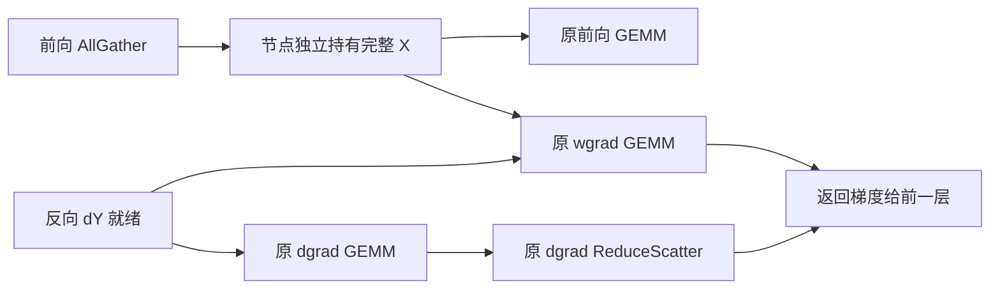

# MA8：保留前向已收集的激活，删除反向重复 AllGather

**2026-10-26，设计与可执行对比实验。目标：相对同期 CR3 减少至少 2% 的完整 optimizer step 时间；尚无 MA8 八卡性能结果。**

本轮只引入一种机制：**QKV／FC1 前向 AllGather 的完整输入由该次 autograd 节点独立持有，反向 wgrad 直接复用，删除对同一输入的第二次 AllGather。** 实验名为 `F4-cache`，对照 `F4` 即 [baseline.md](baseline.md) 的 CR3。原 CR3 的 row-parallel 投影、选择性量化、producer、发布屏障、decoder＋bias/residual、LayerNorm 及其反向保持原实现。

这是一项针对现有 CR3 的新机制，不宣称激活保留这一通用思想本身是新的研究发明。它改变需要执行的通信次数，不依赖给原通信换一个等待位置，或把 wgrad 移到辅助 stream。

## 1. 为什么换这条路径

现有结果不能支持继续把局部重叠或 decoder 小改动当成 2% 的主要预算：

| 已试路线 | 同期完整训练证据 | 对 MA8 的约束 |
| --- | --- | --- |
| MA6-v2 多行 decoder tile | −0.339%，95% CI 全负 | 不继续调该 tile 来解释新机制 |
| MA6-v2 bias／AllGather 重排 | −0.680%，95% CI 全负 | 不继续添加异步 gather 和 wait 调度 |
| MA6-v3 packed mask | +0.279%，区间跨零 | 不把局部 decoder 改善当作已确认整步收益 |
| MA6-v3 同 tile 布局 | +0.251%，约 1.284 ms，单 trial | 有小幅正增量，距离约 10 ms 目标仍远；不叠加到 MA8 |
| MA7 辅助 stream 延迟 wgrad | −9.378%，约增加 48.411 ms；profile 未观察到目标重叠 | 不引入 wgrad 队列、延迟累积或新的 stream |

详见 [MA6 第 13、16 节](ma-6.md)和 [MA7 第 8 节](ma-7.md)。MA8 的改动对象是 **column-parallel QKV／FC1 的输入激活收集**；MA6/MA7 改动的主要对象是 **row-parallel Attention linear_proj／MLP FC2 的消费和反向**，二者不可混称。

MA6 中提到的 gather buffer 缓存，是为 row 反向 `grad_output` 收集减少分配／提交开销，通信本身仍需执行。这里保留的是 column **前向已得到的激活值**，目的在于删除另一次 collective，不是给 MA6 的缓冲区优化换名。

## 2. 被重复执行的工作是什么

冻结 Megatron 的 [`LinearWithGradAccumulationAndAsyncCommunication`](../../../../logs/h100/phase6/ma7-v1-wgrad-1x-50steps-20261026-171946-355178/fullstep/megatron/megatron/core/tensor_parallel/layers.py) 在 sequence parallel 下执行：

```text
前向：
    X = AllGather(x_local)       # 原来写入可复用的全局临时 buffer
    Y = X @ W.T
    保存 x_local、W

反向：
    X_again = AllGather(x_local, async=True)
    dX_full = dY @ W
    wait(input_AllGather)
    prepare_input_tensors_for_wgrad_compute(dY, X_again)
    dX_local = ReduceScatter(dX_full, async=True)
    dW = dY.T @ X_again
    原 bias gradient
    wait(ReduceScatter)
    返回原梯度
```

前后向间，这一节点的输入没有改变，前向已经获得所需的 `X`。反向再次通信是原实现选择少保留激活的代价，并不是数学上必须重新获取的数据。原实现已经让输入 AllGather 与 dgrad 有重叠，但 `handle.wait()` 在 ReduceScatter 提交之前；因此 **dgrad 完成后尚未结束的输入 AllGather，仍会推迟向前一层传播 dX**。

### 最新 CR3 trace 的依据

只读分析使用 `ma6-v3-receiver-1x-50steps-20261026-145811-248551/fullstep/results/profile-F4/` 的八份 trace。每 rank 有 260 对该 Linear 的前后向：四个 microbatch，各 32 对 QKV／FC1 加一个 LM head。排除四次 LM head 后，目标为 **每 rank 256 次，八 rank 共 2048 次**。每次都关联到一个反向输入 AllGather、一个 dgrad ReduceScatter 和两个 GEMM。

下表先取各 rank 的角色中位数，再取八 rank 中位数，单位 μs；使用同一 rank 的 GPU 时间戳，不跨 rank 相减绝对时间。

| 目标 column-parallel 反向指标 | QKV | FC1 |
| --- | ---: | ---: |
| 输入 AllGather kernel | 802.068 | 410.673 |
| dgrad GEMM | 53.584 | 70.944 |
| wgrad GEMM | 59.792 | 71.008 |
| `max(0, AG_end − dgrad_end)` | 744.059 | 334.448 |
| dgrad 结束→ReduceScatter 开始 | 746.891 | 337.968 |
| 输入 AllGather 结束→ReduceScatter 开始 | 3.184 | 3.024 |

这些结果支持“存在一个真实的通信完成依赖”的判断。**它们不是预计可以省下的时间。** NCCL kernel 时长包含 rank 到达差异和等待；profile 又显著扰动训练。各 rank 的上述正尾部之和约 39.6–142.1 ms，差异很大，不能把它们加到历史 501 ms 上做减法。实际净收益必须来自本轮无 profiler 的完整训练配对。复算见 [analyze.py](../../../../outputs/h100/phase6/ma8-validation-20261026/baseline-analysis/analyze.py) 与 [analysis.json](../../../../outputs/h100/phase6/ma8-validation-20261026/baseline-analysis/analysis.json)，记录了八份输入 trace 的 SHA256。

## 3. MA8 的实现

```text
前向：
    X_owned = empty(full_shape)  # 本次节点独立所有；不是共享 buffer 的别名
    原 AllGather(x_local, out=X_owned)
    Y = 原 matmul(X_owned, W.T)
    保存 x_local、W、X_owned

反向：
    dX_full = 原 dY @ W
    prepare_input_tensors_for_wgrad_compute(dY, X_owned)
    dX_local = 原 ReduceScatter(dX_full, async=True)
    dW = 原 dY.T @ X_owned
    原 bias gradient
    原 wait(ReduceScatter)
    返回原梯度
```

只删除反向输入 AllGather 及其 wait。dgrad、wgrad、bias gradient、ReduceScatter、DDP `main_grad` 累积、四个 microbatch 的累积顺序和 optimizer 均使用原算术与边界。没有新计算 stream，没有把权重梯度推迟到节点返回以后。



图表示数据依赖；实际提交顺序仍是 dgrad → ReduceScatter → wgrad → wait(ReduceScatter)。没有为了画出并行关系而额外创建 stream。

### 所有权与生命周期

1. **不能保存原全局 buffer 的 view。** 后续 column projection 会覆盖它，反向将读到别的层的输入。首版让原前向 AllGather 直接写到独立 `torch.empty`，不走“全局 buffer→clone”的额外复制。
2. 缓存属于一次 forward 的 autograd context，不属于某个层永久持有的跨 step cache。每次 forward 都收集本次激活，不复用旧 batch、旧 microbatch 或参数更新前的激活。
3. 使用 `save_for_backward` 管理保存张量；保留原 local input 和 weight 的版本检查，不绕过原地修改检测。节点反向完成后按 autograd 生命周期释放，统计记录不额外持有缓存 tensor。
4. 保留原 forward collective 的可消费依赖及 backward ReduceScatter 的 wait。`async_op` 返回与 GPU 可安全使用不是同一件事，仍遵守当前 PyTorch 2.6 的 [collective 语义](https://docs.pytorch.org/docs/2.6/distributed.html#synchronous-and-asynchronous-collective-operations)与 [autograd 保存张量约束](https://docs.pytorch.org/docs/2.6/autograd.html)。
5. 八 rank 对相同 64 个模块一致启用该机制。不会只有部分 rank 删除同一 TP group 中的 collective，也没有异常后重新发 collective 的静默回退。

### 实现边界

入口为 [ma8_adapter.py](../../../../tools/h100/phase6/ma8_adapter.py)。仅覆盖每层 `.self_attention.linear_qkv` 和 `.mlp.linear_fc1`，不改 LM head 或 row-parallel 模块。安装时核对冻结 Megatron 函数身份与模型配置；不支持重计算、CUDA Graph、不同 TP／shape、梯度融合或 wgrad 延迟等组合实验。

`ColumnParallelLinear.forward` 会在每次调用内重新设置 `_forward_impl`，因此单独给该属性赋值不足以安装机制。MA8 为目标实例绑定原 forward 的独立函数环境，只替换该实例的 linear 调用入口；不全局 monkeypatch Megatron 的 linear 函数。对照使用原类的算术，候选从同一冻结源码生成仅含上述缓存变换的路径；双方都有相同口径的模块计数与 profile 标记。

## 4. 2% 的预算与显存代价

CR3 历史均值 501.433 ms 仅用于量级估算：

```text
2% × 501.433 ms = 10.02866 ms / step
10.02866 ms ÷ 256 = 39.17445 μs / 被删除的 backward AllGather
```

因此合理的待测假设是：删除 256 次重复通信及其提交／等待后，扣除前向独立分配、缓存压力和调度变化，平均每次能净省约 39 μs。**当前证据说明值得测，尚不能保证达到这个值。** 若原通信在无 profiler 环境下多数已被隐藏、或删除后仍等待其他 rank，收益可能很小。

每个完整输入为 `[2048, 1, 4096]` BF16，16 MiB；local input 为 `[256, 1, 4096]`，2 MiB。首版保留原 local input，因此新增缓存的逻辑容量为：

```text
32 层 × 2 个 column projection × 16 MiB = 1024 MiB / rank
```

原 PP1 训练依次完成四个 microbatch 的前后向，首版不跨 microbatch 保留，不能误算成四倍同时驻留。1 GiB 是新增逻辑激活容量，不是测得的 allocator 峰值；缓存释放时机、原全局 buffer、临时 GEMM 张量和内存池可能使 `allocated`／`reserved` 增量与它不同。报告必须给出两种峰值，若存活缓存跨过反向边界则直接判失败。

按输入数据量计，每次 AllGather 的完整结果 16 MiB，其中远端贡献 14 MiB；删除 256 次对应每 rank 每 step 3.5 GiB 的远端有效载荷收集。该值不是 NVLink 链路实测流量，也不能用峰值带宽直接换算收益。

## 5. CR3／MA8 的实验协议

| 项目 | 固定设置 |
| --- | --- |
| 两组 | `F4`（CR3），`F4-cache`（CR3＋本机制） |
| 模型 | TP8，32 层，hidden 4096，sequence 2048，global batch 4，四个 microbatch，BF16，零 dropout |
| 原生库 | 两组源码逐文件与注册 F4 相同；原 mask、arrival order、双工作区及 decoder geometry |
| 运行环境 | 与现有启动器相同：运行 CUDA 12.4、构建 CUDA 12.8，`CUDA_DEVICE_MAX_CONNECTIONS=1`、`NCCL_NVLS_ENABLE=0` |
| 正式窗口 | 每窗 10 步预热＋50 步完整 optimizer step；取八 rank 最大窗口墙钟 / 50 |
| 配对 | 每 trial 8 个平衡 AB／BA 块，共 16 窗口、800 正式步骤；可选两个独立 trial |
| 统计 | 完整块配对对数比与 bootstrap 95% CI，所有窗口保留，不删负收益和慢窗口 |

流程为：构建 → 原 row projection 算子预检／计时／profile → 完整模型三步梯度与更新 smoke → 完整训练配对计时 → 独立训练 profile。算子阶段只证明原 CR3 native 路径未变，**并未触发 column 激活缓存，不能用它判断 MA8 加速**。

完整模型 smoke 保留每 rank 全部 **389 个参数张量**的梯度和更新指纹比较；正式窗口检查同块同 rank 的 loss、grad norm 与末态参数指纹。浮点容差不会为了让候选通过而放宽。

### 路径必须可验证

- 每个正式窗口，64 个目标 column 模块各有 `(10+50)×4=240` 次前后向；候选复用次数为 240，反向输入 AllGather 为零，末态未完成缓存为零。对照保留原反向收集。
- 独立 profile 每 rank 的 QKV／FC1 各 128 次：两组前向输入 AllGather 各 256 次；反向输入 AllGather 从 256 降到 0；原 dgrad ReduceScatter 仍为 256 次；两个 GEMM 与 bias 梯度保持完整。
- row projection 的原 producer→发布屏障→consumer decoder→LayerNorm 及 bias→AllGather→dgrad→wgrad 仍通过检查。LM head 继续使用原实现。
- GPU 事件以 autograd sequence、CPU 调用范围、launch correlation 关联，不能仅根据 Python 计数认定通信已消失。
- MA7 曾误拒绝原 cuBLAS 的 4-byte memset。MA8 的审计器只按准确大小、父 `mm/matmul` 调用与对应 GEMM 关联允许原有清零；column QKV 的原 bias `sum` 中 48-byte 清零也单独归类。继续拒绝未知复制／清零，不整体过滤 `gpu_memset`。

### 结果判定

报告区分三个问题：配对点估计是否达到 2%；95% CI 是否确认正增量；95% CI 下界是否达到 2%。**“确认达到 2%”要求点估计及区间下界均至少为 2%，并通过数值与实际路径检查。** 单 trial 仍属探索，两个独立 trial 均通过才有复现证据。

原始 timing 报告先产生；只有后续 profile 也通过，整个批次才算完成，不能把中途 timing 的正数直接当作最终验收。若数值或实际路径失败立即停止；若性能为负或不足 2%，保留完整结果并标记未达到，不自动换参数继续挑选。

## 6. 启动方式

在 H100 实验机的 `TempName` 目录运行：

```bash
# 仅显示计划，不创建批次目录、不查询 GPU
bash tools/h100/phase6/run_ma8.sh

# 与 run_ma6.sh 相同风格：后台启动一轮 CR3 / MA8 对比
bash tools/h100/phase6/run_ma8.sh --execute

# 两轮独立 trial，用于确认复现
bash tools/h100/phase6/run_ma8.sh --trials 2 --execute

# 需要在当前终端查看完整执行过程时
bash tools/h100/phase6/run_ma8.sh --foreground --execute
```

自定义 Python 可设置 `MA8_PYTHON=/path/to/python`；继续沿用现有 container-recovery 的环境发现方式。`--out` 可指定新的批次目录；`--ma8-build` 仅复用已经通过 MA8 身份验证的完整构建，不直接把历史 MA6／MA7 构建改名冒充 MA8。

主要结果位于启动器打印的批次目录：`batch-state.json`、`fullstep/preflight.json`、`fullstep/report.json`、`fullstep/report.md`、`fullstep/profile-summary.json`。原始 rank 数据和 trace 保留；冻结控制器支持离线复算，复算不会重写历史证据。

## 7. 验证边界

**51 项本地测试全部通过，零跳过**，记录见 [validation.json](../../../../outputs/h100/phase6/ma8-validation-20261026/validation.json)：

- 12 项 adapter 检查：PyTorch `2.6.0+cu124` 的 CPU 数值执行，BF16／FP32、三次参数更新与四个 microbatch 累积、非连续上游梯度、共享 buffer 被覆盖、保存张量版本检查、64 模块完整安装与失败不留下部分补丁；还实际验证了 AMP 装饰器、CPU profiler 中的 Function 名称、autograd sequence 和标记范围。
- 9 项构建／在线 worker 检查：两组 native 源码与注册 F4 逐字节一致，篡改来源或动态库身份会拒绝；真实冻结 worker 在首次导入 Torch 前完成在线检查。测试占位库没有被加载，不属于编译或 GPU 运行证据。
- 30 项 harness／launcher／profile 检查：完整梯度和末态参数比较、平衡配对、2% 判定、负结果保留、冻结控制器独立复算，以及错误通信次数、依赖、stream、复制和未知清零的拒绝。
- 实际 shell 两轮预览确认 32 窗口／1600 正式步骤，未创建预览批次目录；生成 Python 源码与 shell 语法通过。八份历史 trace 的列／行投影检查也全部通过。

本页的历史 trace 分析与本地 CPU 验证不等于新的 GPU 实测。MA8 未在本次编写期间执行八卡训练或完整 native 链接，未产生候选步时或加速率；**2% 是明确的实验目标，不是已实现结论**。CPU collective 为模拟实现，实际 NCCL、显存峰值、GPU 数值与性能均由上述启动脚本验收。
