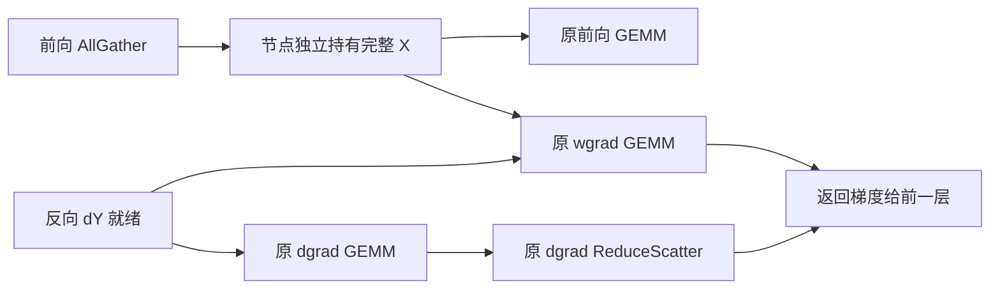

# MA8：保留前向已收集的激活，删除反向重复 AllGather

**2026-10-27，MA8-v2 八卡实测达到本轮 2% 目标。** 相对同期 F4／CR3，F4-cache 完整训练均值由 **502.381 降至 474.004 ms/step**，平均减少 **28.377 ms**；配对收益 **+5.648%［95% CI：+5.252%, +6.035%］**，8/8 个块更快。数值与实际路径检查通过，目标反向输入 AllGather 从每 rank 每步 256 次降为 0；allocated 峰值的窗口均值增加约 **0.995 GiB**。这是 **一次独立 trial**，已通过本轮门槛，尚需独立复现，详见第 10 节。

本次使用第 9 节的无新增逐调用包装版本：F4 直接使用原 column forward、linear 入口和 autograd Function；F4-cache 只保留独立保存前向激活、反向复用的机制改动。两组均不新增逐调用状态计数、输入检查或 column `record_function`。

本轮只引入一种机制：**QKV／FC1 前向 AllGather 的完整输入由该次 autograd 节点独立持有，反向 wgrad 直接复用，删除对同一输入的第二次 AllGather。** 实验名为 `F4-cache`，对照 `F4` 即 [baseline.md](baseline.md) 的 CR3。原 CR3 的 row-parallel 投影、选择性量化、producer、发布屏障、decoder＋bias/residual、LayerNorm 及其反向保持原实现。

这是一项针对现有 CR3 的新机制，不宣称激活保留这一通用思想本身是新的研究发明。它改变需要执行的通信次数，不依赖给原通信换一个等待位置，或把 wgrad 移到辅助 stream。

## 1. 为什么换这条路径

现有结果不能支持继续把局部重叠或 decoder 小改动当成 2% 的主要预算：

| 已试路线 | 同期完整训练证据 | 对 MA8 的约束 |
| --- | --- | --- |
| MA6-v2 多行 decoder tile | −0.339%，95% CI 全负 | 不继续调该 tile 来解释新机制 |
| MA6-v2 bias／AllGather 重排 | −0.680%，95% CI 全负 | 不继续添加异步 gather 和 wait 调度 |
| MA6-v3 packed mask | +0.279%，区间跨零 | 不把局部 decoder 改善当作已确认整步收益 |
| MA6-v3 同 tile 布局 | +0.251%，约 1.284 ms，单 trial | 有小幅正增量，距离约 10 ms 目标仍远；不叠加到 MA8 |
| MA7 辅助 stream 延迟 wgrad | −9.378%，约增加 48.411 ms；profile 未观察到目标重叠 | 不引入 wgrad 队列、延迟累积或新的 stream |

详见 [MA6 第 13、16 节](ma-6.md)和 [MA7 第 8 节](ma-7.md)。MA8 的改动对象是 **column-parallel QKV／FC1 的输入激活收集**；MA6/MA7 改动的主要对象是 **row-parallel Attention linear_proj／MLP FC2 的消费和反向**，二者不可混称。

MA6 中提到的 gather buffer 缓存，是为 row 反向 `grad_output` 收集减少分配／提交开销，通信本身仍需执行。这里保留的是 column **前向已得到的激活值**，目的在于删除另一次 collective，不是给 MA6 的缓冲区优化换名。

## 2. 被重复执行的工作是什么

冻结 Megatron 的 [`LinearWithGradAccumulationAndAsyncCommunication`](../../../../logs/h100/phase6/ma7-v1-wgrad-1x-50steps-20261026-171946-355178/fullstep/megatron/megatron/core/tensor_parallel/layers.py) 在 sequence parallel 下执行：

```text
前向：
    X = AllGather(x_local)       # 原来写入可复用的全局临时 buffer
    Y = X @ W.T
    保存 x_local、W

反向：
    X_again = AllGather(x_local, async=True)
    dX_full = dY @ W
    wait(input_AllGather)
    prepare_input_tensors_for_wgrad_compute(dY, X_again)
    dX_local = ReduceScatter(dX_full, async=True)
    dW = dY.T @ X_again
    原 bias gradient
    wait(ReduceScatter)
    返回原梯度
```

前后向间，这一节点的输入没有改变，前向已经获得所需的 `X`。反向再次通信是原实现选择少保留激活的代价，并不是数学上必须重新获取的数据。原实现已经让输入 AllGather 与 dgrad 有重叠，但 `handle.wait()` 在 ReduceScatter 提交之前；因此 **dgrad 完成后尚未结束的输入 AllGather，仍会推迟向前一层传播 dX**。

### 设计时的 CR3 trace 依据

只读分析使用 `ma6-v3-receiver-1x-50steps-20261026-145811-248551/fullstep/results/profile-F4/` 的八份 trace。每 rank 有 260 对该 Linear 的前后向：四个 microbatch，各 32 对 QKV／FC1 加一个 LM head。排除四次 LM head 后，目标为 **每 rank 256 次，八 rank 共 2048 次**。每次都关联到一个反向输入 AllGather、一个 dgrad ReduceScatter 和两个 GEMM。

下表先取各 rank 的角色中位数，再取八 rank 中位数，单位 μs；使用同一 rank 的 GPU 时间戳，不跨 rank 相减绝对时间。

| 目标 column-parallel 反向指标 | QKV | FC1 |
| --- | ---: | ---: |
| 输入 AllGather kernel | 802.068 | 410.673 |
| dgrad GEMM | 53.584 | 70.944 |
| wgrad GEMM | 59.792 | 71.008 |
| `max(0, AG_end − dgrad_end)` | 744.059 | 334.448 |
| dgrad 结束→ReduceScatter 开始 | 746.891 | 337.968 |
| 输入 AllGather 结束→ReduceScatter 开始 | 3.184 | 3.024 |

这些结果支持“存在一个真实的通信完成依赖”的判断。**它们不是预计可以省下的时间。** NCCL kernel 时长包含 rank 到达差异和等待；profile 又显著扰动训练。各 rank 的上述正尾部之和约 39.6–142.1 ms，差异很大，不能把它们加到历史 501 ms 上做减法。实际净收益必须来自本轮无 profiler 的完整训练配对。复算见 [analyze.py](../../../../outputs/h100/phase6/ma8-validation-20261026/baseline-analysis/analyze.py) 与 [analysis.json](../../../../outputs/h100/phase6/ma8-validation-20261026/baseline-analysis/analysis.json)，记录了八份输入 trace 的 SHA256。

## 3. MA8 的实现

```text
前向：
    X_owned = empty(full_shape)  # 本次节点独立所有；不是共享 buffer 的别名
    原 AllGather(x_local, out=X_owned)
    Y = 原 matmul(X_owned, W.T)
    保存 x_local、W、X_owned

反向：
    dX_full = 原 dY @ W
    prepare_input_tensors_for_wgrad_compute(dY, X_owned)
    dX_local = 原 ReduceScatter(dX_full, async=True)
    dW = 原 dY.T @ X_owned
    原 bias gradient
    原 wait(ReduceScatter)
    返回原梯度
```

只删除反向输入 AllGather 及其 wait。dgrad、wgrad、bias gradient、ReduceScatter、DDP `main_grad` 累积、四个 microbatch 的累积顺序和 optimizer 均使用原算术与边界。没有新计算 stream，没有把权重梯度推迟到节点返回以后。



图表示数据依赖；实际提交顺序仍是 dgrad → ReduceScatter → wgrad → wait(ReduceScatter)。没有为了画出并行关系而额外创建 stream。

### 所有权与生命周期

1. **不能保存原全局 buffer 的 view。** 后续 column projection 会覆盖它，反向将读到别的层的输入。首版让原前向 AllGather 直接写到独立 `torch.empty`，不走“全局 buffer→clone”的额外复制。
2. 缓存属于一次 forward 的 autograd context，不属于某个层永久持有的跨 step cache。每次 forward 都收集本次激活，不复用旧 batch、旧 microbatch 或参数更新前的激活。
3. 使用 `save_for_backward` 管理保存张量；保留原 local input 和 weight 的版本检查，不绕过原地修改检测。节点反向完成后按 autograd 生命周期释放，统计记录不额外持有缓存 tensor。
4. 保留原 forward collective 的可消费依赖及 backward ReduceScatter 的 wait。`async_op` 返回与 GPU 可安全使用不是同一件事，仍遵守当前 PyTorch 2.6 的 [collective 语义](https://docs.pytorch.org/docs/2.6/distributed.html#synchronous-and-asynchronous-collective-operations)与 [autograd 保存张量约束](https://docs.pytorch.org/docs/2.6/autograd.html)。
5. 八 rank 对相同 64 个模块一致启用该机制。不会只有部分 rank 删除同一 TP group 中的 collective，也没有异常后重新发 collective 的静默回退。

### 实现边界

入口为 [ma8_adapter.py](../../../../tools/h100/phase6/ma8_adapter.py)。仅覆盖每层 `.self_attention.linear_qkv` 和 `.mlp.linear_fc1`，不改 LM head 或 row-parallel 模块。安装时核对冻结 Megatron 函数身份与模型配置；不支持重计算、CUDA Graph、不同 TP／shape、梯度融合或 wgrad 延迟等组合实验。

`ColumnParallelLinear.forward` 会在每次调用内重新设置 `_forward_impl`，因此单独给该属性赋值不足以安装机制。v2 仅为候选目标实例绑定原 forward 的独立函数环境，并复制原 linear 入口的函数环境，将其最终调用的 autograd 类替换为缓存版本；这两个入口的原函数体与调用层数保持一致，不增加 dispatch 包装。F4 的实例方法、linear 入口与 autograd 类均不修改，也不安装候选适配器。

源码身份、模型配置和 64 模块覆盖只在初始化阶段检查一次，在预热及计时开始之前结束。两组均无 MA8 新增的逐调用计数、输入／指针检查、异常包装、辅助 autograd Function 或 `record_function`；原 F4 本身已有的 row 投影执行逻辑继续作为对照的一部分。

## 4. 2% 的预算与显存代价

CR3 历史均值 501.433 ms 仅用于量级估算：

```text
2% × 501.433 ms = 10.02866 ms / step
10.02866 ms ÷ 256 = 39.17445 μs / 被删除的 backward AllGather
```

因此设计时的待测假设是：删除 256 次重复通信及其提交／等待后，扣除前向独立分配、缓存压力和调度变化，平均每次能净省约 39 μs。**设计时的 trace 只能说明值得测，不能保证达到这个值。** 若原通信在无 profiler 环境下多数已被隐藏、或删除后仍等待其他 rank，收益可能很小。第 10 节给出了后续同场实测结果，不用上述局部时间估算替代整步计时。

每个完整输入为 `[2048, 1, 4096]` BF16，16 MiB；local input 为 `[256, 1, 4096]`，2 MiB。首版保留原 local input，因此新增缓存的逻辑容量为：

```text
32 层 × 2 个 column projection × 16 MiB = 1024 MiB / rank
```

原 PP1 训练依次完成四个 microbatch 的前后向，首版不跨 microbatch 保留，不能误算成四倍同时驻留。1 GiB 是新增逻辑激活容量，不是测得的 allocator 峰值；缓存释放时机、原全局 buffer、临时 GEMM 张量和内存池可能使 `allocated`／`reserved` 增量与它不同。报告给出两种峰值；缓存生命周期由原 autograd 的保存／释放机制管理，并在独立正确性测试中检查，不为此在每次调用维护状态计数。

按输入数据量计，每次 AllGather 的完整结果 16 MiB，其中远端贡献 14 MiB；删除 256 次对应每 rank 每 step 3.5 GiB 的远端有效载荷收集。该值不是 NVLink 链路实测流量，也不能用峰值带宽直接换算收益。

## 5. CR3／MA8 的实验协议

| 项目 | 固定设置 |
| --- | --- |
| 两组 | `F4`（CR3），`F4-cache`（CR3＋本机制） |
| 模型 | TP8，32 层，hidden 4096，sequence 2048，global batch 4，四个 microbatch，BF16，零 dropout |
| 原生库 | 两组源码逐文件与注册 F4 相同；原 mask、arrival order、双工作区及 decoder geometry |
| 运行环境 | 与现有启动器相同：运行 CUDA 12.4、构建 CUDA 12.8，`CUDA_DEVICE_MAX_CONNECTIONS=1`、`NCCL_NVLS_ENABLE=0` |
| 正式窗口 | 每窗 10 步预热＋50 步完整 optimizer step；取八 rank 最大窗口墙钟 / 50 |
| 配对 | 每 trial 8 个平衡 AB／BA 块，共 16 窗口、800 正式步骤；可选两个独立 trial |
| 统计 | 完整块配对对数比与 bootstrap 95% CI，所有窗口保留，不删负收益和慢窗口 |

流程为：构建 → 原 row projection 算子预检／计时／profile → 完整模型三步梯度与更新 smoke → 完整训练配对计时 → 独立训练 profile。算子阶段只证明原 CR3 native 路径未变，**并未触发 column 激活缓存，不能用它判断 MA8 加速**。

完整模型 smoke 保留每 rank 全部 **389 个参数张量**的梯度和更新指纹比较；正式窗口检查同块同 rank 的 loss、grad norm 与末态参数指纹。浮点容差不会为了让候选通过而放宽。

### 路径必须可验证

- 正式窗口不新增逐调用运行计数。候选安装的 64 模块身份在初始化后记录一次；全模型 smoke 与正式末态参数检查保留在各自原有的计时边界之外。
- 独立 profile 使用 PyTorch 自动产生的 autograd 事件与 sequence number：F4 为原 `LinearWithGradAccumulationAndAsyncCommunication`，候选为 `_MA8CachedRawLinear`；两组 LM head 均为原类，不使用自定义 column `record_function` 标记。
- 独立 profile 每 rank 的 QKV／FC1 各 128 次：两组前向输入 AllGather 各 256 次；反向输入 AllGather 从 256 降到 0；原 dgrad ReduceScatter 仍为 256 次；两个 GEMM 与 bias 梯度保持完整。原类的四次 LM head 单独识别，不能算入候选目标。
- row projection 的原 producer→发布屏障→consumer decoder→LayerNorm 及 bias→AllGather→dgrad→wgrad 仍通过检查。LM head 继续使用原实现。
- GPU 事件以 autograd sequence、CPU 调用范围、launch correlation 关联；冻结拓扑、角色 bias 行为与原 LM head 数量共同约束目标识别。旧版带包装的 Function 或自定义 column 标记不能通过 v2 验收。
- MA7 曾误拒绝原 cuBLAS 的 4-byte memset。MA8 的审计器只按准确大小、父 `mm/matmul` 调用与对应 GEMM 关联允许原有清零；column QKV 的原 bias `sum` 中 48-byte 清零也单独归类。继续拒绝未知复制／清零，不整体过滤 `gpu_memset`。

### 结果判定

报告区分三个问题：配对点估计是否达到 2%；95% CI 是否确认正增量；95% CI 下界是否达到 2%。**“确认达到 2%”要求点估计及区间下界均至少为 2%，并通过数值与实际路径检查。** 单 trial 仍属探索，两个独立 trial 均通过才有复现证据。

原始 timing 报告先产生；只有后续 profile 也通过，整个批次才算完成，不能把中途 timing 的正数直接当作最终验收。若数值或实际路径失败立即停止；若性能为负或不足 2%，保留完整结果并标记未达到，不自动换参数继续挑选。

## 6. 启动方式

在 H100 实验机的 `TempName` 目录运行：

```bash
# 仅显示计划，不创建批次目录、不查询 GPU
bash tools/h100/phase6/run_ma8.sh

# 与 run_ma6.sh 相同风格：后台启动一轮 CR3 / MA8 对比
bash tools/h100/phase6/run_ma8.sh --execute

# 两轮独立 trial，用于确认复现
bash tools/h100/phase6/run_ma8.sh --trials 2 --execute

# 需要在当前终端查看完整执行过程时
bash tools/h100/phase6/run_ma8.sh --foreground --execute
```

自定义 Python 可设置 `MA8_PYTHON=/path/to/python`；继续沿用现有 container-recovery 的环境发现方式。`--out` 可指定新的批次目录；`--ma8-build` 仅复用已经通过 MA8 身份验证的完整构建，不直接把历史 MA6／MA7 构建改名冒充 MA8。

主要结果位于启动器打印的批次目录：`batch-state.json`、`fullstep/preflight.json`、`fullstep/report.json`、`fullstep/report.md`、`fullstep/profile-summary.json`。原始 rank 数据和 trace 保留；冻结控制器支持离线复算，复算不会重写历史证据。

## 7. 验证边界

**首次上机前的 51 项本地测试全部通过，零跳过**，记录见 [validation.json](../../../../outputs/h100/phase6/ma8-validation-20261026/validation.json)：

- 12 项 adapter 检查：PyTorch `2.6.0+cu124` 的 CPU 数值执行，BF16／FP32、三次参数更新与四个 microbatch 累积、非连续上游梯度、共享 buffer 被覆盖、保存张量版本检查、64 模块完整安装与失败不留下部分补丁；还实际验证了 AMP 装饰器、CPU profiler 中的 Function 名称、autograd sequence 和标记范围。
- 9 项构建／在线 worker 检查：两组 native 源码与注册 F4 逐字节一致，篡改来源或动态库身份会拒绝；真实冻结 worker 在首次导入 Torch 前完成在线检查。测试占位库没有被加载，不属于编译或 GPU 运行证据。
- 30 项 harness／launcher／profile 检查：完整梯度和末态参数比较、平衡配对、2% 判定、负结果保留、冻结控制器独立复算，以及错误通信次数、依赖、stream、复制和未知清零的拒绝。
- 实际 shell 两轮预览确认 32 窗口／1600 正式步骤，未创建预览批次目录；生成 Python 源码与 shell 语法通过。八份历史 trace 的列／行投影检查也全部通过。

上述为首次上机前的历史验证，未覆盖实际 `inspect.getsource()` 读取类方法的缩进；安装测试当时 mock 了取源接口，因此没有发现第 8 节的问题。首次批次完成构建和独立算子阶段后，在完整训练预检退出。CPU collective 为模拟实现，这些历史验证不构成 GPU 性能证据；修复及删除包装后的 v2 八卡结果见第 10 节。


## 8. 首次上机失败与源码指纹修复

### 8.1. 失败发生在训练初始化

批次 [`ma8-v1-cache-1x-50steps-20261026-201336-451664`](../../../../logs/h100/phase6/ma8-v1-cache-1x-50steps-20261026-201336-451664/batch-state.json) 的构建、独立 row 投影算子正确性／计时／profile 已完成，随后在完整训练的第一个 `smoke-F4` 退出。八个 rank 在安装 column 激活缓存适配器时均遇到同一错误，见 [process.log](../../../../logs/h100/phase6/ma8-v1-cache-1x-50steps-20261026-201336-451664/fullstep/results/smoke-F4/process.log)：

```text
require_source(inspect.getsource(original_forward), COLUMN_FORWARD_SHA256)
RuntimeError: MA8 requires the pinned, unmodified Megatron source
```

后续 `SIGTERM` 是 torchrun 在 worker 失败后关闭其他进程。日志没有将失败指向其他进程占用 GPU 或显存不足。完整训练没有生成 `preflight.json`、正式 `report.json` 或 `profile-summary.json`；独立 row 算子完成也不代表 column 缓存机制已通过全模型验证。

### 8.2. 根因与修复范围

回传的 Megatron `layers.py` 与本地文件 SHA256 一致，源码没有发生版本漂移。错误来自预存指纹的生成方式：旧测试用 `ast.get_source_segment()` 截取类方法，首行 `def` 的四个空格被移除，其余行仍保留类内缩进；此时 `textwrap.dedent()` 无法整体去掉四个空格。运行时 `inspect.getsource()` 则保留首行缩进，整体去缩进后得到另一份文本。

| 取源方式 | 归一化后的 `ColumnParallelLinear.forward` SHA256 |
| --- | --- |
| 旧 AST 片段，首行缩进已丢失 | `fd242d309b08e9711486439da4b3881513056deb16643f2d98d241da3191a8b9` |
| 实际运行时 `inspect.getsource()` | `9ee66b4f84be3e67664610ec0311e26e8a8b2f463a0088c6a242178ba0f5bd82` |

[ma8_adapter.py](../../../../tools/h100/phase6/ma8_adapter.py) 已固定为正确的运行时指纹，并在不匹配时同时报告预期与实际 SHA256。**仍然只接受一个固定指纹**，没有删除校验、增加绕过选项或自动接受新源码；前后向数学、激活所有权、通信调度和数值门槛均未改动。

[test_ma8_adapter.py](../../../../tools/h100/phase6/test_ma8_adapter.py) 改为将原始类／方法写入临时模块，由真实 `inspect.getsource()` 读取，不再 mock 该接口。新增回归使用本批冻结源码复现旧指纹失败，并验证修复后的指纹通过；F4 和 F4-cache 均覆盖全部 64 个目标模块的安装，源码被改动、末尾模块不合法或覆盖缺失时仍必须拒绝且不留下部分安装。

### 8.3. 验证与重新启动

**修复后 52 项本地测试通过，零跳过**，见 [validation.json](../../../../outputs/h100/phase6/ma8-source-identity-fix-20261026/validation.json)。其中 [13 项 adapter 测试](../../../../outputs/h100/phase6/ma8-source-identity-fix-20261026/adapter-tests.log)覆盖真实源码读取、两组各 64 模块安装、源码漂移拒绝及原 BF16／FP32 梯度／三步更新；[39 项控制器测试](../../../../outputs/h100/phase6/ma8-source-identity-fix-20261026/controller-tests.log)覆盖冻结身份、在线 worker、完整训练报告、profile 及启动入口。修复前，同一真实取源回归已在两组安装路径复现原错误。

安装回归使用模拟层属性与真实 `inspect.getsource()`，数值测试使用 PyTorch CPU 和模拟 TP collective；这不代替 H100 运行。失败批次全部冻结脚本哈希仍与原计划一致。本次没有重新运行 GPU，也没有修改失败批次的冻结脚本、计划、报告或日志。

同步修复提交后，在 H100 容器仓库根目录启动新批次：

```bash
bash tools/h100/phase6/run_ma8.sh --execute
```

默认命令会创建新 build 和新批次。旧 build 的身份记录包含 `ma8_adapter.py` 哈希，因此**不能直接用旧 `--ma8-build` 复用，也不能就地修改原失败快照继续计时**。修复后的 800 个正式训练步骤及 profile 仍须重新完成，才能判断 MA8 是否有收益。

## 9. MA8-v2：删除额外的逐调用诊断包装

原生源码一致只能证明 native 部分一致。v1 对 F4 也安装了 `MA8ReferenceLinear`，并在两组每次前后向执行状态字典更新、输入／参数检查和 `record_function`，因此其完整执行路径与原 F4 有差别。按本次要求，**这些新增工作在两组中全部删除**。

| 路径 | v2 的执行方式 |
| --- | --- |
| F4 column 前后向 | 原 `ColumnParallelLinear.forward` → 原 linear 函数 → 原 `LinearWithGradAccumulationAndAsyncCommunication.apply`，不安装或绑定 MA8 方法 |
| F4-cache column 前后向 | 原 forward 与 linear 函数的相同 code object，初始化时替换函数环境中的类引用，直接进入 `_MA8CachedRawLinear.apply`；原来的外层 Function 和 dispatch 包装均删除 |
| 每次调用的诊断 | 删除 `CacheState`、tracker、计数／pending 字段、MA8 新增输入／指针检查、异常包装与 column `record_function` |
| 初始化与结果检查 | 源码／模型／64 模块身份只在预热前检查一次；完整梯度和参数指纹沿用原计时边界，结果离线验收 |
| 路径核对 | 另跑 profiler，通过自动 autograd 事件、sequence、kernel 关联以及四次原 LM head 验证；没有额外 column 标记 |

候选 Function 的必要差异仍然只有：前向 AllGather 写入独立张量、保存该张量，以及反向复用它并删除重复 AllGather／wait。原 F4 已有的 row 投影、GEMM、归约和训练 step 函数保持原行为。

两组旧批次约 40 ms 的步时差距没有经过隔离包装开销的同场消融，不能全部归因于包装，也不能据此认定 GPU 被其他任务占用。v2 是按要求移除额外开销后的新实验；目前不声称它消除了这 40 ms，更不把 v1 的性能结果改写为 v2 结果。

构建、训练与启动协议升级到 `h100-ma8-f4-cache-v2` 系列，默认目录前缀改为 `ma8-v2-cache-`。旧 v1 的计数记录、带包装的 profile 和构建身份均不接受为 v2 证据。历史日志与验证记录保持原样。

启动命令保持不变，执行后会创建新批次：

```bash
bash tools/h100/phase6/run_ma8.sh --execute
```

**v2 的 65 项本地测试通过，零跳过**：14 项 adapter、10 项构建／在线 worker、19 项控制器／启动器与 22 项 profile 检查。覆盖 F4 实例与方法完全不被安装过程修改、候选两个入口使用原 code object、无新增逐调用诊断，以及原 BF16／FP32 梯度和参数更新一致性。八份原 F4 trace 通过新版读取；旧 MA8 两组实际带包装的 trace 均被新版拒绝。

记录见 [validation.json](../../../../outputs/h100/phase6/ma8-v2-validation-20261026/validation.json)。以上是 v2 上机前的本地验证，记录未随 GPU 结果回写；后续八卡实测见下一节。

## 10. MA8-v2 八卡结果与离线复核（2026-10-27）

### 10.1. 完成范围与主要结论

批次 [`ma8-v2-cache-1x-50steps-20261027-002245-655981`](../../../../logs/h100/phase6/ma8-v2-cache-1x-50steps-20261027-002245-655981/batch-state.json) 已完成所有阶段，`status=completed`、`stage=done`。完整训练为 **1 trial、8 个平衡两组块、16 个窗口、128 份正式 rank 记录、800 个正式 optimizer steps**；每窗另有 10 步预热，两组各 400 个正式步骤。算子和完整训练的正确性、计时及独立 profile 均完成。

环境为 `gxn75` 的 8×H100 80GB HBM3，每卡 132 SM，PyTorch `2.6.0+cu124`、运行 CUDA 12.4、NCCL 2.21.5；继续使用原 TP8／PP1、32 层、sequence 2048、global batch 4、BF16 与选择性量化配置，`CUDA_DEVICE_MAX_CONNECTIONS=1`、`NCCL_NVLS_ENABLE=0`。

**本轮确认了完整训练正增量，且达到预先规定的 2% 门槛。** `increment_over_F4_validated["F4-cache"]`、`target_point_observed` 与 `target_validated` 均为 `true`；整轮配对区间下界为 5.252%，高于 2%。这不等于已经完成独立复现；前半／后半是同一个 trial 的两个分段。

### 10.2. 同期完整 optimizer step

来源为[完整训练报告](../../../../logs/h100/phase6/ma8-v2-cache-1x-50steps-20261027-002245-655981/fullstep/report.json)。每窗取八 rank 最大墙钟 / 50；百分比采用完整块配对对数比及 10000 次 bootstrap，正数表示候选更快。表内时间均为各范围全部窗口的算术均值。

| 范围 | 配对块 | F4 ms/step | F4-cache ms/step | F4-cache／F4 收益 %［95% CI］ |
| --- | ---: | ---: | ---: | --- |
| 前半程 | 4 | 502.015 | 475.247 | +5.333 [ +4.823, +5.840 ] |
| 后半程 | 4 | 502.747 | 472.762 | +5.963 [ +5.640, +6.415 ] |
| **完整一轮** | **8** | **502.381** | **474.004** | **+5.648 [ +5.252, +6.035 ]** |

整轮平均减少 **28.377 ms/step**；8/8 个块更快，每块减少 **23.940–33.503 ms/step**。F4 全部窗口范围为 **498.323–506.615 ms**，F4-cache 为 **470.568–477.383 ms**，没有删除慢窗口。窗口中位数为 **502.207／473.600 ms**。按每 step 8192 token 换算，吞吐为 **16306.35／17282.55 tokens/s**。

本节只比较本批同期 F4 和 F4-cache，不以历史 501.433 ms 作分母，也不把与 v1 的跨批次差值当作删除 Python 包装的净收益。第 9 节关于旧批次约 40 ms 差距的归因边界保持不变。

### 10.3. 正确性与未加包装的实际路径

[算子预检](../../../../logs/h100/phase6/ma8-v2-cache-1x-50steps-20261027-002245-655981/operator/preflight.json)通过原 row 投影的逐位前向、input／weight／bias／residual 梯度及三步更新检查。[完整训练预检](../../../../logs/h100/phase6/ma8-v2-cache-1x-50steps-20261027-002245-655981/fullstep/preflight.json)覆盖每 rank **389 个可训练参数张量**的三步梯度／参数更新指纹；正式窗口同块同 rank 的 loss、grad norm 轨迹与最终参数指纹一致。

两组 mean loss 均为 `3.793363792030723`，final loss 为 `0.00030573460389859974`，final grad norm 为 `0.01800245891878419`。这证明固定输入下本轮短程数值一致，不作长期收敛结论。

全部正式记录均使用 `retain_owned_column_input_uninstrumented`：F4 的 setup 为 `installed=false`，保留原 autograd 类；候选为 `installed=true`、`_MA8CachedRawLinear`，均登记完整 32 个 QKV 与 32 个 FC1。正式记录没有 v1 的 `ma8_activation_cache_state`；模块执行次数来自独立 profile，不是在计时循环里补回计数。

[训练 profile](../../../../logs/h100/phase6/ma8-v2-cache-1x-50steps-20261027-002245-655981/fullstep/profile-summary.json)由两组各 8 份 trace 重算。下表为每组八 rank 总数，对应每 rank 一个完整 step：

| 目标 column 路径 | F4 | F4-cache |
| --- | ---: | ---: |
| QKV／FC1 前后向配对 | 2048 | 2048 |
| 前向输入 AllGather | 2048 | 2048 |
| **反向重复输入 AllGather** | **2048** | **0** |
| 原 dgrad ReduceScatter | 2048 | 2048 |
| dgrad／wgrad GEMM，各自 | 2048 | 2048 |
| 未修改的原 LM head 调用 | 32 | 32 |

两组均没有 MA8 外层 Function 或自定义 column 标记；候选没有回退到原反向收集。四次 LM head／rank 继续执行原前后向 AllGather 与 ReduceScatter，并被排除在 256 次目标调用之外。row projection 的原 producer→发布屏障→fused decoder→LayerNorm 及 bias→AllGather→dgrad→wgrad 也完整保留。原库内清零按父算子与 launch correlation 分类通过，没有未知复制／清零混入。

### 10.4. 关键依赖确实被移除，但局部时长不作整步分账

以下取每 rank 的角色中位数，再取八 rank 中位数，单位 μs：

| column 反向指标 | F4：QKV／FC1 | F4-cache：QKV／FC1 |
| --- | --- | --- |
| 输入 AllGather kernel | 794.700／404.750 | 已删除／已删除 |
| dgrad 结束→ReduceScatter 开始 | 739.333／332.015 | 5.184／5.288 |
| dgrad GEMM | 53.416／70.976 | 41.896／49.456 |
| wgrad GEMM | 59.824／71.192 | 59.368／70.880 |
| backward CPU 区间 | 613.391／546.126 | 436.943／369.987 |

目标通信在 trace 中消失，dgrad 后的 ReduceScatter 启动间隔也明显缩短，支持本机制移除了原输入收集的完成依赖。dgrad 时长和其他通信等待也随执行上下文改变，不能把 28.377 ms 简单归为单个 NCCL kernel 时长的删除。

rank 差异仍然存在：候选 rank0 的 QKV／FC1 上述启动间隔中位数为 **81.680／59.296 μs**，其余七 rank 分别为 **4.704–5.776／4.960–5.952 μs**。因此不能从跨 rank 中位数推断所有等待都已消失，也不能跨 rank 相减未对齐的时间戳。本批独立 profile 的 GPU span 八 rank 中位数为 **830.313／778.445 ms**，明显高于正式步时；其 CPU／GPU 时间包含插桩与到达差异，只用于解释路径。正式收益仍以第 10.2 节无 profiler 的完整训练为准。

独立 row 投影算子未触发缓存机制，其结果如下，均未确认两组存在差异：

| 角色 | F4 平均 μs | F4-cache 平均 μs | 收益 %［95% CI］ |
| --- | ---: | ---: | --- |
| Attention | 93.109 | 93.112 | −0.003 [−0.384, +0.325] |
| MLP | 139.909 | 140.230 | −0.228 [−0.614, +0.082] |

这与两组原生 row 投影代码相同的设置一致；它既不否定完整训练加速，也不能用来估算 column 激活复用的收益。见[算子报告](../../../../logs/h100/phase6/ma8-v2-cache-1x-50steps-20261027-002245-655981/operator/report.json)。

### 10.5. 显存代价

每窗先取八 rank 最大峰值，再跨本组 8 个窗口汇总，单位 GiB：

| 指标 | F4 | F4-cache | 候选增量 |
| --- | ---: | ---: | ---: |
| allocated 峰值的窗口均值 | 16.428879 | 17.423455 | +0.994575 |
| allocated 峰值的窗口最大值 | 16.429282 | 17.423455 | +0.994173 |
| reserved 峰值的窗口均值 | 16.638672 | 17.638672 | +1.000000 |
| reserved 峰值的窗口最大值 | 16.638672 | 17.638672 | +1.000000 |

allocated 均值约增加 **1018.45 MiB**，reserved 增加 **1024 MiB**，与第 4 节新增约 1 GiB 逻辑激活的量级一致。它们是实际 allocator 峰值，不要求与逻辑容量逐字节相等。

### 10.6. 复核范围与后续

使用回传的冻结控制器，以 `offline=True`、`save=False` 重算**算子报告、算子 profile、完整训练报告和训练 profile**，四份均与回传 JSON 逐字段一致；另外从全部 128 份正式 rank 记录独立重算窗口步时、8 个配对块、前半／后半／整轮 bootstrap 和显存汇总，均一致。

**38 份冻结脚本／配置、1383 份 Megatron 快照文件**通过计划哈希校验，启动时登记的 **61 个控制器依赖**与当前仓库一致。两组登记的 **354 份原生源码身份相同**，但该事实单独不代表完整执行路径一致；本批另有 v2 setup 和无包装 trace 验证。回传没有服务器 `build/` 与动态库本体，因此未重新加载或验证二进制本体。12 份关键计划、预检、报告及状态文件在复核前后哈希不变。

复核入口与结果见 [audit.py](../../../../outputs/h100/phase6/ma8-v2-results-audit-20261027/audit.py)、[audit.json](../../../../outputs/h100/phase6/ma8-v2-results-audit-20261027/audit.json)。本次只更新实验文档和新增离线复核记录，未修改运行实现、历史报告或日志，也未重跑 GPU。

**结论：MA8-v2 在本轮已达到 2% 目标，保留为有明确收益证据的候选。** 下一步以相同代码、配置和数值门槛再运行独立 trial，确认约 5.65% 的增量能否复现；暂不把本次单轮结果提升为稳定默认基线，也不把它与 MA6 的小幅布局收益相加。
