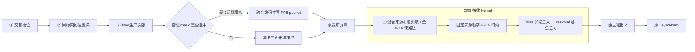

# H100 核心思路：交替顺序 → 到达优先＋选择性量化 → 接收端预取

更新：2026-10-26。本文仍以 **交替顺序、到达优先＋选择性量化、接收端预取** 为三大策略：先让各目标分区轮流获得生产槽位，再根据到达观测提前安排近临界贡献并选择其传输表示，最后在接收端把下一来源的读取提前到当前来源的计算期间。

当前完整实现统一称为 **CR3**，对应 [MA4-F 消费链融合](New-Mechanism/ma-4.md) 中的 **F4**；原始脚本、构建与报告仍使用 `F4` 标识。本次改名不代表产生了一次新的 GPU 实验。本文以 GPT6.7B、TP8 的 Attention/MLP 输出投影说明机制，当前方案对照使用 **A、C、R、CR3**；B、CR、CR2 仅在解释历史消融或实现继承时出现。

CR3 同时包含双工作区、原生提交缓存，以及归约后的 bias/residual 消费融合。它们是三策略落地时的配套工程，不另列第四大策略，也不能把其收益全部算作“预取收益”。汇总数据与命名见 [新机制 baseline](New-Mechanism/baseline.md)，机制消融见 [MA1](New-Mechanism/ma-1.md)、[MA2](New-Mechanism/ma-2.md) 和 [组合实验](New-Mechanism/ma-2-ablation.md)。**三策略的叙述沿生产、传输表示和消费的数据流展开，不表示逐层收益可以相加。**

| 层次 | 要回答的问题 | 实际改变什么 |
| --- | --- | --- |
| **交替顺序** | 不同目标 GPU 的贡献，按什么节奏生产？ | GEMM 逻辑槽位到输出 tile 的映射 |
| **到达优先＋选择性量化** | 同一目标内哪些贡献应提前？哪些远端贡献值得使用压缩表示？ | 分区内置换表，以及按来源、物理 tile 记录的量化 mask |
| **接收端预取** | 数据已经发布后，怎样减少“读一个来源、算完、再读下一个”的等待？ | decoder 内下一来源的加载时机、连续系数打包和寄存器布局；来源累加顺序不变 |

三者操作的对象不同：交替顺序分配**目标的生产槽位**，到达优先调整**同一目标内的贡献顺序**，选择性量化决定**物理贡献的数据格式**，预取安排**已发布数据的读取时机**。到达优先与选择性量化共用同一份离线到达计划，因此合为第二大策略。

## 1. 先明确：一个输出 tile 需要八个来源的贡献

### 1.1. 来源、目标与贡献

行并行线性层把输入维度 K 分给八张 GPU。来源 GPU s 持有输入分片 X_s 和权重分片 W_s，计算：

$$
C_s=X_sW_s^{\mathsf T},\qquad Y=\sum_{s=0}^{7}C_s.
$$

每张 GPU 计算的是完整输出形状上的一份**部分和**。ReduceScatter 再将最终 Y 的不同行分区交给不同目标 GPU。对于归目标 d 的一个输出 tile t，最终结果为：

$$
Y_d(t)=\sum_{s=0}^{7}C_{s\rightarrow d}(t).
$$

因此需要区分三个对象：

- **来源 s：** 哪张 GPU 计算了这一份部分和。
- **目标 d：** 哪张 GPU 最终持有这一块归约结果。
- **物理 tile t：** 这一块数据在完整输出矩阵中的真实坐标。

`来源 s 对 tile t 的贡献`是排序和量化的基本分析单位。对于同一个 tile，来自八个来源的贡献必须相加；不能把它们误解为八份可任选其一的副本。`s=d` 是本地贡献，`s≠d` 是远端贡献。本地贡献始终保留 BF16。

### 1.2. 当前形状下有多少 tile

本页覆盖 Attention 输出投影和 MLP 输出投影：

| 角色 | 模块 | 全局 `[M,N,K]` | 每来源本地 K |
| --- | --- | --- | ---: |
| Attention | `self_attention.linear_proj` | `[2048,4096,4096]` | 512 |
| MLP | `mlp.linear_fc2` | `[2048,4096,16384]` | 2048 |

两者的输出形状相同，GEMM 工作量不同，因此使用各自的到达计划。这里的 Attention 指输出投影，不包括 Q/K/V、QK、Softmax 或 AV 的改写。

输出按 `128×128` 分块，共 `16×32=512` 个物理 tile。目标 GPU 各持有 256 行，即两行 tile、共 64 个 tile。对于每个来源，它生产的 512 份贡献中，有 64 份归自己、448 份归其他目标。

```text
一个来源的完整输出贡献：2048 × 4096
  目标0：行    0～255，64个tile
  目标1：行  256～511，64个tile
  …
  目标7：行 1792～2047，64个tile

每个目标最终把八个来源的对应分区相加，得到自己的 256 × 4096 输出。
```

### 1.3. 为什么要关心最后到达的贡献

设 A_s(t) 是来源 s 对 tile t 的完整贡献在接收端的到达时刻，则该 tile 收齐的时刻为：

$$
J(t)=\max_s A_s(t).
$$

例如八份贡献在 `8、9、9、10、10、11、12、16 μs` 到达，收齐时间是 16 μs。把原来 8 μs 的贡献提前，通常不能改变收齐时间；把 16 μs 的贡献提前到 11 μs，收齐时间才可能下降到 12 μs，此时原来 12 μs 的贡献成为新的限制。

这是贡献级调度的动机。**J(t) 只描述数据何时齐备。** 当前实现还存在整个 GEMM 之后的发布屏障、解码和有序归约，因此 tile 更早齐备不等于它已经被消费，更不等于完整训练步已经同比加速。

## 2. 第一策略：交替顺序，让各目标分区轮流获得生产槽位

### 2.1. 要解决什么问题

如果逻辑上先安排完目标 0 的 64 个 tile，再安排目标 1，最后才安排目标 7，那么不同目标获得生产机会的时间会不均衡。后面目标的贡献可能较晚才开始生成。

交替顺序将目标分区穿插安排：每轮给每个目标一个槽位，再进入下一轮。来源 s 从自己的本地目标开始，随后按相对 rank 偏移轮转：

```text
来源0：目标0、1、2、3、4、5、6、7、0、1、2、3、…
来源1：目标1、2、3、4、5、6、7、0、1、2、3、4、…
来源3：目标3、4、5、6、7、0、1、2、3、4、5、6、…

对每个来源都是：本地、远端1、远端2、…、远端7，然后重复。
```

TP8 中的“交替”是**八个目标分区轮转**，不是本地、远端各占一半，也不是八张 GPU 轮流串行运行。各 GPU 仍并行计算，交替描述的是每个来源内部的逻辑 tile 排列。

### 2.2. 槽位如何映射到物理 tile

当前形状下，来源 s 的第 i 个逻辑槽位按以下规则映射：

```python
destination = (s + i % 8) % 8
within = i // 8
tile_m = destination * 2 + within // 32
tile_n = within % 32
physical_tile = tile_m * 32 + tile_n
```

`i % 8` 决定这一槽轮到哪个目标；`i // 8` 决定该目标内部推进到第几个 tile。以来源 0 为例：

| 逻辑槽位 i | 目标 | 目标内序号 | 物理 tile |
| ---: | ---: | ---: | ---: |
| 0 | 0 | 0 | 0 |
| 1 | 1 | 0 | 64 |
| 2 | 2 | 0 | 128 |
| 3 | 3 | 0 | 192 |
| 7 | 7 | 0 | 448 |
| 8 | 0 | 1 | 1 |
| 11 | 3 | 1 | 193 |

每个目标的槽位间隔八个位置。完整 512 个槽位覆盖所有输出 tile，不重复、不遗漏，也不改变输出最终属于哪个目标。

### 2.3. 为什么可能有帮助，以及它还没有解决什么

这种排列为不同目标较早、持续地提供贡献，也使远端写入有机会与后续 tile 的计算重叠。实现通过 GEMM tile swizzle 改变生产映射，不改变矩阵乘法本身的数学内容。

但是，交替顺序只决定“这一槽轮到哪个目标”，目标内部仍按照基础 tile 顺序推进。它不知道目标 3 的 tile 192 和 tile 241，究竟哪个更可能拖尾。

此外，**逻辑槽位靠前不保证物理完成时间一定靠前**。CTA 并发、Stream-K 依赖和访存等仍会影响完成顺序。因此下一层需要真实到达观测。基础映射实现见 [build.py](../../../tools/h100/phase6/build.py) 和 [scope_build.py](../../../tools/h100/phase6/scope_build.py)。

## 3. 第二策略：到达优先＋选择性量化，分别调整生产时机与传输表示

这两项机制共用到达信息，但承担不同任务：**到达优先决定先生产哪份贡献，选择性量化决定哪份远端贡献使用 FP8 表示。** 当前 C 与 CR3 使用相同的冻结原到达表和选择计划；CR3 沿用 CR/CR2 的计划，没有因接收端融合而重新采样或更换 mask。

### 3.1. “到达优先”优先的是预计较晚的近临界贡献

这里不是“谁先到了就先相加”。接收端的来源相加顺序不变；改变发生在生产端，目标是提前安排可能拖延汇合的贡献。

先以基础 BF16 路径做离线校准，在接收 GPU 上观察来源贡献的发布标记。一个 `128×128` tile 的贡献由八个 epilogue fragment 组成；每个 fragment 对应 16 行。必须取这八个 fragment 的最晚观测，才代表这一来源的完整 tile 已被观察到。

不同来源统一使用同一个接收 GPU、同一次调用的起点归一化：

$$
A_s^{(p)}(t)=\max_f \operatorname{observed}^{(p)}(s,t,f)-\operatorname{start}^{(p)}_d.
$$

这样避免直接比较不同 GPU 的绝对时钟。观测仍包含标记传播、轮询延迟和采样扰动，适合作为排序标签，不能直接当成纯网络延迟。

原计划采用三遍稀疏观测：pass 0、1 用于拟合，pass 2 仅作留出诊断。不同 tile 可能来自不同调用，不是一条无扰动的全输出联合时间线。正式运行使用冻结表，不携带这套采样器，也不逐次在线重排。

### 3.2. 如何确定哪些贡献值得提前

对训练遍次 p，先计算 tile 的汇合观察 `J_p(t)=max_s A_s^(p)(t)`。来源 s 只有在两遍训练观察中都接近最后到达，才进入优先集合：

$$
J_p(t)-A_s^{(p)}(t)\le\varepsilon_p(t),\qquad p\in\{0,1\}.
$$

其中误差带 ε 取该次记录两倍的最大轮询周期，用于容纳采样分辨率内的近似并列。准入后，其 `tail` 分数为：

$$
P_s(t)=\max\left(0,\operatorname{median}_{p\in\{0,1\}}J_p(t)\right).
$$

未准入或缺少有效训练观测的贡献记零分。分数表达两件事：这个来源持续接近该 tile 的最后到达者；这个 tile 本身收齐得较晚。

例如 tile X 在 10 μs 收齐，tile Y 在 20 μs 收齐，即使 X 最后来源与其他来源的差距更大，`tail` 仍会优先考虑 Y 的近临界来源。它关注晚汇合，而不是只关注同一个 tile 内的到达偏斜。

该评分是启发式，没有直接计算每次交换能节省多少完整 step 时间。当前工具还支持其他排序策略；**本页解释的是 C/CR3 沿用的冻结原计划，不把新策略与历史表混为同一个版本。** 评分和置换逻辑见 [arrival/plan.py](../../../tools/a800/arrival/plan.py)，H100 计划入口见 [phase6/plan.py](../../../tools/h100/phase6/plan.py)。

### 3.3. 如何提前贡献，又不破坏交替顺序

先固定每个目标的槽位集合，再在同一目标的合法窗口内按分数稳定降序排列。当前窗口为每目标 64 个槽位，恰好覆盖当前形状下该目标的全部 64 个 tile。

以来源 0、目标 3 为例，合法槽位是：

```text
3、11、19、27、…、507
```

到达优先可以交换这些槽位上安排的 tile，但不能把它们放到目标 0 或目标 4 的槽位中。**窗口 64 指同一目标的 64 个槽位，不是全局相邻的 64 个位置。** 同分时保持基础顺序。

下面是当前 C 的 Attention 冻结计划中的真实例子：

| 来源 0 的槽位 | 3 | 11 | 19 | 27 | 35 | 43 | 51 | 59 |
| --- | ---: | ---: | ---: | ---: | ---: | ---: | ---: | ---: |
| 基础交替的物理 tile | 192 | 193 | 194 | 195 | 196 | 197 | 198 | 199 |
| 到达置换后的物理 tile | 241 | 247 | 255 | 227 | 229 | 231 | 235 | 234 |
| 目标 | 3 | 3 | 3 | 3 | 3 | 3 | 3 | 3 |

tile 241 的坐标是 `(tile_m=7, tile_n=17)`，归目标 3。基础交替中，它位于槽位 `49×8+3=395`；原到达表将它提前到槽位 3。目标分区不变，整个置换仍完整覆盖原 tile 集合。

实现中设备查表返回的是原逻辑槽位，之后再经过基础交替映射：

```text
新的逻辑槽位 i → maps[source][i] → 基础交替映射 → 物理 tile

实际例子：i=3 → maps[0][3]=395 → physical_tile=241
```

计划中的 `coords` 记录最终物理坐标，便于核验；不能将设备置换表的值直接当作物理 tile 编号。

### 3.4. 为什么还要选择性量化

提前生产可以缩短生产等待，但远端贡献仍需要传输。量化把 BF16 数据变为更小的 FP8 载荷，有机会缩短这部分工作，同时增加编码、尺度处理和解码成本，并引入误差。

因此需要权衡：

```text
可能节省：远端数据传输及相关访存
新增成本：编码＋元数据＋解码＋混合路径管理
```

当前方案没有逐 tile 测量这两项的净差值，而是沿用同一份 `tail` 分数，在有限预算内选择近临界远端贡献。它是一套可执行的选择规则，不是已求解的最优通信计划。

具体规则为：

1. 排除本地贡献，只允许 `source != destination`。
2. 仅考虑正分远端贡献。
3. 每个来源独立按分数降序选择，同分按物理 tile 编号升序。
4. 最多选择该来源远端 tile 数的 `1/64`，不足时不补满。

每个来源有 448 个远端 tile，因此预算上限为 `floor(448/64)=7`。这是**每个来源合计最多 7 份贡献**，不是给每个目标各 7 份，也不是强制每个来源都量化 7 份。

当前 C/CR3 使用的冻结 mask 为：

| 角色 | 各来源选中数，按 rank 0～7 | 总选中贡献 / 全部远端贡献 | 覆盖率 |
| --- | --- | ---: | ---: |
| Attention | `[7,7,7,7,4,7,7,7]` | 53 / 3584 | 1.479% |
| MLP | `[7,7,7,7,1,7,7,7]` | 50 / 3584 | 1.395% |
| 两种角色合计 | — | 103 / 7168 | 1.437% |

上面的置换例子与 mask 均来自同一份 [baseline 冻结 selection-plan.json](../../../logs/h100/phase6/baseline-taco-cuda-3x-50steps-20261021-162929-989672/compare1/scripts/selection-plan.json)，它与 [CR3 批次冻结计划](../../../logs/h100/phase6/ma4-f-1x-50steps-20261025-115124-977713/fullstep/scripts/selection-plan.json)逐字一致。旧版双角色实验中的 45/39 个选中贡献属于另一份历史计划，不是当前 C/CR3 的 mask。选择逻辑见 [phase5/plan.py](../../../tools/a800/phase5/plan.py)。

### 3.5. 量化身份必须跟着物理贡献走

仍看来源 0、目标 3、tile 241 的例子：

```text
生产位置：原槽位395 → 新槽位3
量化身份：mask[0][241] = 1，始终跟着来源0的物理tile241
错误查询：mask[0][3] = 0，它描述的是另一个物理tile
```

同一 tile 241 的八来源 mask 实际为 `[1,0,0,0,0,0,0,0]`。也就是说，只量化来源 0 的这一份贡献；来源 3 的本地贡献，以及其他六个远端来源，都保留 BF16。

这说明两个表的职责不同：**置换表回答“这个槽位计算谁”，mask 回答“这份物理贡献用什么表示”。** 排序不能改变量化身份；接收端也必须用相同物理 tile 和来源查询 mask，才能正确选择 BF16 或 FP8 路径。

### 3.6. 选中的贡献实际怎样量化

量化选择粒度是 `128×128` tile；codec 的处理粒度是 tile 中每行的 128 个数，即一个 H128 组。选中 tile 的 128 行分别编码：

```text
GEMM 的 BF16 输出贡献
  → 根据组内统计得到 adaptive scale a
  → 缩放并做归一化 H128 Hadamard 变换
  → 根据变换系数得到 quant scale q
  → E4M3 FP8 系数＋q＋a
  → 写入目标 GPU 的该来源 packet 区域
```

接收端执行反向过程：FP8 转浮点、乘 q、逆 Hadamard、除 a，再按原规则舍入到 BF16。归一化 Hadamard 在理想实数下可逆，但 FP8 转换和浮点运算仍有误差。

每个 H128 组的 BF16 数据为 `128×2=256` 字节；量化载荷为 `128` 字节 FP8 加两个 FP32 scale，共 `136` 字节，减少 **46.875%**。这是逻辑载荷，不含所有协议、同步及工作区管理成本。

当前只有约 1.4% 的远端贡献被选择，所以**相对全 BF16**，总远端逻辑载荷的减少不到 1%；即使选满 `1/64`，上限也约为 `46.875%/64=0.732%`。**相对全远端量化的 A/R，C 与 CR3 反而传输更多 BF16 数据，却减少了大量 codec 工作。** 两种对照解释的是不同权衡。

编码融合在 GEMM epilogue 中，选中远端贡献写 FP8 packet，跳过其远端 BF16 写入；其他贡献走 BF16。基础 codec 见 [taco_codec.cuh](../../../src/gemm_rs/taco_codec.cuh)，packet 和选择条件见 [taco_runtime.h](../../../src/gemm_rs/taco_runtime.h)；具体实验版本以对应构建 manifest 为准。

### 3.7. 两项机制如何协同，以及为什么收益不一定叠加

到达优先与量化 mask 都从**同一份基础 BF16 校准**生成，然后冻结后一起执行。当前流程不是“先重排，重新测量，再对剩余拖尾贡献量化”，也没有每步在线更新临界来源。

设计上，提前生产和缩小载荷可以共同帮助一个晚到贡献。但其中一个生效后，另一个来源可能成为最后到达者；编码本身也可能推迟生产完成。当前接收端又要等整个发布屏障，因此局部 tile 提前未必缩短实际等待。

这正是到达优先多次复测中增量不稳定的一个可解释方向，但还不能将其当作已被单因素实验证明的唯一原因。后续预取转而优化发布之后仍必需执行的消费工作。

## 4. 第三策略：接收端预取，把下一来源的读取提前到当前来源计算期间

### 4.1. 预取发生在什么地方

先把 CR3 的投影与后继消费路径画出来：



预取位于图中的**接收端读取或解码阶段**。发布屏障之前，生产者已把远端贡献写入目标 GPU；屏障之后，decoder 从目标 GPU 的来源独立缓冲读取数据。

预取将下一来源的 FP8 payload 和两个 scale，或者下一来源的 BF16 数据，提前加载到寄存器。它不提前启动网络传输，也没有让 GEMM 与 decoder 跨 kernel 并发；本实现不是 `cp.async` 搬到 shared memory 的流水线。

### 4.2. 关键依赖：读取下一来源，不需要等待当前来源的结果

原消费过程可以抽象为：

```text
读来源1 → 解码1 → 累加1 → 读来源2 → 解码2 → 累加2 → …
```

下一来源的地址由配置、来源编号和 H128 组号决定，与当前来源的解码结果无关。因此可以把读取提前：

```text
先读来源1
发射来源2读取 → 解码来源1 → 累加来源1
发射来源3读取 → 解码来源2 → 累加来源2
…
提前读本地BF16 → 解码最后远端 → 累加最后远端 → 累加本地
```

如此，当前来源的 Hadamard 和归约计算为下一来源的数据读取提供了隐藏延迟的机会。程序同时保留“当前来源”和“下一来源”两份寄存器状态。

但累加器有真实数据依赖：第 j 次累加必须使用第 j−1 次的结果。**可以提前读，仍须按原顺序相加。** 对目标 d，来源顺序固定为 `(d+1)%8, …, (d+7)%8, d`，本地来源最后加入，不按实际到达先后重新求和。

### 4.3. 来源间流水线：MA1 提供的直接预取对照

MA1 让每个 warp 处理一个 H128 组，每个 lane 持有四个系数：

```text
lane l：l、l+32、l+64、l+96
```

warp 的 32 个 lane 合起来覆盖全部 128 个系数。当前来源进行 Hadamard、缩放和 BF16 累加时，提前发射下一来源的四个 FP8 字节与两个 scale 的读取。本地贡献只读 BF16，不读本地 FP8 packet。

MA1 用 W/P 对照隔离预取：W/P 的线程布局与算术相同，W 即时读取，P 提前读取；P/A 还包含接收端 warp 布局等共同变化，不能全部视为纯预取收益。实现见 [ma1_decode.cuh](../../../tools/h100/phase6/ma1_decode.cuh)，实验见 [MA1](New-Mechanism/ma-1.md)。

### 4.4. 当前打包方式：连续四个系数一次读取

MA1 每 lane 的四个系数分散，需要四条 byte load。MA2 改变系数在 lane 之间的分配：

```text
lane l：4*l、4*l+1、4*l+2、4*l+3
```

四个连续 FP8 字节恰好组成一个 32-bit 数据，可以一次对齐读取，并先以一个原始寄存器保存，使用时再转换。R 与 CR3 的量化来源读取都沿用这套布局；CR3 再根据 mask 选择 FP8 或 BF16 来源。

| 每 lane 的操作 | MA1 P | MA2 V 及其后继 decoder |
| --- | --- | --- |
| 四个系数的位置 | 间隔 32 | 连续四个 |
| FP8 payload 读取 | 四条 8-bit load | 一条 32-bit load |
| 两个 scale | 两条 FP32 load | 两条 FP32 load |
| FP8 转换 | 单值转换 | 两次 FP8x2 转换 |
| 本地四个 BF16 / 最终输出 | 分散读取或写回 | 连续 64-bit 读取或写回 |
| 下一来源预取 | 保留 | 保留 |

这里的“打包”改变寄存器组织和读取宽度，**不改变网络 packet 布局，也不减少通信字节数**。payload 的组偏移为 `128*group`、lane 偏移为 `4*lane`，满足 4 字节对齐；四个 BF16 为 8 字节，并满足对应对齐。PTX 的内存访问要求地址按访问宽度自然对齐，见 [CUDA 12.8 PTX 内存操作数说明](https://docs.nvidia.com/cuda/archive/12.8.0/parallel-thread-execution/index.html#addresses-as-operands)。

系数归属改变后，Hadamard 的距离 1、2 两级在每个 lane 的四个寄存器内部进行，其余距离 4、8、16、32、64 用 warp shuffle。每个物理系数经历的变换顺序仍是原顺序；没有交换数学阶段。

具体实现见 [ma2_decode.cuh](../../../tools/h100/phase6/ma2_decode.cuh)。inline PTX 的 `volatile` 和 `memory` 约束用于限制编译器优化，但源码先写 load 并不证明实际延迟已被隐藏；还需核对 PTX/SASS 的发射顺序、寄存器和 spill，再看计时。[CUDA 12.8 Inline PTX 说明](https://docs.nvidia.com/cuda/archive/12.8.0/inline-ptx-assembly/index.html#incorrect-optimization)

### 4.5. 数值顺序为什么不能随预取一起改变

对 FP8 来源，原实现至少有两个 BF16 舍入点：先把该来源解码结果舍入 BF16，再与 BF16 累加器相加并舍入。对每个输出元素，可简写为：

$$
v_j=\operatorname{BF16}(\operatorname{decode}(packet_j)),\qquad
acc_j=\operatorname{BF16}\bigl(\operatorname{FP32}(acc_{j-1})+\operatorname{FP32}(v_j)\bigr).
$$

BF16 来源直接使用其原值。本地来源最后加入。预取只移动读数据的时间，保留这些舍入点和来源顺序。

不能先用 FP32 把所有来源加完再舍入，也不能把多个来源的逆 Hadamard 合成一次后声称逐位等价。MA2 还对量化尺度乘法使用显式舍入，避免连续寄存器布局让编译器把乘法与加减合并成 FMA，改变原结果。

### 4.6. 与第二策略结合：CR3 的混合来源流水线

MA2 V/R 使用全远端量化；C 与 CR3 只量化很少的贡献，接收端必须依据 mask 选择数据格式。CR3 继承 CR/CR2 对 MA2 打包预取的混合适配：

- 一个 H128 组的全部来源均为 BF16 时，保留 C 原有 packed BF16 快路径，不强制进入 FP8 解码，也不将该分支算作新增混合预取路径。
- 至少一个远端来源被选中时，执行混合来源流水线：选中者读取 FP8 和两个 scale，其他来源直接读取 BF16，并提前载入下一来源。
- 不读取未选中来源的 FP8 packet，避免把工作区中未更新的旧内容当成当前数据。

继续使用 tile 241 的真实例子：目标是 rank3，只有 source0 被量化。其消费顺序为：

```text
source4 BF16 → source5 BF16 → source6 BF16 → source7 BF16
  → source0 FP8解码 → source1 BF16 → source2 BF16 → source3本地BF16
```

可以在处理 source7 时提前读取 source0 的 FP8/scale，在解码 source0 时提前读取 source1 的 BF16；相加顺序始终保持上面这一条链。到达优先将 source0 的 tile241 安排到更早的生产槽位，mask 决定其 FP8 身份，预取决定接收后何时加载下一份数据，三者各有明确位置。

混合实现见 [ma2_c_decode.cuh](../../../tools/h100/phase6/ma2_c_decode.cuh)。由于选择性量化覆盖稀疏，显式 current/next 混合流水线的适用范围也有限；全 BF16 分支保留原 packed BF16 快路径。**不能把所有 CR3 调用都描述成新增预取路径，也不能把全远端量化条件下的收益直接套到 CR3。**

### 4.7. CR3 的接收端配套：在同一 kernel 完成 bias/residual 消费

第三策略的核心仍是提前读取下一来源。CR3 在此基础上进一步缩短接收结果交给后继算子的过程：保留八来源归约，随后在 decoder 内完成原来两个独立的 bias/residual 加法。

设 P 是已按原来源顺序归约并舍入的 BF16 投影结果，b 是 bias，r 是当前子层的 residual。零 dropout 配置下，CR3 写出：

$$
u=\operatorname{BF16}(P+b),\qquad Z=\operatorname{BF16}(r+u).
$$

```text
历史 CR2：decoder 写 P → 独立 bias add 写 u → 独立 residual add 写 Z → 原 LayerNorm
当前 CR3：decoder 内得到 P → bias 舍入 → residual 舍入 → 写 Z → 原 LayerNorm
```

bias 只在八来源归约完成后加一次，不参与逐来源累加；两次 BF16 舍入保持独立，不能合并成一次 FP32 三项求和。融合同时覆盖全 BF16 快路径与混合预取分支，后继 LayerNorm 保持原实现。`Z` 由本次调用独立拥有，反向仍返回 input、weight、bias、residual 四类梯度。

这减少了接收结果的中间读写与两个独立 kernel 提交；每 rank 每 step 的 256 次目标投影共删除 **512 次独立 add kernel**。这是消费融合的路径变化，不是预取单独带来的效果。实现见 [ma4_f_sources.py](../../../tools/h100/phase6/ma4_f_sources.py) 和 [ma4_f_adapter.py](../../../tools/h100/phase6/ma4_f_adapter.py)，数值与整步证据见 [MA4-F 实测](New-Mechanism/ma-4.md#6-本轮-ma4-f-结果相对-cr2-有端到端增量)。

### 4.8. 为什么预取仍可能没有整步收益

预取只是创造延迟重叠的机会，实际效果取决于当前计算能覆盖多少读取延迟，以及 GPU 是否原本就能通过多个 warp 隐藏等待。当前与下一来源同时存活还会增加寄存器压力，可能降低并发度或产生 spill。

即使 decoder 变快，它也只占训练步的一小部分；CPU 提交、其他计算或跨 rank 等待仍可能限制后继执行。需要分别看 decoder、完整算子和完整 optimizer step，不能把三个层次的百分比互相替代。

## 5. 三策略如何组成当前 CR3：计划、执行与工作区复用

### 5.1. 离线只决定表，在线执行实际计算

```text
离线：
  两种 shape 分别进行基础 BF16 到达校准
    → 用训练采样计算 tail 分数
    → 在目标分区约束内生成置换表
    → 从同一份分数生成物理贡献 mask
    → 冻结 shape、置换、mask 与校准身份

在线，以 CR3 为例：
  选择对应 shape 的原生实例与当前工作区槽，更新本次动态指针
    → GEMM 按交替槽位＋到达置换生产物理 tile
    → epilogue 按 mask 写 BF16 或编码后的 FP8
    → 原跨 rank 发布屏障
    → 全 BF16 快路径，或混合来源打包预取
    → 固定来源顺序 BF16 归约
    → 同一 decoder 内：bias 加法舍入 → residual 加法舍入
    → 返回本次调用独立拥有的 Z，再进入原 LayerNorm
```

正式路径没有在线到达采样，没有按实时先后改变求和顺序。Attention 和 MLP 按精确 shape、尤其本地 K=512/2048，使用各自计划。

### 5.2. C/CR3 的双工作区与 decoder 预取是两件事

双工作区是两套完整的 IPC 数据区，每套包含 BF16 来源缓冲和 FP8 packet。相邻调用交替使用：

```text
调用 k：   槽0，GEMM → 发布屏障 → 接收 consumer
调用 k+1： 槽1，GEMM → 发布屏障 → 接收 consumer
调用 k+2： 槽0，重新使用 k 的工作区
```

每个 rank 的 GPU 工作在各自固定的 stream 上，先完成调用 k 的接收 consumer，才能执行调用 k+1 的发布屏障；CR3 的 consumer 包括 bias/residual 消费。该屏障要求所有 rank 到达，所以一旦通过，就知道所有 rank 已经读完调用 k 的槽0；下一次 k+2 可以安全覆写其 BF16/FP8 缓冲。这是 GPU 执行依赖，CPU 可以提前排队，不要求每次调用都做主机同步。

因此可以省掉单工作区原本需要的“解码之后再约定可以复用”的独立屏障，但**每次 GEMM 后的发布屏障仍保留**。前提是各 rank 调用顺序一致、stream 固定。它不表示同一 rank 的两个 GEMM 同时运行。

| 对比项 | 双工作区 | 来源预取 |
| --- | --- | --- |
| 管理对象 | 跨调用的完整 BF16/FP8 工作区 | 同一次 decode 中当前与下一来源的数据 |
| 存储位置 | GPU 全局内存与 IPC 资源 | warp 寄存器 |
| 要解决的问题 | 上一次调用仍在读取时，何时可以安全复用 | 当前来源计算期间，能否先读下一来源 |
| 主要依赖 | 跨 rank 发布屏障与 stream 顺序 | 数据地址独立、算术仍有序 |

双工作区实现与安全条件见 [GemmRSTacoDoubleBuffered](../../../python/flux/gemm_rs_taco.py)。输出 Tensor 则由每次调用独立拥有，不能把工作区复用理解为旧输出会被覆盖。

### 5.3. 当前 A、C、R、CR3 的对应关系

| 方案 | 生产顺序 | 远端量化 | 接收端 | 工作区与提交 |
| --- | --- | --- | --- | --- |
| **A** | 基础交替 | 全远端 | 原融合 v2 scalar decoder | 单工作区、两道屏障、逐次配置、输出 clone |
| **C** | 交替＋原到达表 | 冻结选择性 mask | 原混合 BF16/FP8 decoder | 双工作区、一道发布屏障、实例配置、独立输出 |
| **R（MA2-R）** | 基础交替 | 全远端 | MA2 连续系数打包预取 | 单工作区、两道屏障、实例配置、独立输出 |
| **CR3（原 F4）** | 与 C 相同 | 与 C 相同 | BF16 快路径／混合来源打包预取，归约后融合 bias/residual | 双工作区、原生提交缓存、一道发布屏障、独立消费输出 |

从机制覆盖看，**A 包含第一策略，C 包含第一＋第二策略，R 包含第一＋第三策略，CR3 同时包含三策略**。A/R 实际使用全远端量化；C/CR3 使用同一选择性 mask。A→C→CR3 可以作为理解组合的主线，R 则保留为全远端量化条件下的接收端对照。它们的工程路径也有差异，不能把整组比较直接视为严格的单因素消融。

历史版本用于拆开这些变化：B 在 A 上增加到达置换；CR 把混合打包预取接到 C；CR2 在 CR 上缓存原生 operator/固定信息，减少重复查找与中间视图；CR3 再融合归约后的 bias/residual 消费。R 与原 MA2 V 的 decoder 相同，R/V 主要比较配置提交与独立输出路径。

CR3 沿用的提交缓存仍逐次更新动态 input/weight 指针、执行 CUTLASS 初始化和必要 workspace 清零，不缓存旧权重结果。Attention/MLP 的 K=512/2048 和两个工作区槽分别保持绑定身份。双工作区、提交缓存和消费融合均可影响完整步时，因此要分别说明其贡献；**当前 CR3 没有启用 CUDA Graph，也没有把 MA6 的 tile/gather 候选默认叠加进去。**

## 6. 现有实验能说明什么

### 6.1. 同期消融回答机制是否有净增量

下面保留三策略及其配套工程的证据；不同批次不合并，也不把不同对照的百分比相加。历史组名用于辨认原始实验，不表示它们仍占当前 baseline 的展示列。

| 证据 | 实际结果 | 应如何理解 |
| --- | --- | --- |
| [baseline 的 B/A](base-baseline.md) | 三次约 +0.516%、+0.236%、−0.391%，第三次区间跨零 | 到达优先没有稳定复现额外整步收益 |
| [MA1 的 P/W](New-Mechanism/ma-1.md) | 单批约 +0.400%，区间为正 | 该批支持来源预取有小幅增量，尚不是跨批稳定结论 |
| [MA2 原版 V 的复测](New-Mechanism/ma-2.md) | decoder/部分算子改善，完整 step 未稳定达到 1% | 打包读取本身的局部改善不能代替整步证据 |
| [MA2-R 的 R/A](New-Mechanism/ma-2.md) | 两轮约 +3.761%、+3.718%，区间为正 | 支持 R 整体实现的收益，不能全部归给预取；R/V 主要检验执行管理改动 |
| [原 CR/C](New-Mechanism/ma-2-ablation.md) | Attention / MLP 独立算子分别约 +11.66% / +7.19%，未转化为可靠整步增量 | 将预取适配到 C 后，仍受整步占比和提交等因素影响 |
| [历史 CR2/C、CR2/R](New-Mechanism/ma-2-ablation.md) | 两轮 CR2/C 为 +1.027% / +1.097%；CR2/R 为 +0.630% / +1.083%，区间均为正 | 支持提交缓存后的整体实现增量；第一轮相对 R 尚不足 1%，更未达到 2% |
| [CR3/同期 CR2](New-Mechanism/ma-4.md#6-本轮-ma4-f-结果相对-cr2-有端到端增量) | **+1.652%［95% CI：+1.297%, +2.034%］**，8 个配对块全部更快 | 支持加入消费融合后的端到端增量；decoder 的混合预取沿用原实现，不能把这次收益归为新预取算法 |

CR2 的历史比较来自 `ma2-cr2-2x-50steps-20261023-153237-090898`，CR3 的比较来自 `ma4-f-1x-50steps-20261025-115124-977713`。这里使用各自完整块的配对收益；不把 CR2/C 与 CR3/CR2 的百分比相加，推导一个未运行的同期 CR3/C 结果。

### 6.2. 当前 CR3 的正式结果与数值边界

[原始完整训练报告](../../../logs/h100/phase6/ma4-f-1x-50steps-20261025-115124-977713/fullstep/report.json)记录 CR3/同期 CR2 平均步时为 **501.433 / 509.852 ms**，平均减少 **8.419 ms/step**。两组共 16 个正式窗口、800 个正式 optimizer step，每窗口 10 步预热＋50 步计时。这里只完成一次独立 trial，前后半程不是两次独立重复；本批没有同期 C/R，因此没有验证“CR3 同时比 C/R 快 2%”。

验证覆盖逐位前向、全部 389 个可训练参数张量的三步梯度/更新指纹、正式训练 loss/grad_norm 轨迹与最终参数指纹。真实 profile 确认每 rank 每步 256 次消费融合调用、原两个独立 add 消失、后继 LayerNorm 保留。它支持融合实现及本批整步增量，尚不能把 8.419 ms 精确分摊给访存、kernel 提交和跨 rank 调度。

### 6.3. 当前 baseline 的选定窗口值只作描述性展示

与 [baseline.md](New-Mechanism/baseline.md) 保持一致，当前展示使用 CR3 最快窗口，对照三组使用各自最慢窗口：

| 组别 | 全部窗口平均 ms/step | 选定窗口 ms/step | CR3 相对该选值耗时下降 |
| --- | ---: | ---: | ---: |
| **CR3（原 F4）** | **501.433** | **498.478，8 窗口中最快** | — |
| Flux＋基础量化 v2 | 582.318 | 586.668，12 窗口中最慢 | +15.032% |
| Flux＋CUDA量化 | 610.632 | 614.115，30 窗口中最慢 | +18.830% |
| Megatron＋CUDA量化 | 632.905 | 637.375，30 窗口中最慢 | +21.792% |

每个窗口值是八 rank 最大总墙钟除以 50 个正式步。最后一列按 `100 × (1 − CR3最快窗口 / 对照最慢窗口)` 计算，使用未舍入原始值。**这些是跨批次的极值对比，不是中位数比、同场配对收益，也不能作为三策略各自或合计贡献的证明。** 各组全窗口平均值单列保留，既不删除其他窗口，也不把选出的极值写成平均性能。

这里的 [Flux＋基础量化 v2](New-Mechanism/a-baseline.md) 以 GemmOnly＋独立 TACO 编码＋NCCL All-to-All 为共同路径，仅融合接收端反量化和求和。CR3 则使用 GEMM epilogue 编码与直接远端写入、交替/到达调度、选择性量化和不同的消费路径。因此与这些基线的整体差值包含多项实现差异，不等于“接收端预取单独快了 15%～22%”。

### 6.4. 保留负结果与当前实现边界

此前 [G0–G6 消融](消融实验/base-phase6-ablation.md) 和 [五组重复消融](消融实验/base-phase6-ablation2.md) 还保留两个重要边界：完整候选对朴素量化的大幅优势不等于三个策略各自的增量；定向选择也尚未稳定证明优于匹配的随机 mask。旧五组七次复测中，组合相对同实现“交替＋全 BF16”的逐轮收益范围为 −0.552% 至 +0.730%，没有一次两轮都确认额外正收益。

完整 step 包含前后向、通信、参数更新和清梯度。当前模型每步四个微批，共 256 次目标前向投影，因此几十微秒的单次提交工作也可能积累成可观察开销；反过来，某个短 kernel 的大幅百分比加速，换算成整步绝对时间可能很小。

数值比较同样需要对应版本：R/A 使用同一全远端量化语义，CR3/CR2/CR/C 使用同一选择性量化语义；两类方案不能要求相同训练轨迹，也不能只凭短程 loss 判断长期质量。现有实验重复固定合成微批，未替代真实语料的长期训练验证。

[MA4-G](New-Mechanism/ma-4.md) 的提交优化未验证整步正增量，不能把 CUDA Graph 作为当前 CR3 的有效组成。[MA6](New-Mechanism/ma-6.md) 的第一轮 tile 候选相对同期 F4 为 −0.146%，区间跨零；gather/bias 虽实际重叠，整步为 −0.876%，区间为负。MA6-v2 的多行 tile 与缓存 gather 元数据尚未八卡实测，均不纳入本文已验证的 CR3 结果。预取、融合或重叠是否有用，最终都由完整训练的同期比较回答。

## 7. 阅读和实现索引

| 想进一步核对的内容 | 对应资料 |
| --- | --- |
| 交替映射、两种 K 的分派 | [build.py](../../../tools/h100/phase6/build.py)、[scope_build.py](../../../tools/h100/phase6/scope_build.py) |
| 到达观察、tail 分数、分区内置换 | [arrival/plan.py](../../../tools/a800/arrival/plan.py)、[H100 plan.py](../../../tools/h100/phase6/plan.py) |
| 每来源预算与物理 mask | [phase5/plan.py](../../../tools/a800/phase5/plan.py)、[当前冻结计划](../../../logs/h100/phase6/baseline-taco-cuda-3x-50steps-20261021-162929-989672/compare1/scripts/selection-plan.json) |
| 原 codec 与 epilogue 接入 | [taco_codec.cuh](../../../src/gemm_rs/taco_codec.cuh)、[epilogue_evt.hpp](../../../src/gemm_rs/epilogue_evt.hpp) |
| 来源预取及打包读取 | [ma1_decode.cuh](../../../tools/h100/phase6/ma1_decode.cuh)、[ma2_decode.cuh](../../../tools/h100/phase6/ma2_decode.cuh) |
| 选择性量化下的混合预取 | [ma2_c_decode.cuh](../../../tools/h100/phase6/ma2_c_decode.cuh)、[ma2_ablation_sources.py](../../../tools/h100/phase6/ma2_ablation_sources.py) |
| CR3 沿用的原生提交缓存 | [ma2_cr2_sources.py](../../../tools/h100/phase6/ma2_cr2_sources.py)、[组合实验设计与实测](New-Mechanism/ma-2-ablation.md) |
| CR3 接收端 bias/residual 消费与反向 | [ma4_f_sources.py](../../../tools/h100/phase6/ma4_f_sources.py)、[ma4_f_adapter.py](../../../tools/h100/phase6/ma4_f_adapter.py)、[MA4-F 实测](New-Mechanism/ma-4.md) |
| 当前命名、基线和选值口径 | [baseline.md](New-Mechanism/baseline.md)、[接收端基础量化 v2](New-Mechanism/a-baseline.md) |
| 双工作区与输出所有权 | [gemm_rs_taco.py](../../../python/flux/gemm_rs_taco.py)，具体版本以构建快照为准 |
| 历史作用范围、论文初稿 | [Attention/MLP 对照](base-phase6-mlp-attention.md)、[中文初稿](../paper/test.md) |

本文更新机制说明及其与当前版本的对应关系，没有修改运行代码或产生新的 GPU 实测。Flux GEMM、TACO codec 和基础通信组件的原有归属保持不变。
