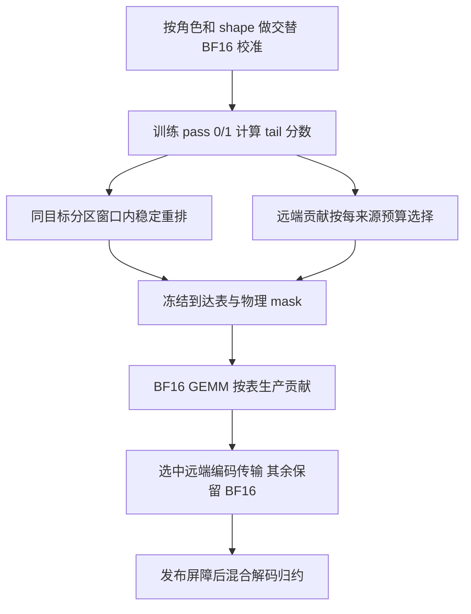

# H100 核心思路：交替顺序、到达优先与选择性量化

更新：2026-10-15。本文以当前 H100 Phase6 源码、冻结候选及真实双 shape 校准计划为依据，说明这三个机制分别解决什么问题、如何组合，以及当前实现到哪一步。早期思路见 [A800 idea](../design-a800/idea.md)；H100 实验结果分别见 [六策略对照](base-phase6.md)、[五组消融](base-phase6-ablation2.md) 和 [Attention/MLP 对照](base-phase6-mlp-attention.md)。

核心思想是：**按目标分区交替生产贡献，用接收端的到达观测识别较晚汇合的 tile，优先生产这些 tile 的近临界贡献，再把少量量化预算用在其中的远端贡献上。** 三者分别控制分区节奏、分区内顺序和传输表示，共同目标是缩短计算与通信的尾部等待。

## 1. 问题：一个输出 tile 要等待八个来源的贡献

GPT 的行并行线性层沿输入维度 K 切分。设第 s 张 GPU 持有输入分片 X_s 和权重分片 W_s，它先计算自己的输出贡献：

$$
C_s=X_sW_s^{\mathsf T},\qquad Y=\sum_{s=0}^{7}C_s.
$$

开启 sequence parallel 后，ReduceScatter 将 Y 的不同行分区交给不同 GPU。对于归属目标 GPU d 的一个输出 tile t，它需要八个来源的贡献：d 自己的贡献是本地贡献，其他七个来源的贡献需要跨 GPU 传输。这里的“本地/远端”由**来源与目标是否为同一 rank**决定；同一来源产生的不同输出 tile 可以归属不同目标。

记来源 s 对 tile t 的完整贡献到达目标端的时刻为 A_s(t)，贡献齐备的时刻为：

$$
J(t)=\max_s A_s(t).
$$

例如某 tile 的八个贡献分别在 8、9、9、10、10、11、12、16 μs 到达，它至少要等到 16 μs 才能收齐。提前那个 8 μs 的贡献通常不改变 J(t)；提前 16 μs 的贡献才可能减少等待。与此同时，一个很早收齐的 tile 即使有明显到达偏斜，也未必影响整个算子的完成时间。因此，需要同时考虑**这个 tile 收齐得有多晚**，以及**哪个来源接近它的最后到达者**。

J(t) 是解释贡献齐备的指标。实际完成还包括发布屏障、解码、归约和后续计算。正式收益以无采样的完整 optimizer step 验证，不能直接用 J(t) 或到达偏斜替代。

当前模型固定 GPT 6.7B：32 层、hidden 4096、FFN 16384、32 heads，序列长度 2048，单节点 8×H100、TP8。作用范围具体对应以下两个前向输出投影：

| 作用范围 | 模块 | 全局 `[M,N,K]` | 每张 GPU 的本地 K |
| --- | --- | --- | ---: |
| Attention | `self_attention.linear_proj` | `[2048,4096,4096]` | 512 |
| MLP | `mlp.linear_fc2` | `[2048,4096,16384]` | 2048 |

Attention 范围指注意力输出投影；Q/K/V、QK、Softmax、AV 等计算仍沿用模型原路径。两种投影的输出均为 2048×4096，但局部 GEMM 工作量不同，必须分别校准。GEMM 使用 BF16，量化作用于选中的前向远端输出贡献，反向沿用现有 BF16/STE 实现。

## 2. 交替顺序：给各个目标分区持续安排生产槽位

### 思想

如果先集中计算某个目标分区，再计算下一个分区，后面的接收方可能较晚才获得贡献。交替顺序希望把不同目标分区的生产交织起来，让各个接收方更早获得数据，也让远端写入有机会与后续 tile 的计算重叠。

当前 `interleaved` 在来源 rank s 上按照下面的目标顺序循环：

```text
L, R1, R2, R3, R4, R5, R6, R7, L, R1, ...

来源 rank 0：目标 0,1,2,3,4,5,6,7,0,1,...
来源 rank 1：目标 1,2,3,4,5,6,7,0,1,2,...
```

L 表示目标就是来源自身，Rj 表示相对来源偏移 j 的目标。TP8 每轮覆盖一个本地分区和七个远端分区。“交替”在这里是八个目标分区轮转，不能照搬 TP2 的本地、远端 1:1 节奏。

### 实际做法

当前输出按 128×128 划分，共 `16×32=512` 个物理 tile；每个目标分区拥有 `512/8=64` 个 tile。对于来源 s 的逻辑生产槽位 i，基础映射为：

```python
destination = (s + i % 8) % 8
within = i // 8
tile_m = destination * 2 + within // 32
tile_n = within % 32
physical_tile = tile_m * 32 + tile_n
```

同一目标的 tile 每隔八个槽位出现一次。这个映射覆盖完整输出，不重复、不遗漏，也不改变 tile 的最终归属。实现修改 GEMM 的 tile swizzle，将逻辑槽位映射到物理坐标；算法的乘法内容和输出布局保持一致。

这种顺序提供较均匀的分区生产节奏，但每个分区内部仍按基础顺序推进，尚未利用实际到达信息。逻辑上较早安排也不保证 GPU 上先完成：CTA 并发、Stream-K 依赖、访存和链路争用仍会影响实际到达。

历史 `remote_first` 是另一条基础路线，采用 `rank+1` 的分区偏移，其名字不能理解为严格的“全部远端 tile 都在本地 tile 前”。本页后面的五组消融和 Attention/MLP 范围实验以 `interleaved` 为基础。

实现见 [H100 基础映射](../../../tools/h100/phase6/build.py) 和 [双 shape 调度表生成](../../../tools/h100/phase6/scope_build.py)。

## 3. 到达优先：在交替约束内提前近临界贡献

### 思想

交替顺序决定“下一个槽位属于哪个目标分区”，到达优先进一步决定“该分区现在应当先生产哪个 tile”。这里优先的是**预计较晚汇合 tile 的近临界来源**。它通过提前生产可能拖尾的贡献来减少接收端等待。

该策略采用离线校准：先在真实 H100 上运行相应基础顺序的 BF16 GEMM，生成每个来源的静态置换表，正式运行时查表执行。运行时无须为每个 tile 交换全局队列状态。

### 如何获取到达观测

每种 shape 的目标端有 64 个本地 tile offset。校准遍历三遍，共 192 个 repeat，每个 repeat 包含关闭采样的 `off` 和接收端稀疏采样的 `receiver_sparse`。

一个来源对一个 128×128 tile 的贡献由八个 epilogue fragment 构成。校准在接收端观察各 fragment 的发布标记，取该来源八个 fragment 的最晚观测，作为完整贡献的观察时刻。所有来源都使用**同一个接收 GPU、本次调用的起点**归一化：

$$
A_s^{(p)}(t)=\max_f\operatorname{observed}^{(p)}(s,t,f)-\operatorname{start}^{(p)}_d.
$$

这避免直接比较不同 GPU 的绝对时钟。观测包含标记传播、轮询延迟和采样扰动，适合作为排序标签；它不能直接分解成纯网络传输时间。

pass 0、1 用于拟合，pass 2 仅用于留出诊断。留出结果不参与选择，也不用于补齐预算。

### 当前评分：两次都接近最后到达，按汇合时间排序

令训练遍次 p 中的汇合观察为 `J_p(t)=max_s A_s^(p)(t)`，误差带 ε_p(t) 取该次记录的两倍最大轮询周期。来源 s 只有在两次训练采样中都满足下面条件，才获得正优先级：

$$
J_p(t)-A_s^{(p)}(t)\le\varepsilon_p(t),\qquad p\in\{0,1\}.
$$

准入后，分数为：

$$
P_s(t)=\max\left(0,\operatorname{median}_{p\in\{0,1\}}J_p(t)\right).
$$

未准入或缺少有效训练观测的贡献记为零分。这个 `tail` 评分同时表达两层含义：来源在该 tile 内持续接近临界；该 tile 的汇合时间较晚。多个近似并列的最后来源可以同时获得优先级，本地来源也可以参与重排。

例如 tile A 的汇合时间是 10 μs，最后来源比其他来源晚 5 μs；tile B 的汇合时间是 20 μs，最后两个来源只差 0.2 μs。当前评分会倾向于 B 的近临界贡献，因为 B 收齐得更晚。早期仅按“最后来源领先其他来源多少”评分的 `gap` 方法可能偏向 A；当前 H100 拟合入口固定使用 `tail`。

### 如何保持交替顺序

对每个来源 rank，先收集属于同一目标分区的全部逻辑槽位，再按每 64 个该分区槽位组成一个合法窗口，在窗口内按 P_s(t) 稳定降序排列。同分保持原序。

例如来源 0 中，目标 3 占据槽位 `3,11,19,...`。到达优先可以交换这些槽位上的 tile，但这些槽位仍全部属于目标 3。目标序列 `0,1,...,7` 的循环节奏因此得到保留。

**窗口 64 指同一目标分区中的 64 个槽位。** 在当前 shape 下，它覆盖该分区的全部 64 个 tile；这些槽位分布在完整 512 槽位序列中。它不同于只在全局相邻 64 个槽位内排序。

计划记录 `maps[source][slot]` 和对应的 `coords`。正式 GEMM 先查到达置换，再应用交替基础映射，得到最终物理 tile。置换保持目标分区、合法窗口及 tile 集合一致，相关工作区和主机映射也按同一计划核验。

评分、观测和稳定排序见 [arrival/plan.py](../../../tools/a800/arrival/plan.py)；H100 的调用及计划冻结见 [phase6/plan.py](../../../tools/h100/phase6/plan.py)。

## 4. 选择性量化：把有限压缩预算用于少量远端近临界贡献

### 思想

量化可以缩小远端数据，但会引入编码、缩放、解码和数值误差。如果把全部远端贡献都量化，新增工作可能超过节省的传输时间。选择性量化希望保留大部分 BF16 路径，把少量预算集中用于较可能影响尾部的远端贡献。

概念上的选择目标，是让选中贡献的传输节省覆盖新增成本：

$$
\Delta T_s(t)=T_{\mathrm{BF16}}-
\left(T_{\mathrm{encode}}+T_{\mathrm{FP8+metadata}}+T_{\mathrm{decode}}\right)>0.
$$

**当前代码实际采用 tail 分数和固定预算这一启发式。** 它没有逐 tile 测量上式各项，也没有直接估计每个贡献的净收益或数值敏感度。净性能和数值可接受性分别通过预检及正式计时验证。

### 选择单位和预算

选择单位为 `[source rank, physical tile]`：某个来源对某个 128×128 输出 tile 的贡献。对于同一物理 tile，可以只量化来源 2 的贡献，来源 0、1、3 等仍走 BF16。

当前规则为：

1. 排除本地贡献，即目标分区等于来源的 tile。
2. 仅保留 `P_s(t)>0` 的远端贡献。
3. 每个来源分别按分数降序选择，同分按物理 tile 编号升序。
4. 数量最多为 `floor(远端 tile 数×1/64)`；符合条件的数量不足时，保留实际数量。

每个来源有 512 个输出 tile，其中本地 64 个、远端 448 个，因此当前每来源预算上限是 `floor(448/64)=7`。它既不是每个目标各选 7 个，也不意味着八个来源都必须选满。

本次 Attention/MLP 双 shape 真实校准生成的计划为：

| 角色 | 各来源实际选择数，按 rank 0–7 | 总选中贡献 | 占全部 3584 个远端贡献 |
| --- | --- | ---: | ---: |
| Attention | `[7,7,7,2,7,7,7,1]` | 45 | 1.256% |
| MLP | `[2,7,7,2,7,7,7,0]` | 39 | 1.088% |

这里的零表示该来源没有符合准入条件的正分远端贡献。早期五组消融复用的冻结 MLP mask 为 `[7,7,7,0,7,7,7,3]`，与本次重新校准的 MLP mask 属于不同计划。

选择算法见 [phase5/plan.py 的 select](../../../tools/a800/phase5/plan.py)；实际双 shape 计划见 [Attention 计划](../../../outputs/h100/phase6/TTention-MLP-gpt67-tp8-20261014-231236/plans/measured/attn.json) 和 [MLP 计划](../../../outputs/h100/phase6/TTention-MLP-gpt67-tp8-20261014-231236/plans/measured/mlp.json)。

### 为什么必须绑定物理 tile

假设基础槽位 11 对应物理 tile 193。加入到达优先后，tile 193 可能提前到槽位 3。它的量化身份必须继续由 `mask[source][193]` 决定；如果按 `mask[source][3]` 查询，就会压缩另一个贡献。

因此，调度表描述“某个执行槽位生产哪个 tile”，量化 mask 描述“哪个来源的哪个物理贡献使用 FP8”。两者独立冻结。这个约定也使 G3 和 G4 能保持完全相同的量化对象，只改变到达优先是否开启。

### H128/E4M3 实际如何编码和传输

选中 tile 的每一行包含 128 个数，每行独立组成一个 H128 编码组。设 BF16 输出转换后的向量为 x：

1. 根据组内均方值计算自适应尺度 a，并使用实现规定的截断范围。
2. 计算 `y=H128(a×x)`，其中 H128 是归一化 Hadamard 变换，用来改变系数分布。
3. 根据 y 的最大绝对值计算量化尺度 q，将 `y/q` 截断到 E4M3 有限范围 `[-448,448]`，转换为 FP8。
4. 发送 128 字节 FP8 系数、4 字节 q 和 4 字节 a。
5. 接收端转换回浮点、乘 q、执行逆 Hadamard 变换并除以 a，恢复该来源的近似贡献。

理想实数计算下，归一化 Hadamard 变换可逆；实际误差包含 FP8 舍入和浮点运算误差。一个 128×128 tile 包含 128 个这样的编码组。物理 tile 是选择粒度，128 个数是 codec 粒度。

每组 BF16 数据为 256 字节，编码后为 `128+4+4=136` 字节，载荷减少 46.875%，压缩比约 1.882 倍。这里包含两份缩放元数据，完整运行成本还包括同步、访存和协议开销。按全体远端贡献最多选择 1/64 估算，总数据载荷减少上限约 `46.875%/64=0.732%`。因此，这套稀疏选择主要是在有限开销和误差预算下尝试改善尾部；大幅完整 step 差距还需要结合共同实现和对照方式解释。

选中贡献在 GEMM epilogue 中完成编码并写入目标 GPU 的来源独立 packet 区域，跳过对应远端 BF16 写入。未选中远端贡献继续走 BF16；本地贡献始终保留 BF16。接收端依据同一物理 mask 混合读取、解码并归约，保持既有 BF16 ring 归约次序和舍入语义。

codec 数学实现见 [taco_codec.cuh](../../../src/gemm_rs/taco_codec.cuh)，本地排除和 packet 布局见 [taco_runtime.h](../../../src/gemm_rs/taco_runtime.h)。本次运行的具体版本保存在 [双 shape 候选源码快照](../../../outputs/h100/phase6/TTention-MLP-gpt67-tp8-20261014-231236/candidates/scope-candidate/)。

## 5. 三项机制如何组合

| 机制 | 决定的问题 | 当前实现输出 |
| --- | --- | --- |
| 交替顺序 | 各个目标分区以什么节奏获得生产槽位 | 来源相关的基础 tile 坐标映射 |
| 到达优先 | 同一目标分区的合法窗口内，哪些贡献提前生产 | 每来源的到达置换表 |
| 选择性量化 | 哪些远端物理贡献使用压缩表示 | `[source, physical tile]` 二值 mask |

当前离线生成与在线执行的关系如下：



**当前的到达置换和量化 mask 来自同一份基础 BF16 校准评分。** 两者一次生成、冻结后组合执行。正式路径保留 GemmRS 的发布屏障，屏障后再执行混合解码归约；使用双工作区交替复用，保证上次接收端读取完成后才覆盖对应来源缓冲。

更完整的研究设想可以在重排之后重新观测，再选择仍然拖尾且量化净收益为正的贡献。但当前实现尚未进行重排后或量化后的固定点重新校准，也没有在线更新临界集合。重排、编码与链路争用都可能改变最后来源，因此应将现有实现理解为一次离线预测的联合方案。

用一个理想例子解释组合目标：一个 tile 的最后三个贡献原本在 10、12、16 μs 到达；重排使最后者提前到 13 μs，选择性量化再使它提前到 11 μs，其他贡献保持不变，则汇合时刻从 16 降到 12 μs，原先 12 μs 的来源成为新的最后者。这说明收益会在关键来源切换后受限。真实执行还会改变其他贡献的排队和争用，是否更快必须实测。

## 6. Attention 与 MLP 为什么需要两份计划

两种投影的 M/N 相同，tile 数和每来源预算相同；Attention 的本地 K 为 512，MLP 为 2048，计算就绪、访存及通信重叠关系可以不同。它们的近临界来源、到达排序和实际选择数量因此需要独立测量。

当前范围实验为每个角色分别冻结完整 shape、到达置换、物理 mask、校准来源及设备身份。CUDA 查表按本地 K 精确分派，运行适配器同时核对角色与完整 shape。两个候选 `interleaved_full_attn` 和 `interleaved_full_attn_mlp` 共享同一个双 shape 动态库和同一份 Attention 计划；后者额外启用独立的 MLP 计划。

Attention-only 组的 MLP 保留原生 Megatron BF16。扩展到 Attention＋MLP 时，MLP 切换到完整候选 GEMM/通信实现，所以这一差距反映扩展整套实现的净变化。对应实现见 [scope_plan.py](../../../tools/h100/phase6/scope_plan.py)、[scope_build.py](../../../tools/h100/phase6/scope_build.py) 和 [scope_sources.py](../../../tools/h100/phase6/scope_sources.py)。

## 7. 如何用消融检验思想

当前五组消融均限定 MLP，四个候选保留相同的共同执行路径，按以下开关组合：

| 组 | 交替基础顺序 | 到达优先 | 通信量化 |
| --- | --- | --- | --- |
| `native_taco` | 原生 Megatron 路径 | 关闭 | 所选模块的全部远端贡献采用朴素 TACO |
| G1 | 开启 | 关闭 | 全 BF16 |
| G2 | 开启 | 开启 | 全 BF16 |
| G3 | 开启 | 关闭 | 定向选择性量化 |
| G4 | 开启 | 开启 | 与 G3 相同的物理 mask |

G2 对 G1 检验 BF16 条件下到达优先的增量；G3 对 G1 检验关闭到达优先时选择性量化的增量。G4 对 G3 检验选择性量化条件下到达优先的增量；G4 对 G2 检验到达优先条件下选择性量化的增量。G4 对 G1 回答在交替基础上同时加入两项机制是否有收益。

这五组没有原始 tile 顺序的 G0，所以不能单独分离交替基础顺序的贡献。候选对 `native_taco` 的整体差距还包含 GEMM、融合方式及量化覆盖范围的差别。正式结论应结合上述组间比较，保留负收益和跨零区间，不能把完整候选对朴素量化的全部优势归因于某一个开关。

当前完整 step 包含前向、反向、通信、参数更新及清梯度，每窗口 10 步预热、20 步计时；窗口耗时取八 rank 最大 elapsed/20。配对比较和按完整配对块计算的 95% 区间用于检验性能，profile 和映射用于核验执行路径。详细分组及报告协议见 [消融实验2](消融实验2.md) 和 [Attention/MLP 范围协议](mlp-attetion.md)。

## 8. 相比早期 A800 idea 的变化

| 内容 | 早期说明 | 当前 H100 实现 |
| --- | --- | --- |
| 作用范围 | 主要围绕 MLP `linear_fc2` | 保留 MLP 消融，并已扩展到 Attention 输出投影与双模块范围实验 |
| 到达评分 | 文档包含历史 `gap` 和较完整尾部模型的设想 | H100 入口使用两次近临界准入的 `tail` 分数，尚无完整移动收益/代价模型 |
| 重排窗口 | 早期原型描述每目标 16 槽位 | 当前配置为每目标 64 槽位，TP8 下保留八分区交替节奏 |
| 量化选择 | 设想在重排后继续识别临界贡献并估计净收益 | 置换和 mask 同源于基础 BF16 校准，一次冻结；每来源最多选择 1/64 远端贡献 |
| shape 与计划 | 以早期 MLP 配置为主 | GPT 6.7B 的 Attention、MLP 各自真实校准，双 shape 库按本地 K 分派 |

对应收益应查阅本页开头链接的实测汇总；这里解释的是当前机制及其验证方式，性能大小由各次完整 step 结果给出。
