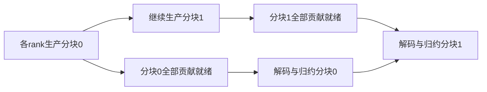

# H100 改进方案：分块消费、到达调度与选择性量化

更新：2026-10-17。本文承接 [当前核心思路](idea.md)、[消融实验3实测](base-phase6-ablation3.md) 和 [Attention/MLP实测](base-phase6-mlp-attention.md)，记录后续设计与验证路线。**以下均为待实现、待验证的方案，不代表已经取得性能收益，也不改写现有实验结论。**

建议保留交替顺序作为基础，将后续工作集中到两个目标：**让已经到齐的数据可以提前解码归约；让重排和量化共同服务于最终完成时间，而不只追求单条贡献提前到达。**

## 1. 当前实现为什么限制了增量收益

消融3的A组已经包含交替顺序与融合的全远端量化；B只增加到达置换。B对A的逐轮完整step耗时下降如下：

| 作用范围 | 第一轮 | 第二轮前4个完整块 |
| --- | ---: | ---: |
| MLP | +0.107% | −0.036% |
| Attention | +0.149% | −0.345% |
| MLP＋Attention | −0.587% | +0.255% |

上述正收益的95%区间均跨零，当前不能确认稳定的到达优先增益。第二轮尚未完整，不能将部分结果推广为严格等效或稳定退化。双模块相对单模块的3.246%–4.402%收益属于作用范围扩展，不能归因于到达优先。

代码核查揭示了以下限制：

1. **生产与消费之间仍有整算子屏障。** 当前量化候选虽然编译为SM90，但使用V2算法路径，执行 `forward_gemm_impl → forward_barrier → forward_reduce_scatter_impl`，跨rank屏障后才启动解码归约。中间贡献提前到达，只有改变整段生产完成时间，才能在现有结构中直接体现收益。GEMM epilogue中的远端写仍可能与其他CTA计算重叠，不能表述为完全没有通信计算重叠。
2. **到达优先是固定生产置换。** 它在同一目标分区的64个合法槽位内重排，不改变交替的目标分区节奏，也不是运行时动态选择已就绪工作的消费者。
3. **顺序和mask共用基础BF16校准分数。** 当前计划没有在重排、量化之后重新校准。排序可能已经消除了某条贡献的拖尾，量化仍继续针对同一对象，两者的收益不能直接相加。
4. **完整step会稀释局部变化。** 优化范围仅是所选前向输出投影，而计时包括整个模型前向、反向和optimizer更新。局部收益必须同时在算子与完整step上报告。

以上是实现约束与实验事实；屏障、计算拖尾、编解码、链路争用各占多少时间，仍需新增测量，不能预设占比。

## 2. 改进目标：以最终完成时间评价动作

记来源s对输出分块c的完整贡献到达时刻为 `A_s(c)`，该分块全部贡献齐备的时刻为：

$$
J(c)=\max_s A_s(c).
$$

当前历史到达分数可继续用于筛选候选，但新的选择目标应是：

$$
\Delta T_{\mathrm{op}}=T_{\mathrm{op}}(\text{当前方案})-T_{\mathrm{op}}(\text{候选方案}).
$$

其中完整算子耗时必须包含GEMM、编码、远端写、就绪通知、等待、解码归约，以及这些工作竞争GPU资源的影响。模型可以辅助筛选，最终以无采样实测验证；不能把可重叠阶段的耗时简单相加当作完整算子耗时。

下面的示例只解释分块汇合时间，不是实际测量：

| 两个最晚来源的到达时间 | 加速其中一个后的时间 | 分块齐备时间减少 |
| --- | --- | ---: |
| 90、100 μs | 90、95 μs | 5 μs |
| 100、100 μs | 100、95 μs | 0 μs |

第二种情况需要同时处理并列拖尾来源，或者把预算用于其他工作。即便 `J(c)` 提前，也要判断该分块是否影响最终消费完成；早期分块的局部改善未必缩短算子。

因此，后续选择应同时考虑：贡献是否拖尾、改变它能提前多少、是否存在并列拖尾、分块能否及时被消费、编解码与调度成本是否抵消收益。对多个贡献的组合动作重新估计收益，不能直接累加单项预测。

## 3. 核心结构改动：分块就绪后消费

### 3.1 目标执行方式

将当前“全部生产结束后统一解码归约”，改为“一个分块的全部来源贡献就绪后即可处理该分块”。消费者与后续生产并发执行：

第一版仍要求下游算子等待完整输出。预期收益来自解码归约与剩余GEMM/发布重叠，不依赖下游也支持分块输入。跨算子的分块消费属于后续独立项目。

### 3.2 分块与完成判据

当前每目标分区有64个128×128物理tile。一个消费分块只属于一个目标rank，可以由一个或多个完整tile组成；初版选择能整除64的分块大小，比较少量较粗粒度，再决定是否细化。过细会增加标记、轮询和调度成本；过粗则接近当前整算子等待。TP8的来源数、每tile的fragment数与消费分块数量是不同概念。

必须区分**调度分块、物理tile、epilogue fragment和H128编码组**。当前Stream-K回调可能只拥有一个16行的epilogue fragment；一个回调或CTA完成，不代表完整128×128 tile可读。完成计数或标记必须覆盖该分块全部有效fragment，并保证每个贡献唯一发布、无重复计数。

### 3.3 新增的同步与生命周期协议

| 机制 | 必须保证的条件 |
| --- | --- |
| `ready[slot, epoch, source, chunk]`或等效状态 | 该来源的完整分块数据已经发布；FP8分支包括payload与两个scale，BF16分支也必须具备同等完成语义 |
| 消费者领取分块 | 全部所需来源已就绪；每个输出分块只被处理一次 |
| `consumed`或等效ACK | 所有相关读取者确实完成读取后，生产者才可覆盖对应缓冲区 |
| 调用代号epoch | 旧调用的ready/ACK不能被下一次调用误认，状态重置不能与在途访问竞争 |
| 输出完成依赖 | 调用方在所有输出写完之后才能交给下游使用 |

这些是协议要求，不限定必须采用某一种状态数组或原子操作。具体实现需按现有IPC/P2P访问方式建立正确的跨设备发布与可见性关系；不能只写一个普通整数标记，就认为先前payload和scale已经对接收端可见。

**不能直接删除现有barrier。** 当前双完整工作区的复用证明依赖下一次调用的post-GEMM全rank屏障：它保证上一次调用的所有解码读取已经完成。删除该屏障后，必须以显式消费确认或等效依赖重新证明复用安全。当前已有的per-tile flag/queue代码还存在路径限制，不能认为打开选项即可适配当前H100量化路径。

### 3.4 并发资源与数值顺序

第一版允许分块之间乱序消费，**分块内部继续沿用当前固定来源顺序及舍入规则**。先避免将浮点归约顺序变化混入调度实验，也不采用多个来源无序原子累加作为默认方案。

可以先用分块kernel原型判断重叠潜力，再决定如何将发布嵌入现有epilogue。原型新增的kernel launch、GEMM切分及占用变化必须计入成本，不能直接当成最终内核的收益预测。

消费者必须限制驻留CTA与资源占用，并验证生产者可以持续前进。第二条stream或更高stream优先级本身不保证有效并发；占满GPU并轮询等待的消费者可能阻塞生产者。粗分块、少量消费者及必要的资源配置应分别测量，不能假定轮询和调度免费。若为并发而调整生产者占用，协议兼容的屏障对照也使用相同配置，并另外与原有最优屏障配置比较。

## 4. 联合调度：让各来源优先凑齐同一个分块

各source独立排序时，可能分别优先生产不同分块，导致接收端没有任何完整分块可以消费。分块流水线建立后，建议增加跨来源的协调：

1. 保留destination之间的交替服务，避免某个接收方长期得不到贡献。
2. 对同一destination，先给各source一个共同的粗分块顺序，促进早期分块齐备。保留各source之间错开的目标rank轮转，不要求所有来源同时集中发送给同一个目标。
3. 在共同顺序允许的范围内，优先安排该分块预计拖尾的来源贡献；不增加等待所有来源同时开始的锁步约束。
4. 量化针对排序后仍影响分块齐备和最终完成的贡献。近似并列的多个拖尾来源可以作为小组评估。
5. 消费端领取已经全部ready的分块，避免队头尚未就绪的分块阻塞后面的可执行工作。

共同分块顺序可能改变GEMM局部性、缓存行为和链路争用，因此它是候选策略，不是无条件优于各来源独立排序。需要固定mask，单独比较旧顺序与协调顺序，再评估重新选择mask的增量。

后续可以研究“已到达来源先解码，全部到齐后再按固定顺序归约”，但这需要额外scratch和访存，作为独立消融，不纳入首版默认路径。

## 5. 按实际执行路径重校准，并调整量化预算

### 5.1 先改静态计划，再考虑在线更新

保持当前屏障结构也可以先做以下改进：

1. 在最终候选的GEMM、编码、解码和交替顺序上建立测量，减少基础BF16标签直接迁移的误差。
2. 先固定重排，重新短校准，再生成量化mask；或者固定mask后更新顺序。每轮只改一个因素，限制迭代次数。
3. 增加独立校准重复，采用低占空比的代表性采样，用未参与拟合的轮次验证。中间到达标签改善必须最终对应完整算子改善。
4. 区分普通计时与专项诊断。完整性能计时关闭采样；诊断不假定能够免费获得全tile联合时间线，也不直接比较不同GPU的绝对时钟。

用于选择预算、分块大小和顺序的轮次属于拟合或调参数据；如果根据留出诊断选择了方案，这些数据也已参与选择，不能再次充当最终独立评估。冻结方案后，应另用未参与选择的完整配对块报告性能。

Attention与MLP分别建计划：两者M/N相同，但本地K分别为512和2048，计算量与编解码成本占比不同。只有代表层的测量显示明显差异后，再考虑早、中、晚层分组，避免一开始为32层逐层做高成本校准。

运行中优先采用低频、粗粒度的耗时漂移检测，必要时触发短校准并更新静态表；不将每步追踪全部tile、CPU实时重排作为首版方案。更新至少要满足预计剩余调用所节省的时间能够覆盖测量和更新成本，并且新计划通过独立验证。执行期间的计划替换也必须发生在明确的安全边界。

### 5.2 当前稀疏预算意味着什么

当前全部远端贡献为 `8×448=3584` 个，C的选择情况如下：

| 角色 | 选中远端贡献 | 实际比例 | 按当前编码格式计算的逻辑远端字节减少 |
| --- | ---: | ---: | ---: |
| Attention | 45 / 3584 | 1.256% | 约0.589% |
| MLP | 39 / 3584 | 1.088% | 约0.510% |

当前完整H128组从256字节BF16变成128字节FP8加两个FP32 scale，共136字节。上表按 `选中比例×(1−136/256)` 计算，只是协议层逻辑字节估算，不是实测NVLink流量、显存流量或速度提升。

因此，当前C很难依靠总字节大幅减少取得收益，而高度依赖选中真正影响完成时间的贡献。后续预算可分别比较0、当前1/64上限、1/16、1/4与全远端量化等预先指定点；这些是实验候选，不是最优值结论。

预算只作为上限，没有正净收益的贡献可以不选。必须报告**实际选中数量**：现有选择器仅接受正分候选，只提高fraction不一定增加实际量化数量。改变准入规则也属于算法改动，应单独记录。

### 5.3 预算同时受误差约束

量化对象始终绑定 `[source rank, physical tile]`，不能因执行槽位重排而改变对象。后续可在净收益选择中加入输出误差约束和每rank的编解码资源约束，分别为Attention与MLP确定预算。

质量验证至少包含同权重、同输入的前向误差，必要的梯度检查，以及真实数据上的验证loss和较长训练。固定合成batch的短程末步loss不能用来决定放宽量化精度要求。

加入与目标mask保持每来源数量一致的随机mask对照；保留物理远端约束，并预先固定随机种子。它用于区分“压缩了这些字节”的收益与“选择了正确贡献”的收益。

## 6. 实施顺序与阶段出口

| 阶段 | 工作 | 进入下一阶段前需要的证据 |
| --- | --- | --- |
| P0：定位可优化时间 | 分别测两个shape的GEMM/发布、屏障、解码及完整算子；建立同V2路径的全零mask对照 | 确认可减少的等待或可重叠工作，避免将原生/V3与候选差异误归因给调度 |
| P1：改进静态计划 | 按实际路径重校准、重排后选择、评估净收益和预算 | 留出数据及无采样计时上有改善，测量成本可摊销 |
| P2：建立分块消费 | 实现完整ready、epoch、consumed及输出依赖；保持原mask和归约规则 | 正确性、前进性和复用安全通过；观察到实际生产/消费重叠 |
| P3：协调与联合选择 | 比较共同分块顺序，再比较净收益mask及预算 | 优于同runtime旧策略和匹配随机mask，收益反映在最终完成时间 |
| P4：有限自适应 | 按角色或必要的层组缓存计划，漂移后低频更新 | 更新开销可摊销，长期运行不因频繁切换退化 |

P1是较小改动，P2是主要结构项目。若P0表明可重叠部分很小，不应仅因为分块机制更复杂就继续投入；若P2造成GEMM减速超过隐藏的解码时间，应调整粒度/资源或保留原路径。

新方案应使用独立实现版本、构建目录、协议与实验记录，不覆盖既有冻结候选、原始计划和消融3数据。

## 7. 最小结构消融：同步方式 × 到达重排

先固定同一GEMM、codec、物理mask、来源归约顺序、shape、模型和输入，比较四组：

| 组别 | 同步与消费方式 | 到达重排 |
| --- | --- | --- |
| E0 | 全部生产完成后消费 | 关 |
| E1 | 全部生产完成后消费 | 开 |
| E2 | 分块就绪后消费 | 关 |
| E3 | 分块就绪后消费 | 开 |

E1/E0回答当前结构中重排的作用；E3/E2回答分块结构中重排的作用；E2/E0与E3/E1回答两种顺序下分块机制的净变化。第二对重排比较更好只是候选现象，还应直接估计两种结构下重排收益之差及其配对不确定性，不能用“一组显著、一组不显著”替代交互比较。

四组由同一新runtime派生。矩阵内部的E0/E1采用协议兼容的屏障版：与E2/E3使用相同分块参数、数据与缓冲布局、ready/epoch发布、归约数学实现和消费回收协议，但等待全部生产完成才允许消费。保持计算与量化配置一致，单独改变消费放行条件；launch时序、实际轮询次数和资源重叠属于机制差异，不能声称所有kernel执行行为完全相同。

同时保留原始无新增标记的屏障实现，单独报告协议兼容版相对原版的开销，避免通过拖慢基线制造收益。结构改动若必须改变kernel切分、资源配置或launch数量，应明确登记，纳入该机制的净成本。

首次四组比较沿用同一份冻结到达表，不按同步方式分别重新调优。重校准、协调顺序、mask优化在后续独立实验中增加。每个mask条件下四组必须相同；先测零量化或固定选择性mask，再扩展预算，不一次混合改变所有因素。

先在Attention和MLP两个真实shape上做算子验证，再进入完整模型。完整step继续按同场完整配对块统计；rank和同一窗口内的step不是独立实验重复。固定同批次参考，不用历史均值或C与历史各50%的汇总作为新方案配对基线。

## 8. 验证指标与保留条件

| 类别 | 需要观察的指标 |
| --- | --- |
| 机制是否生效 | 首个分块消费时间、最后生产完成时间、生产与解码实际重叠、发布到消费延迟 |
| 调度是否有效 | 分块最晚到达、来源间等待差、可执行分块数量、消费者空转与队头阻塞 |
| 新增成本 | 编解码资源占用、轮询/原子/标记开销、额外launch、GEMM退化、逻辑字节与可测链路流量 |
| 最终性能 | 完整算子与完整step耗时、尾部表现、配对收益及置信区间；采样关闭后复测 |
| 正确性与质量 | 输出/梯度误差、长时间缓冲区复用、epoch隔离、受控rank延迟下的前进性、真实验证质量 |

受控延迟实验用于验证机制因果：例如人为延迟某个来源或分块，检查其他已就绪分块能否继续消费，以及策略是否减少预期等待。它不能代替正常负载下的正式性能结果。

只有最终算子/step改善、数值约束满足、校准成本可摊销时才保留新增机制。若只有命中率提高或中间tile提前，而最终完成没有稳定改善，则回退至更简单的已验证配置。当前不预设收益百分比，也不沿用其他实验的验收门槛。

## 9. 实现证据与参考

- [当前思想与实现边界](idea.md)、[消融3分组与实测](base-phase6-ablation3.md)、[Attention/MLP与loss口径](base-phase6-mlp-attention.md)。
- [到达评分与destination内置换](../../../tools/a800/arrival/plan.py)、[H100计划拟合](../../../tools/h100/phase6/plan.py)、[按来源预算选择mask](../../../tools/a800/phase5/plan.py)。
- [实测构建的GEMM、屏障与解码调用](../../../outputs/h100/phase6/ablation3-gpt67-tp8-scope-20261016-221018-release1/candidates/arrival/scope-candidate/src/gemm_rs/ths_op/gemm_reduce_scatter.cc)：`phase6_arch`、`forward_impl`、`forward_barrier`与`local_reduction`。
- [实测构建的双缓冲与字节计算](../../../outputs/h100/phase6/ablation3-gpt67-tp8-scope-20261016-221018-release1/candidates/arrival/scope-candidate/python/flux/gemm_rs_taco.py)：`GemmRSTacoDoubleBuffered`与`wire_bytes_per_rank`。
- [fragment编码与发布依赖](../../../outputs/h100/phase6/ablation3-gpt67-tp8-scope-20261016-221018-release1/candidates/arrival/scope-candidate/src/gemm_rs/epilogue_evt.hpp)、[固定来源顺序的解码归约](../../../outputs/h100/phase6/ablation3-gpt67-tp8-scope-20261016-221018-release1/candidates/arrival/scope-candidate/src/gemm_rs/taco_runtime.cu)。
- [FLUX论文](https://arxiv.org/abs/2406.06858)和[官方设计说明](https://github.com/bytedance/flux/blob/main/docs/design.md)提供细粒度通信计算重叠的背景。分块重叠本身不是新的研究主张；本方案需验证量化、汇合调度与消费机制结合后的增量价值。
- [NVSHMEM使用与内存顺序说明](https://docs.nvidia.com/nvshmem/api/latest/using.html)可作为发布/可见性设计参考，不意味着当前IPC实现已经满足新协议，也不要求直接迁移传输后端。
